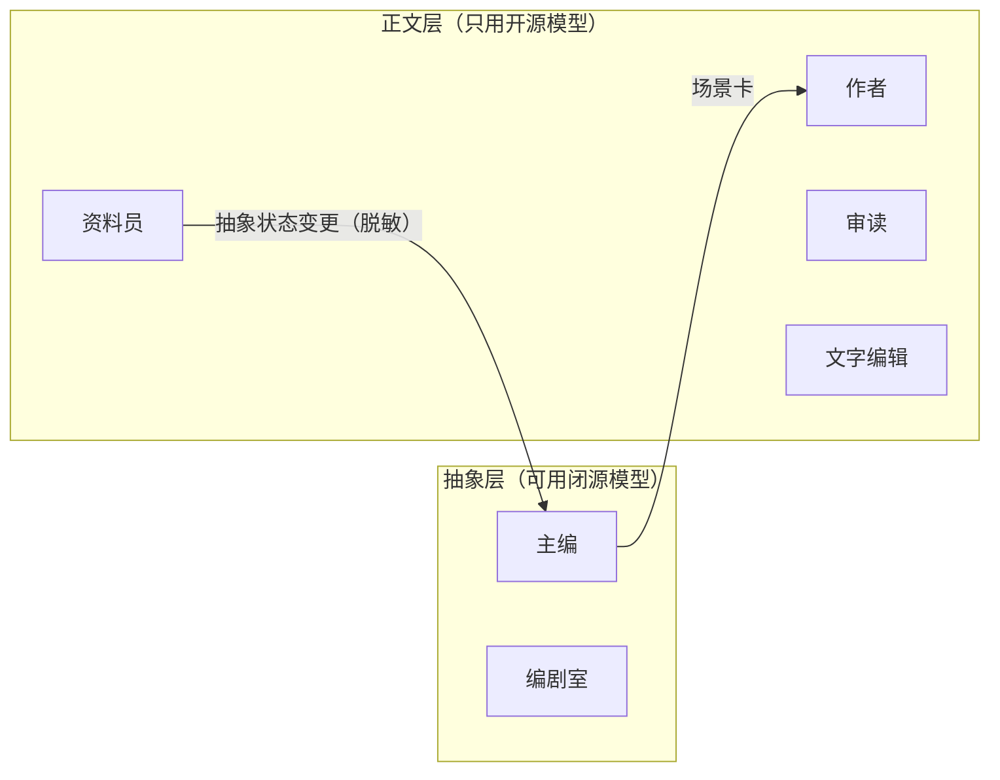
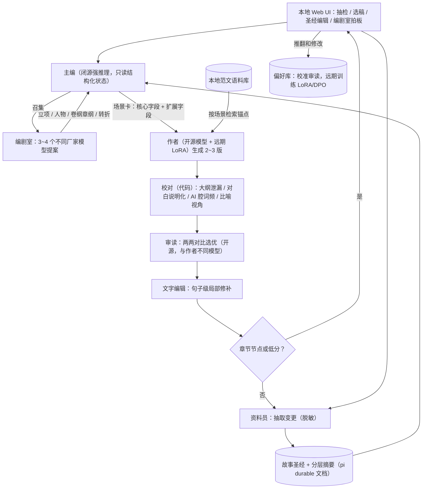
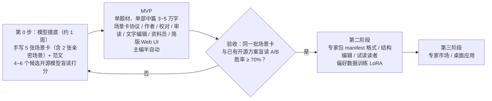

# 书坊（shufang）——中文小说创作 Agent Harness 设计汇总

> 状态：方案设计阶段（不动工，仅对齐架构与规范）　|　项目名：**书坊（`shufang`）**　|　更新：2026-10-24
> 技术底座：[`@earendil-works/pi-durable`](https://github.com/earendil-works)（持久化运行时）+ [`@earendil-works/pi-ai`](https://pi.dev/models)（统一多模型接入层）

---

## 1. 背景与动机

已有的开源小说创作 agent / harness 都试用过，产出质量几乎完全取决于所选的 LLM，读起来不像写给人看的。因此打算基于 pi durable 自建一个**专注中文小说创作**的 agent harness。

## 2. 问题诊断

从用户提供的产出样本里，归纳出四类叠加的问题：

| 症状 | 样本证据 | 根因 | harness 能否解决 |
|---|---|---|---|
| **大纲泄漏进对白** | "第一轮…下一轮是薇薇自己的场" | 场景节拍（beat）直接交给角色念出来，角色在替作者报流程 | ✅ 规划与落笔分开 + 场景卡协议 + 泄漏检测 |
| **对齐痕迹 / 宣读规则** | "我心里有顺序，不是替薇薇做主"、"你要是心里打鼓，我把闩拉开" | 主流闭源模型被训练成在亲密场景里显式表达同意和边界 | ❌ prompt 压不住，只能靠模型选型或微调 |
| **警句化 / 电报体** | "懒还在，懒底下是准的" | 模型自带的"文学腔"，加上"去 AI 味、要简洁"之类负面规则矫枉过正 | ⚠️ 部分能：范文锚点 + 局部修补 |
| **比喻错位** | "像点评一份迟到的工期" | 跨领域硬凑类比，和人物身份、语境不符 | ⚠️ 部分能：检测比喻是否符合人物视角 |

## 3. 核心判断

> [!IMPORTANT]
> 1. 文字层的 AI 腔主要是**模型层问题**，harness 解决不了文笔上限。文笔靠**模型选型 + 范文锚点 + 远期风格 LoRA**。
> 2. harness 真正能起作用的地方：结构和规划泄漏、长篇一致性、质量把关、按角色路由模型、积累偏好数据。
> 3. pi durable 提供持久化、长时运行、多会话和按会话配模型的能力，是合适的底座，但它本身**不提升文笔**。
> 4. 先验证模型，再写框架：如果连"完美场景卡 + 范文"都救不回文笔，就先做 LoRA，不急着写 harness。

## 4. 设计决策总览

| # | 决策点 | 结论 | 未采纳的方案 / 理由 |
|---|---|---|---|
| D1 | 核心品类 | 成人或亲密向内容是核心品类之一，**模型选型以此为硬约束** | — |
| D2 | 总体架构 | 主编（总控）+ 题材专家 subagent（每个专家可单独配模型 API）+ 远期专家市场 | — |
| D3 | 主编可见范围 | 主编**只看结构化状态**，不读露骨正文，可以用闭源强推理模型 | 主编用开源模型：长程规划能力偏弱 |
| D4 | 简报协议 | **核心协议 + 扩展**：harness 定义必填的核心场景卡字段，专家在 manifest 里声明题材扩展字段，主编透传扩展字段 | 完全由专家自定义：主编难以适配，防泄漏无法统一保证 |
| D5 | 质量闭环 | **自动为主，人工抽检**：只在章节节点或检测分低于阈值时叫人 | — |
| D6 | 自动策略 | 每场 2~3 版 → 硬规则淘汰 → 两两对比选优 → **只做句子级局部修补，禁止整段重写**；人工推翻和修改记入偏好库 | 多轮自审自改：越改 AI 味越重，文字被磨平 |
| D7 | 风格锚点 | 用户本地语料库，按场景检索，只在本地使用；专家包不分发受版权保护的原文 | 专家包内置范文：版权风险 |
| D8 | 长程状态 | 结构化故事圣经 + 场景、章、卷三级摘要；全文向量检索只作兜底 | 只用全文检索或滚动摘要：人物状态、伏笔难以精确追踪 |
| D9 | 运行形态 | 本地优先 + 自定义 Web UI，远期升级为桌面应用 | 云端常驻：内容隐私与合规风险 |
| D10 | 路线与验收 | 第 0 步模型摸底 → 单题材 MVP → 盲读 A/B 胜率 ≥ 70% 再做专家包和市场 | 先搭平台骨架：可能做出分发平庸专家的平台 |
| D11 | 角色编制 | **精简编辑部 + 编剧室**（见第 5 节） | 完整编辑部：交接次数多，泄漏被放大 |
| D12 | 编剧室范围 | 只用于策划层和关键节点，3~4 个**不同厂家**的模型提案，用户拍板 | 细到每场：成本高，一致性差 |
| D13 | 模型接入与配置 | 基于 `@earendil-works/pi-ai` 原生支持 `pi.dev/models` 全量 Provider 及自定义 OpenAI/Anthropic 兼容端点；**所有角色的模型绑定通过配置文件按需挂载，不在代码中硬编码** | 绑定死特定模型：无法适应不同题材专家与用户私有 API/本地端点 |

## 5. 角色编制

### 5.1 拆分原则

参考编辑部的职责划分，但不照搬编制。一个角色要不要单独成为 agent，用四条原则判断：

1. **模型**：是否需要不同的模型？
2. **可见范围**：是否需要不同的上下文或权限？
3. **独立判断**：是否需要和产出方相互制衡？比如作者不能审自己的稿。
4. **确定性**：能用代码完成的，就不用 LLM。

### 5.2 MVP 角色表

| 角色 | 编辑部 / 编剧室对应 | 职责 | 模型与可见范围 |
|---|---|---|---|
| **主编** | 主编 / 总监制 + 策划编辑 | 调度、章节规划、生成场景卡、主持编剧室 | 闭源强推理，**只读结构化状态** |
| **编剧室成员** ×3~4 | 编剧室 | 立项、人物、卷纲、章纲、转折的提案 | 不同厂家的模型，只看抽象层材料 |
| **作者** | 作者 / 编剧 | 按场景卡写 2~3 版 | 开源 + 远期 LoRA，可看范文 |
| **校对** | 校对 | 泄漏、AI 腔词频、格式等硬规则检测 | **代码，不用 LLM** |
| **审读** | 三审 | 两两对比选优 | 开源，**与作者用不同模型** |
| **文字编辑** | 文字编辑 | 句子级局部修补 | 开源 |
| **资料员** | 资料员 / 场记 | 抽取变更，写回故事圣经；**兼任脱敏边界** | 开源（要读正文） |

**第二阶段再加**：结构编辑（章、卷级节奏、人物弧光、伏笔回收，只读摘要和圣经）、试读读者（追读意愿、弃书点、爽点密度）。
**不做**：美编、营销。

### 5.3 可见范围分层



> [!NOTE]
> 凡是要读正文的角色都用开源模型。资料员是正文层通往抽象层的**唯一通道**，所以"主编不读露骨正文"在架构上自然成立，不需要再单独做内容过滤。

## 6. 场景卡协议（D4）

### 6.1 核心字段（harness 强制）

| 字段 | 说明 |
|---|---|
| 人物欲望 | 每个在场人物此刻想要什么 |
| 顾忌 | 是什么在阻止他们直接去要 |
| 信息差 | 谁知道什么、谁不知道什么 |
| 潜台词 | 嘴上说的和心里想的之间的差距 |
| 不可言说 | **禁止在正文里直接说出口的内容**，直接针对大纲泄漏 |
| 关系变化 | 场景结束时人物关系发生了什么变化 |
| 说话习惯 | 口头禅、句式和语气特征 |
| 风格锚点 | 从本地语料库检索出的 1~2 段真人范文 |

> [!IMPORTANT]
> 场景卡**不包含动作顺序或流程指令**。作者拿到的是张力和动机，不是节拍清单。

### 6.2 扩展字段（专家 manifest 声明）

示例：网文爽点与钩子、悬疑线索投放、亲密场景节奏等。主编不需要理解扩展字段，原样透传给对应的专家。

## 7. 单场生产流程



## 8. 状态与数据（D7、D8）

| 数据 | 内容 | 存储 | 维护者 |
|---|---|---|---|
| 故事圣经 | 人物卡（当前状态、关系、已知与未知信息）、设定库、伏笔账本、时间线 | pi durable 文档 | 资料员 |
| 分层摘要 | 场景、章、卷三级摘要 | pi durable 文档 | 资料员 |
| 节拍图 | 卷纲、章纲、场景标签 | pi durable 文档 | 主编 + 编剧室 |
| 范文语料库 | 用户导入的作品或旧稿切片，按场景类型、情绪、关系建索引 | 本地，不外传 | 用户 |
| 偏好库 | 人工抽检时的推翻和修改记录 | 本地 | 系统自动 |
| 全文索引 | 已写正文的向量索引 | 本地，只作兜底 | 系统自动 |

## 9. 部署形态与路线图

**部署（D9）**：本地优先。Node + SQLite 跑 pi durable，配自定义 Web UI；开源模型走本地 llama.cpp / vLLM / Ollama 或远程 API；语料和正文都不出本机。远期升级为桌面应用，做市场时只上传专家包。

**路线图（D10）**：



## 10. 命名与 GitHub 开源组织结构

### 10.1 项目定名

- **正式名称**：**书坊（`shufang`）**
- **含义**：古代集编辑、刻版、印行于一体的出书作坊，与本项目的“精简编辑部 + 编剧室 + 逐场流水线”架构完全对应。
- **备选归档**：`baiguan`（稗官）、`huaben`（话本）、`inkroom`、`masthead`、`galley`。

### 10.2 GitHub 仓库与目录结构（`shufang`）

既然面向 GitHub 开源社区，推荐采用 **主仓 Monorepo + 社区专家索引仓** 的结构（集中 Star、Issue 与 PR，避免多仓库分散关注度，同时方便核心协议与 Web UI 同步演进）：

```text
github.com/<your-org-or-user>/
├── shufang/                      ← 主开源仓库（Monorepo）
│   ├── packages/
│   │   ├── core/                 ← @shufang/core：基于 pi durable 的引擎（角色、场景卡协议、故事圣经）
│   │   ├── web/                  ← @shufang/web：本地 Web UI（抽检、选稿、故事圣经编辑、编剧室）
│   │   └── bench/                ← @shufang/bench：第 0 步模型摸底与盲读评测工具
│   ├── experts/                  ← 官方内置示例专家包
│   └── docs/                     ← 架构设计、场景卡协议与专家包开发规范
└── shufang-experts/              ← （第二阶段）社区专家包注册表 / 市场索引仓（通过 PR 提交或读取 GitHub Release）
```

> [!TIP]
> **GitHub 生态联动优势**：未来第二阶段做“专家市场”时，无需自建中心化后端服务——社区作者直接把专家包发在自己的 GitHub 仓库 Release 里，向 `shufang-experts` 索引仓提一个 PR 注册 metadata，本地 `shufang` 客户端即可直接拉取安装。

## 11. 风险与合规

> [!WARNING]
> - **内容合规**：成人内容在国内平台基本不能发布，部分托管 API 的服务条款也禁止。接入第三方托管模型前，先核实它的使用政策。
> - **版权**：范文语料只在本地使用，专家包和市场不分发受版权保护的原文。

| 风险 | 应对 |
|---|---|
| 模型本身写不出来 | 第 0 步先摸底；不达标就先做 LoRA |
| 多 agent 交接导致泄漏 | 场景卡不含流程指令，加上"不可言说"字段和校对检测 |
| 自动审读不可靠 | 用偏好库持续校准；审读和作者用不同模型 |
| 专家包换了模型就失效 | 专家包附带范文锚点和验收样例，不只是 prompt |
| 过早做平台 | 盲读 A/B 验收通过之前不做市场 |
| 编剧室同质化 | 强制使用不同厂家的模型 |

## 12. 后续待细化的设计专题（只定方案，暂不动工）

- [x] 项目定名：**书坊（`shufang`）**
- [x] 模型接入方案：统一基于 `@earendil-works/pi-ai` 支持 `pi.dev/models` 全量模型与自定义端点，通过配置文件按需绑定各角色模型
- [ ] **专题 A：场景卡协议（Scene Card Schema）与正反例设计**（核心字段定义、题材扩展字段挂载机制、如何从结构上杜绝“角色念大纲”）
- [ ] **专题 B：故事圣经（Story Bible）与资料员脱敏契约设计**（人物状态机、知情权矩阵、伏笔账本的数据结构，以及资料员向主编汇报的脱敏状态协议）
- [ ] **专题 C：校对硬规则集与审读/文字编辑裁判机制设计**（AI 腔高频词表、大纲泄漏检测算法、审读两两对比 rubric、句子级修补边界）
- [ ] **专题 D：专家包（Expert Package）Manifest 与配置规范**（目录结构、模型推荐配置、本地范文检索规则、题材扩展字段声明）
