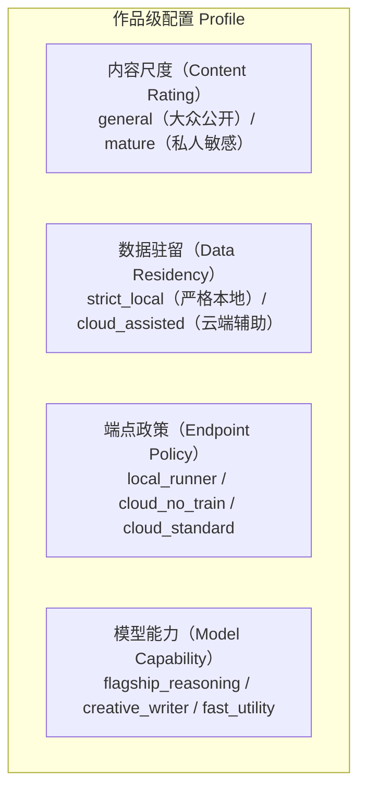
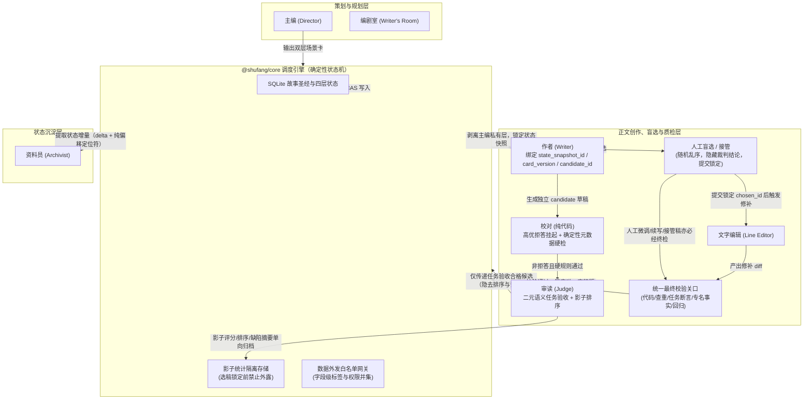
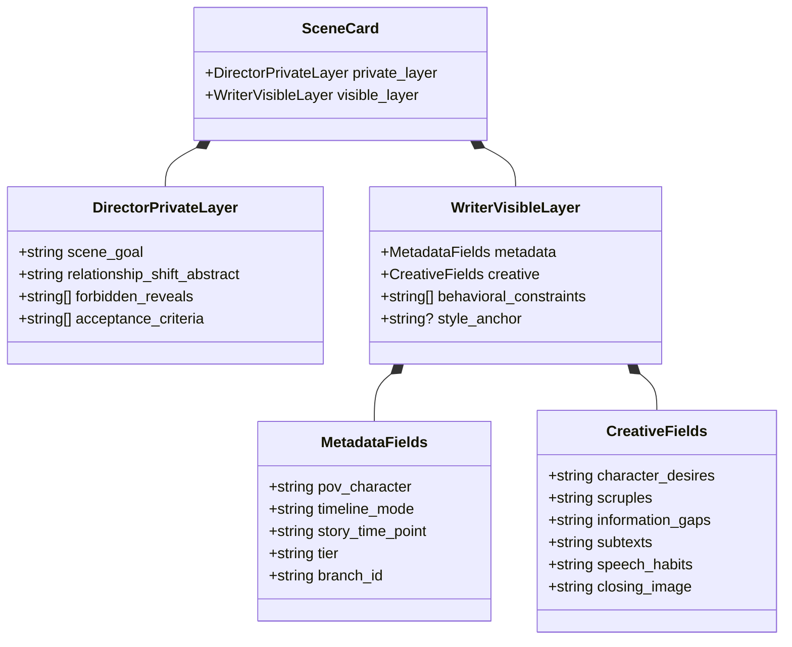
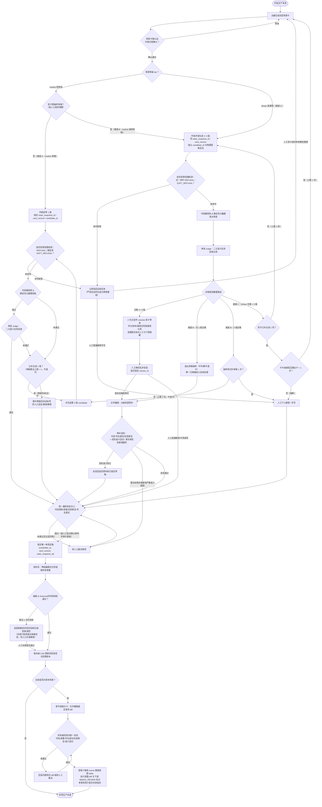
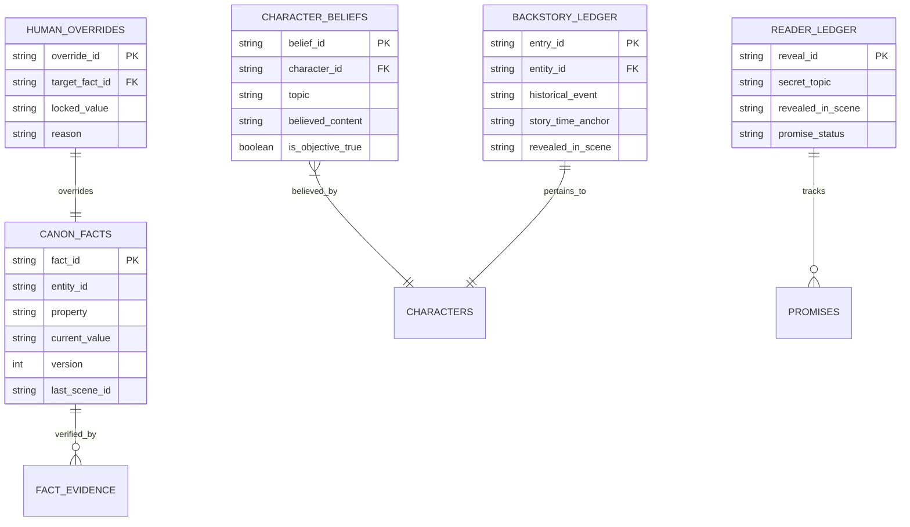
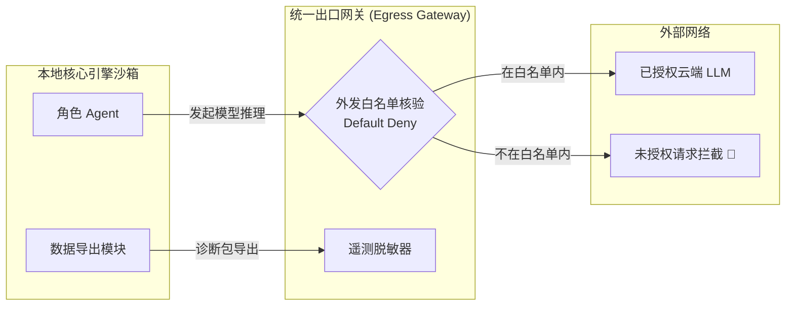
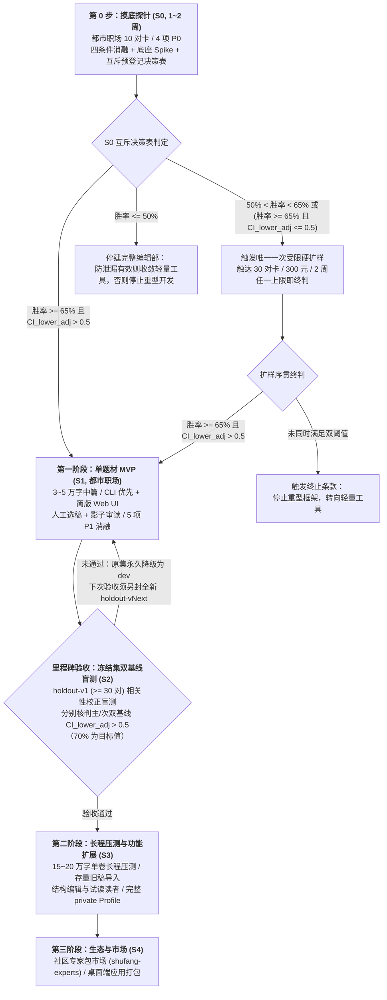

# 书坊（shufang）——中文小说创作 Agent Harness 设计汇总

> **版本**：v2.1（经责任编辑初审与文字编辑统稿修订）  
> **日期**：2026-10-25  
> **状态**：方案设计阶段（不动工，仅对齐架构与规范）  
> **变更来源**：依据 2026-10-24 多模型评审报告及 2026-10-25 责任编辑初审意见全面修订落实  
> **技术底座**：[`@earendil-works/pi-durable`](https://github.com/earendil-works)（持久任务图与文档存储）+ [`@earendil-works/pi-ai`](https://pi.dev/models)（统一多模型接入层）

---

## 1. 背景与动机

当前市面上的开源 AI 小说创作工具与智能体框架（Agent Harness，即围绕大语言模型搭建的任务编排与质检流水线），其产出质量几乎完全受制于所选基础模型。生成的正文往往带有浓重的“机器味”，缺乏真人写作者的语感与戏剧张力，读起来不像写给读者看的作品。

本项目旨在基于 `@earendil-works/pi-durable` 运行时，打造一个**专注高质量中文小说创作**的 Agent Harness——**书坊（`shufang`）**。

经 2026-10-24 评审校准，项目核心定位明确为：**面向大众读者，创作可公开发布的各类主流题材中文小说**。首期 MVP（最小可行产品）主打题材正式锁定为**「都市职场」**（聚焦单一题材，不扩展为三题材并行；目标发布平台如起点、番茄、知乎盐选、豆瓣阅读等仍待作者最终确认，用于对齐篇幅节奏与导出规范）。成人或亲密向内容仅作为作者个人兴趣的次要探索方向，降级为可配置项，不再作为系统架构的前提假设。

---

## 2. 问题诊断与待证假设

在早期的创作样本测试中，我们归纳出四类典型的“机器味”症状。在 v2 方案中，这些归因由原本的“确定性断言”调整为**有待实测验证的假设**，并同步补充了正向读者体验维度。

### 2.1 四类典型“机器味”症状与待证假设

| 症状名称 | 典型现象 | 初步假设与成因分析 | Harness 能否解决 | 验证计划与阶段 |
|---|---|---|---|---|
| **大纲泄漏进对白**<br>*(Outline Leakage)* | 角色直接说出：“第一轮是试探……下一轮是薇薇自己的场。” | 大纲中的场景节拍（Beat）直接被模型塞进角色台词，使角色沦为剧情报幕员。 | ✅ **主要可解**：规划与落笔分离；建立双层场景卡契约；代码与审读联合拦截，显著降低泄漏概率。 | S0 四条件消融；S1 开发集消融（P1） |
| **对齐痕迹与软拒答**<br>*(Alignment Artifacts)* | 角色在冲突或暧昧情境下突然宣读规则：“我心里有数，不是替你做主。”或激烈冲突被强行淡化。 | 模型在安全对齐训练中形成过度防御机制，遇到特定冲突场景时转向说教或弱化戏剧张力。 | ⚠️ **部分可解**：换选适配模型；以具体行动指令替代道德抽象词；检出后挂起并交由人工处理（不跨服务商盲目自动重试）。 | S0 抽测闭源模型软拒答发生率（P0） |
| **警句化与电报体**<br>*(Aphoristic Style)* | 通篇短句堆砌：“懒还在，懒底下是准的。”看似深刻，实则空洞。 | 模型固有的伪文学腔，叠加提示词中“去除 AI 味、要求语言极简”引发的矫枉过正。 | ⚠️ **部分可解**：注入真人范文锚点；由文字编辑执行句级润色；控制去套话词表的惩罚力度。 | S1 开发集范文消融（P1） |
| **比喻错位**<br>*(Metaphor Incongruity)* | 程序员或古装角色突然说出：“这就像点评一份迟到的工期。” | 模型跨知识域随意类比，脱离了角色的生活经验与在场身份。 | ⚠️ **部分可解**：在场景卡中显式限定人物视角与经验边界；在审读环节核查人物设定一致性。 | S1 审读规则校准（P1） |

### 2.2 正向读者体验四要素

早期设计过于侧重“排雷”（不泄漏、不说教、无错位），但没有硬伤并不等于作品好看。v2 方案正式引入**正向读者体验四要素**，作为审读评价与人工选稿的核心标尺：

1. **人物声线辨识度**：遮住人名后，读者能否仅凭语气、口头禅与句式特征分辨出说话人。
2. **期待感与伏笔兑现**：每个场景是否建立起新的悬念，或实质推进了读者期待的真相揭示。
3. **情绪收益**：场景是否提供了清晰的职场爽点、共情张力或认知反差。
4. **情节实质推进**：场景结束时，人物关系或故事局势是否发生了不可逆的实质变化。

---

## 3. 核心判断与架构基石

> [!IMPORTANT]
> 1. **文笔上限取决于基础模型，Harness 决定质量下限与长程一致性**：文字的美感与语感主要源于基础模型的文学表现力及范文引导。Harness 的核心职责是构筑防线：**显著降低大纲泄漏概率、保障长篇逻辑一致、执行多级质量把关、提供人工接管入口、持续沉淀高质量偏好数据**。
> 2. **底座的核心价值在于任务持久化、文档存储与崩溃恢复**：`@earendil-works/pi-durable` 提供了**持久化任务图（DAG 状态机）、结构化文档存储与故障中断恢复**能力，确保多步创作流水线在断电、崩溃或重启后可精准续跑。底座本身并不直接提升文笔。若该底座在 S0 技术探针（Spike）中受阻，框架保留切换至“自研 SQLite 事务队列 + 轻量代码 DAG 状态机”的备选方案。
> 3. **先做轻量摸底，再建重型框架**：在投入开发复杂自动化流水线之前，必须先在第 0 步（S0）完成同模型四条件消融实验。若实测表明 Harness 机制相较单提示直出无显著增益，则立即收缩路线，绝不盲目铺摊。
> 4. **LoRA 微调移出关键路径**：风格 LoRA（低秩自适应微调）依赖大规模合法授权语料与高昂的数据清洗成本，且随基础模型版本迭代易发生分布漂移而失效。因此，LoRA 降级为远期可选探索项；MVP 阶段依靠“模型选型 + 提示词工程 + 范文锚点检索 + 审读修补闭环”提升成稿文质。

---

## 4. 前置设计专题一：内容策略与数据出域白名单

为扭转原方案“因迁就私密题材而一刀切强制全局本地开源、全局默认脱敏”的架构失衡，v2 确立了**以作品级 Profile 为核心的四轴正交配置体系**。

### 4.1 四轴独立配置模型与校验规则

每部作品在创建时分别配置以下四个正交维度，维度间的组合合法性由规则统一校验（例如：当数据驻留设为 `strict_local` 时，端点政策严禁选择任何云端端点）：



1. **内容尺度（Content Rating）**：
   - `general`：面向大众读者的主流题材（MVP 主打「都市职场」），评测集与示例均完全公开。
   - `mature`：私人探索题材，仅限作者在本地设备自用，官方开源仓库严禁收录任何相关样本。
2. **数据驻留（Data Residency）**：
   - `strict_local`：严格本地驻留。所有数据、模型推理与运行状态均不离开本机网络，强制限定端点政策只能选 `local_runner`。
   - `cloud_assisted`：云端辅助模式。允许经显式授权的数据类别通过安全 API 发往云端模型端点。
3. **端点政策（Endpoint Policy）**：
   - `local_runner`：本地推理引擎（如 Ollama、vLLM、llama.cpp）。
   - `cloud_no_train`：服务条款明确承诺不将 API 输入输出数据用于模型训练的商业云端服务商。
   - `cloud_standard`：适用标准商业条款的常规云端端点，允许外发的数据范围由作品的数据外发白名单严格管控。
   - **条款核对与合规提示**：每个端点配置包含 `termsReviewed: "reviewed" | "unknown"` 属性。**标记为 `unknown` 的端点不可默认启用**，须由用户在配置时勾选确认已阅读服务商条款；界面同步展示服务商账号的地域合规与年龄核对提示。
4. **模型能力（Model Capability Tier）**：
   - `flagship_reasoning`：强推理模型（适用于主编规划、编剧室构思等复杂逻辑任务）。
   - `creative_writer`：强创作表现力模型（适用于正文起草与文学润色）。
   - `fast_utility`：轻量高性价比模型（适用于结构化抽取与常规辅助校验）。

### 4.2 数据出域白名单与默认全关原则

> [!CAUTION]
> **新建作品默认规则**：无论内容尺度设为 `general` 还是 `mature`，**新建作品的数据外发权限一律默认全部关闭（Default Deny）**。  
> 未发表手稿与私有范文属于创作者的核心资产；创作公开题材并不代表作者默认同意将未发表手稿上传至云端。

系统将受控数据划分为四个独立类别，构建作品级数据出域白名单（下称「数据外发白名单」）：
- **未发表正文（Unpublished Prose）**：各版草稿、修补稿与章节定稿片段。
- **范文语料（Style Corpus）**：用户本地导入的参考文本与风格切片。
- **结构化摘要（Structured Summaries）**：场景卡、分层大纲、人物状态卡与不含原文子串的故事圣经条目。
- **遥测日志（Telemetry Logs）**：运行报错、耗时指标与 Token 消耗统计。

**字段级来源标签与复合记录权限并集规则**：
- 系统对复合记录、运行上下文快照、圣经视图与诊断日志实施**字段级数据分类标签（Field-Level Classification Tagging）**，出口网关按实际携带的全部子字段执行**所需权限并集检查（Union of Permissions）**，严禁仅按顶层表名或容器类型粗粒度放行。
- **权限不传递原则**：授予「结构化摘要」外发权限**绝不自动授权**内嵌或引用的未发表正文与范文切片；故事圣经中的证据引用仅存储不含原文字符的纯偏移定位符，若需反查解析对应正文原文，必须重新通过「未发表正文」外发权限检查；包含草稿、范文切片与场景卡的复合快照，仅在目标端点同时获授全部对应子类别权限（或经网关剥离未获授权字段）时方可外发。

首次为任意角色绑定云端端点时，系统弹出显式授权卡片，由作者逐类勾选允许向该端点外发的数据范围。

### 4.3 主编与各角色读取正文的唯一判定标准

彻底废除原方案“主编使用闭源模型故不可读正文、资料员使用开源模型故天然脱敏”的陈旧假设。任何角色（含主编、审读、资料员）能否读取未发表正文，**唯一取决于该角色所绑定的推理端点是否已纳入当前作品的「未发表正文外发白名单」**：
- **本地端点或已获正文外发授权的云端端点**：主编可按需读取上一场末尾 500 字及已完成的章节定稿，确保场间转场自然、文气贯通。
- **未获正文外发授权的云端端点**：主编严禁接收任何正文原文（含严禁通过圣经证据定位符解引用原文文本），仅可读取不含原文子串的结构化状态与抽象摘要。
- **跨边界脱敏机制**：脱敏不再绑定于特定角色，而是当且仅当数据跨越“未获对应类别授权的网络边界”时按需触发的可插拔字段剥离与脱敏过滤器。

### 4.4 UI 隐私等级指示器

本地 Web UI 顶部常驻展示当前作品的隐私状态徽章：
- 🟢 `Strict Local`（严格本地模式：全部角色均绑定本地端点，零数据离网）。
- 🟡 `Cloud Assisted`（云端辅助模式：清晰列出当前调用云端 API 的角色清单及已授权外发的数据类别）。

---

## 5. 前置设计专题二：评测协议与实验规范

为避免模型摸底与质量验收滑向主观臆断，v2 建立了可复现、可证伪的量化评测体系。

### 5.1 双基线评测原则

评估 Harness 的有效性时，严禁仅以其他开源工具的笼统输出作为参照，必须在跑数前预登记并执行**双基线对照**：
1. **主基线（Primary Baseline）**：使用完全相同的基础模型，输入等价的故事背景设定，凭单一通用提示词直接生成正文（即“单提示直出”）。
2. **次基线（Secondary Baseline，等总预算对齐基线）**：不再固定为生成 3 版，而是**预先登记按完整 Harness 单场全链路实际总成本或总 Token 预算包络（含主编写卡、多稿起草、审读、文字编辑与重试开销）折算的 $K$ 次独立生成或简单自检重试策略，并严格拉齐选优主体、可见信息与人工耗时预算**——若 Harness 侧采用人工盲选并消耗人工干预预算，则次基线侧须在同等候选可见信息与同等人工耗时上限内按同一盲选规则挑稿（或预登记等预算自动 Best-of-$K$ 对照），确保不把“多花算力与人工挑稿的收益”误归因为多角色框架增益。

S2 验收须**分别报告相对主基线与相对次基线的比较结果及各自预登记通过标准**；若次基线未作为硬性门槛或未显著胜出，必须强制收窄“架构净增益”结论（详见第 12.2 节）。

### 5.2 规划增量与流水线增量的拆解验证

评测拆分为两个正交层级分别检验：
- **测试 A（主编规划能力）**：人工手写高质量场景卡 vs 主编自动生成场景卡（固定同一作者模型，对比所产出的正文质量）。
- **测试 B（Harness 流水线能力）**：主编自动生成场景卡 + 完整生产闭环（校对 + 审读 + 修补）vs 同一基础模型依据大纲单提示直出。

### 5.3 数据集物理隔离与单向退役（按对计数）

- **开发集（`dev-cards`）**：约 10~15 对场景卡，用于日常流程迭代、提示词调优与消融实验，允许研发期间反复查阅分析。
- **冻结验收集（`holdout-cards`）**：至少 30 对未见场景卡，附版本号（如 `holdout-v1`）一次性加密封存，仅在 S2 里程碑验收时启封盲测；严禁在研发阶段用于调参，从制度上杜绝过拟合。
- **启封单向退役与复验换集规则**：每套 `holdout-cards` 严格限用一次。**若 S2 验收未通过而回流 S1 迭代，已启封的原验收集（如 `holdout-v1`）立即永久降级并入错误分析与开发集（`dev-cards`），绝对禁止在调参修复后重跑原集充当验收**；个体样本结果仅在完成降级归档后开放给研发人员复盘。下一次 S2 复验必须另行构建、招募并加密封存全新的未见场景卡集（登记新版本号如 `holdout-v2`），并在启封前预登记复验盲读预算与最大复验轮次。

### 5.4 统计检验规范（抽样聚合单位与相关性校正）

- **配对盲读比较（Paired Blind Evaluation）**：隐去一切模型与配置标识，以正逆序随机打乱后派发给评测读者盲选。
- **跑数前预登记抽样与独立聚合单位**：严禁将“多读者 $\times$ 同一作品连续场景卡”直接拆作独立同分布伯努利样本计算普通二项分布或普通 Wilson 区间。实验启动前必须明确登记样本层级与对应校正方案：
  1. **多读者投票聚合**：同一对场景卡由多名盲读者评阅时，先在**场景卡对（Card Pair）**层级按预登记规则聚合（如多数票裁决，或在混合效应模型中纳入读者随机截距），不得按人头票数虚增样本量。
  2. **多作品抽样方案（跨多部独立作品构建卡集）**：以**作品（Work）为独立聚类单元**，采用预登记的**作品级整群自助重采样（Cluster Bootstrap）置信区间或广义线性混合效应模型（GLMM，含作品与读者交叉随机效应）**校正组内相关性，样本量（作品数 $\times$ 每作品卡数）由预期效应量与组内相关系数（ICC）经功效分析（Power Analysis）反推。
  3. **单作品纵向方案（若卡集仅取自同一部中篇的连续场次）**：明确单作品无法估计跨作品方差，**必须将统计推断结论显式收窄为“该单部样本作品内的场景级流水线表现”**，并采用预登记的**移动分块自助法（Moving Block Bootstrap，按连续章节/场景块重采样）或时间序列自相关校正区间**处理相邻场次依赖，严禁将未校正的普通二项 Wilson 区间称为“已完成聚类校正”。
- **过门判据**：统一以**经上述预登记相关性（及序贯）校正后的单侧 95% 置信区间下界大于 0.5（$CI_{lower,\text{adj}} > 0.5$）**作为优于基线的硬性通过判据；整体配对胜率点估计 $\hat{p} \ge 70\%$ 作为追求目标值（若满足 $CI_{lower,\text{adj}} > 0.5$ 但 $\hat{p} < 70\%$，须记录差距并列入下一阶段针对性优化项）。

### 5.5 S0 探针预登记决策表（互斥有序规则与序贯终判，初值待确认）

在第 0 步（S0）启动前预先登记**互斥且有序**的判定规则，明确 `50%`、`55%`（已合并消除冗余切点）、`65%` 各边界归属及多次查看校正，杜绝“小样本证据不足却惯性开工”或“反复偷看未校正区间尝试过门”：
- **统计查看与序贯校正约束**：预登记须二选一锁定——**方案 A（固定终点单次开盲）**：首轮 10 对仅验证工程跑通而暂不开盲统计，直接跑满预登记终样后一次性开盲计算 $CI_{lower,\text{adj}}$；**方案 B（两阶段序贯查看）**：首轮 10 对开盲查看，若落入规则 2 触发单次扩样，则首轮与扩样终判**必须统一采用预登记的两阶段序贯检验（如 O'Brien-Fleming 或 Pocock $\alpha$ 消耗函数，控制累计一类错误率 $\alpha \le 0.05$）计算校正后下界 $CI_{lower,\text{adj}}$**，严禁使用未校正的名义 95% 区间重复判门。

| 优先序与结果分档 | 互斥统计判定指标（完整闭环条件 iv 相对主基线条件 i） | 处置决策 | 对应行动、扩样上限与唯一终判规则 |
|---|---|---|---|
| **1. 显著胜出** | 胜率点估计 $\hat{p} \ge 65\%$，**且**经预登记校正后的 95% 下界 $CI_{lower,\text{adj}} > 0.5$ | **通过验证，进入 S1** | 正式启动 S1 单题材 MVP（都市职场）系统研发。 |
| **2. 证据不足<br>（单次受限扩样）** | 不满足规则 1，且满足：$50\% < \hat{p} < 65\%$，**或**（$\hat{p} \ge 65\%$ 且 $CI_{lower,\text{adj}} \le 0.5$） | **禁止直接开工，触发唯一一次硬扩样** | **停止采样三上限（任一触达即刻终判）**：① 累计场景卡达上限（预登记固定为 **30 对**，原 25~30 对区间在开工前锁定单值）；② 追加 API 费用达上限（**$\le 300$ 元**）；③ S0 总周期达时间上限（**$\le 2$ 周**）。<br>**扩样终判唯一通过阈值**：触达任一上限停止后，须**同时满足 $\hat{p} \ge 65\%$ 且经两阶段序贯校正的 $CI_{lower,\text{adj}} > 0.5$** 方可进入 S1；否则立即触发终止条款，停建重型框架，转向轻量辅助工具。 |
| **3. 局部有效<br>文笔平庸** | $\hat{p} \le 50\%$，**且**大纲泄漏率相较主基线按预登记检验显著下降 | **全流水线不经济，收敛范围** | 判定多 Agent 流水线对提升文笔不具性价比；停建完整编辑部，仅保留场景卡生成器与确定性校对插件作为单机辅助工具。 |
| **4. 核心假设证伪** | $\hat{p} \le 50\%$，**且**大纲泄漏率未见显著下降 | **核心假设未获支持，停止重型开发** | 终止书坊框架工程，复盘场景卡与提示词基本假设，转向其他创作辅助方向。 |

### 5.6 消融实验分级（P0 / P1）

- **S0 阶段严格收敛于 4 项 P0 任务**：
  1. 同模型四条件消融实验（单提示直出 vs 仅场景卡 vs 场景卡 + 范文 vs 完整闭环，基于都市职场 10 对场景卡）；
  2. `@earendil-works/pi-durable` 底座技术验证（Spike：跑通本地模型非工具调用接入、进程中断崩溃恢复、自建人工审批闸门、SQLite FTS5 + 实体别名表对两字中文人名的检索召回）；
  3. 单场耗时与 API 成本基线测算（核算每千字采纳成稿的实际开销）；
  4. 主流闭源模型在都市职场题材下的软拒答发生率抽测。
- **5 项 P1 消融实验统一移入 S1 开发集（`dev-cards`）执行**：
  1. 范文锚点有效性消融；
  2. 可表演外部约束注记（原“不可言说”）对抑制大纲泄漏的有效性消融；
  3. 收尾画面锚点（Closing Image）防泄漏有效性 A/B 测试；
  4. 动作节拍清单 vs 纯张力动机场景卡对照实验；
  5. 主编自动生成场景卡质量盲评。

### 5.7 推理行为契约与选优遗憾分析

- **推理行为契约（Inference Behavior Contract）**：单场生产中的每次模型调用均须完整记录端点地址、模型精确 ID、构建版本/量化指纹、Prompt 模板版本号、采样参数（Temperature / Top-P）、实际输入输出 Token 计数及结束原因（`finish_reason`）。**无法获取的字段（如商业云端 API 未返回量化精度或内部构建版本）须显式标记为 `unknown`，严禁留空；仅当缺失端点地址、模型 ID 或 `finish_reason` 等核心必填项时，该条记录判定作废**。
- **Best-of-N 选优遗憾分析（Selection Regret Analysis）**：在多稿候选实验中，持续追踪审读模型所选“机器最佳版”与人类作者盲选“人类最佳版”之间的评分差距，据以迭代校准审读 Prompt。

---

## 6. 设计决策总览（D1~D13）

下表汇总经多轮评审修订定案的全部 13 项核心架构决策，逐项给出通俗定案依据，并按**【MVP 必做】**、**【结构预留（仅定义 Schema，暂不写重型逻辑）】**、**【后续阶段】**三档严格切分落地边界。

| # | 决策点 | 修订后结论 | 为什么这样定（通俗说明） | 落地阶段 |
|---|---|---|---|---|
| **D1** | **核心定位与模型选型** | 主体定位为**面向大众读者的主流题材创作**，首期 MVP 主打**「都市职场」**。废除原 D1 成人内容全局硬约束及“正文层仅限开源模型”的强制名单；模型选型以叙事质量、指令遵循度与可发布性为准绳。S0 阶段开源与闭源模型同台竞技，凭实测数据选型。 | 原方案将个人支线诉求设为全局前提，导致系统架构过度防御；主流题材优先追求文学表现力，开源与闭源模型应同场实测择优。 | **【MVP 必做】** 都市职场题材选型与摸底；<br>**【后续阶段】** 私人敏感题材独立验收组。 |
| **D2** | **总体架构与专家包定性** | 总体架构确立为**主编规划 + 精简编辑部 + 纯声明式专家配置包 + `@shufang/core` 确定性代码状态机**，废止“专家 subagent”提法。专家包仅承载字段扩展 Schema、注入指令模板、审读规则与合法示范文本，**严禁包含可执行代码，严禁携带模型端点与凭证**。官方内置示例专家包仅用于契约验证，不参与 S2 盲读验收。 | 由大模型充当流程调度器既慢又不可控，必须由确定性代码掌舵；若允许社区专家包附带代码或私有端点，将引入远程代码执行（RCE）与手稿窃取风险；内置包不参与盲读，可排除额外提示词对基线评测的干扰。 | **【MVP 必做】** 代码状态机编排；<br>**【结构预留】** 最小专家包 Manifest + 内置都市职场示例包（不参与盲读）；<br>**【后续阶段】** 社区专家包市场与分发。 |
| **D3** | **主编可见范围与数据边界** | 主编默认读取不含原文子串的结构化状态；**任何角色能否读取未发表正文（含通过证据定位符反查原文），唯一取决于其所绑端点是否纳入作品的「未发表正文外发白名单」**；复合记录按字段级标签执行权限并集检查，摘要授权绝不自动传递至内嵌正文或范文。已获授权端点的主编可按需读取上一场末尾 500 字与章节定稿。严禁使用会话 `fork` 继承上下文；主编调用一律无状态化（设 Token 上限）并关闭自动压缩（compaction）。 | 原“主编必用闭源模型、故一律不可读正文”的假设在本地部署或用户显式授权下并不成立；按端点白名单与字段级权限并集解耦后边界严密，禁用父子会话继承亦可防止大纲私有信息泄漏给作者。 | **【MVP 必做】** 字段级数据外发白名单、作者上下文白名单拼装、主编无状态化与 Token 上限；<br>**【后续阶段】** 跨网络边界动态脱敏过滤器。 |
| **D4** | **场景卡简报协议** | 场景卡拆分为**主编私有层**与**作者可见层**，元数据字段（POV、时间模式、故事时间锚点、`tier`、`branch_id`）与创作字段分开计数。**作者可见核心创作字段严格锁定为 6 个**，以**收尾画面锚点（Closing Image）**取代抽象关系变化，将“不可言说”转化为角色可表演的外部回避动作注记，显著降低大纲泄漏概率；增设场景卡轻量确认站（Card Checkpoint）。 | 字段过多会导致模型注意力分散、人工审阅负担过重；直接将抽象结局告知作者模型易诱发角色提前“报幕”，改用收尾画面锚点可兼顾方向指引与防泄漏。 | **【MVP 必做】** 双层场景卡、6 创作字段 + 5 元数据字段、Card Checkpoint；<br>**【结构预留】** `branch_id` 字段；<br>**【后续阶段】** 多题材复杂扩展字段。 |
| **D5** | **质量闭环与影子审读** | **MVP 默认采用「人工选稿 + 审读影子模式（Shadow Mode）」**：<br>1. 影子期主观评分、缺陷摘要与排序**仅写入隔离统计存储，人工选稿正式提交锁定前严禁向人工或文字编辑展示**（界面随机乱序展示全部任务合格候选）；`routine` 场在影子期按人工耗时预算抽样多稿；<br>2. 多稿场景生产侧固定执行 **2 次正逆序 Listwise 综合审读**（正逆序得分取均值），天然产出位置交换稳定性信号；<br>3. 确定性闸门信号清单涵盖：代码校对命中数、被淘汰版本数、审读正逆序交换不一致；<br>4. 审读放权初值：与人工盲选一致率 $\ge 75\%$、双向盲测样本 $\ge 50$ 对且严重缺陷漏检率达标后，方可逐步放权；放权后 UI 切换为「展示裁判前 2 名 + 差异摘要」，仍保留约 20% 高分稿随机抽检，并持续核算每千字人工耗时。 | 未经校准的 AI 裁判易将位置偏置或同源偏好强加给作者，污染训练样本；唯有在选稿锁定前彻底隔离裁判结论才能沉淀干净可靠的偏好校准集。 | **【MVP 必做】** 人工全量盲选、影子结论隔离存储、`routine` 影子期抽样、2 次正逆序审读、人工耗时核算；<br>**【后续阶段】** 审读自动放权与高分稿随机抽检。 |
| **D6** | **分级返工与失败矩阵** | 废除“绝对禁止整段重写”的僵化禁令，验收拆分为**代码确定性元数据验收 + Judge 二元语义任务验收**，实行三通道唯一计数与强制终检：<br>1. `routine` 单稿：两级验收通过进统一终检放行；失败仅补生成 1 版（上限 1 次，不退卡），再败则两版交人工；`routine` 抽样多稿仅剩 1 版合格时退出抽样直入后续环节，0 版合格最多补单稿 1 次；<br>2. `climax` 多稿：强制绑定不可变键 `(state_snapshot_id, card_version, candidate_id)`；合格 $< 2$ 版最多补生成 1 轮，卡片缺陷最多退回主编重出卡 1 次，仍不达标熔断交人工；<br>3. **修补与人工出口闭环**：所有编辑修补及章节统稿逐场 diff 均须核验代码规则、专名/事实字段与任务断言（润色做语义回归恶化回滚；事实修复不因审美分波动回滚，但未修好或新增严重语义缺陷转人工裁决）；**一切人工选稿微调、续写或接管结果均须重新进入统一最终校验关口**（例外须显式确认留痕）；资料员抽取失败严格阻断依赖该状态的后续任务；建立单场 5 阶段缓存。 | 对结构性失控的废稿强行做句级润色毫无价值；按通道锁定重试上限严控成本；强制人工与编辑出口回流终检、阻断缺失状态下游推进，防止不合格稿或断链状态静默污染正史。 | **【MVP 必做】** 按通道分道流水线、两级任务验收、修补与人工出口统一终检、资料员依赖阻断、checkpoint 计数、单场阶段缓存。 |
| **D7** | **风格锚点与版权边界** | 范文锚点设为**可选机制**（支持无范文、纯风格说明、人工精选、自动检索四种模式，严禁注入 AI 合成范文）。单部作品绑定叙事声音档案与角色声音约束，本地语料附带来源分类标签。输出端在代码校对层强制执行成稿与所注入范文的**字符级 n-gram / 最长公共子串（LCS）查重**（初值 5-gram，于专题 C 校准），超标即标红拦截（该检查仅作工程风险提示，不构成法律意义上的无侵权证明）。专家包严格区分本地检索标签与随包分发的开源资产。 | 多数新作者本地并无现成语料库，强制绑定范文会阻塞冷启动；输出端硬性查重则从工程层面防范洗稿与无意雷同风险。 | **【MVP 必做】** 范文可选四模式、声音档案与角色约束、来源标签、输出端 n-gram 查重；<br>**【结构预留】** 范文消融实验（P1）；<br>**【后续阶段】** 外部事实资料包。 |
| **D8** | **长程状态、版本链与兜底检索** | 故事圣经存入 `@shufang/core` 自有 SQLite 关系表，采用**四层架构（正文事实 / 人工锁定 / 人物信念 / 读者账本）+ 回溯账本 + 条目级 CAS 版本控制**。每次变更附 `{sceneId, quoteSpan, factType, oldValue, version}`，其中 **`quoteSpan` 为不含原文的纯偏移定位符（反查原文须重验正文权限）**；归档仅接收选定并通过终检的唯一 `candidate_id` 定稿。调度代码通过只读通道向资料员注入主编定性信息以甄别角色谎言；插叙（`flashback`）抽取仅写回溯账本；人工编辑圣经期间冻结依赖任务。修改第 $k$ 场（含章节统稿修改任意已归档场次或退回重改）时，逐被改 `scene` 重抽局部 `delta` 并做增量 diff，将受影响下游条目标记为「待复核」，派生摘要与索引打 `stale` 标记惰性重算。中文检索采用 **SQLite FTS5 + 实体别名表 / `LIKE` 补充路径**。 | 角色谎言不可混入客观正史；纯定位符防止未发表正文借摘要类别外泄；章节统稿或回溯改稿均须按被改 `scene` 重抽局部 `delta` 而绝不全书重算；实测证实 FTS5 `unicode61` 与 `trigram` 均无法命中两字中文人名，必须补齐实体表与 `LIKE` 兜底。 | **【MVP 必做】** 四层圣经表 + 回溯账本、条目级 CAS 与纯定位符引用、只读定性通道、逐改场 diff 与待复核队列、FTS5 + 实体表检索；<br>**【结构预留】** 分支与发布状态 Schema；<br>**【后续阶段】** 多分支演进与分卷归档。 |
| **D9** | **本地运行与数据出域控制** | 拆解为两项正交设计：① **本地存储优先**：基于本地 SQLite、单用户、单引擎进程独占存储（Web UI 与 CLI 均通过引擎 API 通信）、无云端账号中心，导出的 Markdown / YAML 仅为只读视图；② **推理端点显式授权**：废除不切实际的“正文语料永不出本机”绝对承诺，代之以**逐类数据外发白名单 + UI 隐私等级指示器**，新建作品默认外发全关。本地推理通过客户端信号量限流（默认 `maxConcurrency: 1`），所有出口请求显式设置 `identity.attribution`。 | 云端旗舰 API 能提供强推理能力，但绝不能未经授权暗中上传手稿；本地单并发限流可防止 GPU 显存溢出（OOM）；单引擎进程独占则从根源上消除 SQLite 文件锁冲突与双重事实源。 | **【MVP 必做】** 单引擎进程拓扑、数据外发白名单（默认全关）、隐私等级指示器、客户端并发信号量、`identity.attribution`；<br>**【后续阶段】** 离线脱敏增强包。 |
| **D10** | **路线图、S0 决策闸门与两级验收** | S0 聚焦 4 项 P0 探针与**互斥有序预登记决策表**（卡数/费用/时间任一上限触达即终判，采用固定终点或两阶段序贯校正，扩样终判同样须满足 $\hat{p} \ge 65\%$ 且 $CI_{lower,\text{adj}} > 0.5$）；S1 聚焦都市职场单题材 CLI 优先 MVP 及 5 项 P1 消融；S2 在版本化密封冻结集上执行**相关性校正（多作品聚类/GLMM 或单作品分块自助法）双基线盲测**，分别报告主基线与等总预算次基线判据（次基线未过则强制收窄净增益结论；若 S2 未过，原 `holdout` 永久降级为 `dev`，复验须另封新集）；S3 开展 15~20 万字长程压测与存量旧稿导入；S4 开放社区市场。LoRA 全程移出关键路径。 | 防止战线过长或反复偷看未校正区间带病开工；严格隔离一次性 `holdout` 防止调参泄漏；通过等总预算次基线剥离单纯多采样与人工挑稿红利。 | **【MVP 必做】** S0 探针与互斥序贯决策表、S1 都市职场 MVP、S2 版本化冻结集双基线相关性校正验收；<br>**【后续阶段】** 长程压测与社区市场。 |
| **D11** | **角色编制与职责重划** | 维持精简编辑部编制：主编专司大纲拆解、写卡与主持编剧室，流程调度移交确定性代码状态机；校对、审读、文字编辑实行三层质检分工（确定性代码硬淘汰 / 审读语义风险排序 / AI 腔高频词表仅高亮提示而不淘汰整稿）；文字编辑负责句段修补，并在**章末节点承担整章连贯性统稿**；资料员带原文证据抽取状态并剥离默认脱敏职责。全程不新增额外 Agent。 | 确定性流程控制应交由代码执行，避免虚耗大模型资源；由文字编辑兼顾章末统稿，无需为章节连贯性专门增设新角色；套话词表仅作提示而不一票否决整稿，以防矫枉过正。 | **【MVP 必做】** 职责重划后的 6 模型角色 + 代码状态机 + 三层质检分工 + 章节统稿关卡；<br>**【后续阶段】** 独立结构编辑与试读读者角色。 |
| **D12** | **编剧室范围、多样性与成本** | 编剧室仅在立项、分卷、章纲及重大情节转折时按需唤醒。**废除“强制配置 3~4 家不同服务商模型”的硬门槛**，默认采用「单模型 + 3 套差异化视角角色卡」，跨服务商配置作为可选增强。**法定有效提案数默认 $\ge 2$ 份，仅产出 1 份时允许用户确认继续**；**单 Key 模式下 UI 明确标注「非独立提案」，且相关数据不纳入校准集**；**编剧室数据外发同样受作品数据外发白名单约束**。交互改为**两步走：先生成一句话 Logline $\to$ 代码去重 $\to$ 用户圈选后再展开细纲**，并支持单次预算上限告警。 | 强制要求多服务商 API Key 会大幅抬高上手门槛，且跨厂商并不天然等价于构思多样性（属待证假设）；两步走交互可显著节省 Token 开销并减轻人工阅读负担。 | **【MVP 必做】** 单模型多视角角色卡、两步走 Logline 交互、法定数降级放行、非独立提案标注、预算上限告警；<br>**【后续阶段】** 跨服务商等预算对照实验。 |
| **D13** | **模型接入、安全与合规护栏** | 基于 `@earendil-works/pi-ai` 统一配置化接入。专家包严禁声明端点与密钥；统一出口网关实施字段级来源标签与权限并集拦截；**校对入口最高优先级短路识别安全拒答（`REFUSAL` / `SOFT_REFUSAL`，与截断类 `finish_reason` 分开编码）并立即挂起，严禁自动补生成与跨服务商重试同一敏感文本**；完整记录推理行为契约（不可获取项显式标 `unknown`，核心必填项缺失方作废）；端点配置纳入条款核对状态（`termsReviewed`，`unknown` 态不可默认启用）及地域/年龄提示；三类日志分设权限与保留期限；导出边界提供可编辑 AIGC 标识模板与自定义违禁词表挂载口；Web UI 仅监听 `127.0.0.1` 并启用本地访问鉴权，API Key 绝不下发前端。 | 防范 API Key 泄露与恶意专家包窃取手稿；拒答高优短路防止被普通校对重试分支吞没或跨商连环封号；本地鉴权可阻断同机恶意网页跨站调用。 | **【MVP 必做】** 字段级统一出口网关、高优拒答短路挂起、推理契约记录、Web UI 本地鉴权、三类日志分级管理、导出合规清单；<br>**【后续阶段】** 社区专家包 CI 自动化安全准入。 |

---

## 7. 角色编制与权限分层（D3、D11、D12）

### 7.1 角色拆分原则

书坊借鉴传统文学出版与影视编剧室的分工逻辑，但克制拆分粒度、绝不盲目堆砌 Agent。是否单列一个独立角色，严格遵循四条准则：
1. **模型能力特化**：是否确需依赖不同能力倾向的模型？（例如：大纲推演侧重强逻辑推理，正文落笔侧重文学语感与表现力。）
2. **上下文物理隔离**：是否必须对特定角色屏蔽上游信息？（例如：作者模型严禁窥见主编私有层中的全局剧透。）
3. **立场制衡（Checks and Balances）**：产出方不得自审其稿，作者模型不能兼任自己的裁判。
4. **确定性代码优先**：凡能由确定性代码精准高效完成的任务（如字数核验、禁透词扫描、n-gram 查重、状态机分支流转），**一律不用大语言模型**。

### 7.2 MVP 角色职责与权限矩阵

在 MVP 阶段，系统编制由 1 个核心调度引擎、1 个确定性代码校对模块与 6 个模型角色共同组成：

| 角色名称 | 对应现实原型 | 核心职责 | 推理模型要求 | 数据可见范围与权限 |
|---|---|---|---|---|
| **调度引擎**<br>*(`@shufang/core`)* | 生产调度台 | 流水线编排、DAG 状态机流转、并发限流、故障中断恢复与阶段缓存管理。 | **纯代码执行，不用 LLM** | 独占底层 SQLite 数据库读写权限。 |
| **主编**<br>*(Director)* | 总编辑 / 策划总监 | 拆解故事总纲、生成双层场景卡（主编私有层 + 作者可见层）、主持编剧室研讨。 | 强推理模型（闭源旗舰或开放权重旗舰均可） | 读取结构化大纲与故事圣经；依据作品数据外发白名单决定能否读取上一场末尾 500 字与章节定稿；**严禁直接起草正文**。 |
| **编剧室**<br>*(Writer's Room)* | 策划智囊团 | 在立项、卷纲、章纲与重大情节转折处提供多视角构思提案。 | 默认单模型 + 3 套差异化视角角色卡（可选多服务商） | 仅读取高阶大纲与抽象设定，产出两步走 Logline 构思；外发权限受作品数据外发白名单约束。 |
| **作者**<br>*(Writer)* | 签约专栏作者 | 严格依据场景卡起草单场正文（`routine` 产出 1 版，`climax` 并发产出 2~3 版），每次生成强制绑定必填且不可变的三元键 `(state_snapshot_id, card_version, candidate_id)`。 | 强文学表现力模型 | 同场所有候选锚定同一已提交状态快照与卡片版本，且严格隔离会话上下文；仅读取场景卡作者可见层、前文衔接锚点及可选范文切片；**严禁读取主编私有层与后续大纲**。 |
| **校对**<br>*(Proofreader)* | 责任校对 | **最高优先级先识别安全拒答信号（`REFUSAL` / 确定性 `SOFT_REFUSAL`）并立即短路挂起转人工**；其余执行确定性元数据与硬规则筛查：字数边界、排版格式、禁透词字面复现、范文 n-gram 查重、禁用元话语及非安全类输出截断（如 `finish_reason = length`）。 | **纯代码执行，不用 LLM** | 只读当前待检草稿、场景卡确定性元数据/禁透词与所注入范文切片；分别编码输出安全拒答挂起信号与常规拦截报告。 |
| **审读**<br>*(Judge)* | 复审编辑 / 裁判 | 承担两项权责分离的任务：① **二元语义任务验收**（核验收尾画面、核心状态变化、改写式禁透、视角边界等客观任务断言，以及修补稿事实与语义回归）；② **影子质量排序**（对任务验收合格的多候选执行 2 次正逆序 Listwise 排序与分维度评分）。 | 强指令遵循模型（**必须与作者绑定不同模型**） | 独立读取待验草稿、场景卡验收断言与审读标准；**MVP 影子期内，主观评分、缺陷摘要与排序结论仅单向写入隔离统计存储，在人工选稿提交锁定前严禁向人工或下游角色展示**。 |
| **文字编辑**<br>*(Line Editor)* | 文字润色编辑 | **仅在人工选稿正式提交锁定后**，对入选草稿执行句级润色与受限单段重写；在章末节点承担整章连贯性统稿并按场提交逐场 diff。 | 高语感敏感度文学模型 | 读取已锁定入选草稿与允许的局部修补指令，产出修改 diff；**一切编辑产出均须重新进入统一最终校验关口复检**。 |
| **资料员**<br>*(Archivist)* | 场记 / 档案员 | **仅从已完成选定且通过统一最终校验的唯一 `(candidate_id, card_version, state_snapshot_id)` 定稿**（及章节统稿复检通过的被改场次新版本）中抽取状态变更，附纯偏移定位符证据写入故事圣经。 | 强结构化抽取与 Schema 遵循模型 | 读取经终检锁定的定稿，并由调度代码通过单向只读通道注入最小主编定性信息（用于甄别角色谎言）；产出 `delta` 增量变更集；**抽取失败必须挂起依赖该状态的后续任务**。 |

> [!NOTE]
> **明确排除项**：美编（封面与插画生成）与营销（社媒宣发物料生成）。在核心正文质量未获实证验收前，绝不分散精力涉足外围视觉与推广功能。

### 7.3 数据流与隔离架构



---

## 8. 场景卡简报协议（D4）

场景卡（Scene Card）是主编下达给作者的单场创作任务书。为从源头抑制大纲泄漏进对白，场景卡实行**双层物理隔离与严格的字段预算控制**。

### 8.1 结构与字段定义

> [!IMPORTANT]
> **场景卡不包含动作顺序或分步流程指令**。交给作者模型的是在场人物的张力关系与内在动机，而非预设的动作节拍清单。此项作为默认设计规则，将在 S1 开发集中通过 P1 消融实验与“动作节拍清单”方案开展对照验证。



#### 1. 主编私有层（Director Private Layer）——作者绝对不可见

- `scene_goal`：本场核心叙事目的（例如：“让主角意识到上司已察觉报销账目异常”）。
- `relationship_shift_abstract`：抽象的人物关系转折定性（例如：“从表面貌合神离转入暗中正式对峙”），仅留存供审读验收与资料员定性参考，绝不下发作者。
- `forbidden_reveals`：禁透清单，列明本场严禁提前点破的剧情底牌或后续反转。
- `acceptance_criteria`：本场任务验收断言。验收拆分为两步：字面与结构可判项归代码**确定性元数据验收**；收尾画面落地、核心状态变化、动机兑现与改写式禁透由审读（Judge）在**二元语义任务验收**环节核验（与影子期无否决权的主观优劣排序严格区分，详见第 9.1、9.2 节）。

#### 2. 作者可见层（Writer Visible Layer）

为避免信息过载引发模型注意力稀释，作者可见层严格控制信息容量，**系统元数据字段与核心创作字段分开计数**：

**五大元数据字段（供系统路由与状态控制使用）**：
1. `pov_character`（视角人物）：限定本场叙事的感知视角与知情边界。
2. `timeline_mode`（时间模式）：取值为 `linear`（主线顺叙）或 `flashback`（插叙 / 回忆）。
3. `story_time_point`（故事时间锚点）：本场在故事内部时间轴上的精确坐标。
4. `tier`（场景等级）：取值为 `routine`（常规过渡场）或 `climax`（核心高潮场）。
5. `branch_id`（剧情分支标识）：MVP 阶段固定为 `main`。

**六大核心创作字段（严格锁定为 6 个）**：
1. `character_desires`（人物欲望）：在场各人物当下**最迫切想要达成的具体诉求**（如：“设法拿回被压下的那叠报销单据”）。
2. `scruples`（顾忌）：阻碍人物直接摊牌索取的**心理顾虑或现实掣肘**（如：“一旦当面撕破脸，势必惊动分管副总裁”）。
3. `information_gaps`（信息差）：**在场各方分别知道什么、不知道什么**（如：“张经理不知主角昨晚已拷走后台流水；主角误以为张经理仍在怀疑采购部”）。
4. `subtexts`（潜台词）：台面上的寒暄措辞之下，**真正试探或敲打的弦外之音**（如：“嘴上体恤下属连日加班辛苦，实则套问昨晚究竟是谁最后锁门离开”）。
5. `speech_habits`（说话习惯）：在场角色的用词偏好、呼吸节奏与标志性句式。
6. `closing_image`（收尾画面锚点）：**用以替代抽象关系结论**，给出一个可感知的具象动作或空间定格（如：“张经理将茶杯轻轻推至桌沿，主角没有伸手去接，两人隔着百叶窗切碎的斜光静静对视”）。

**可表演外部约束注记（`behavioral_constraints`，原“不可言说”字段的具象化落地）**：
将“禁止泄漏大纲”之类难以执行的否定式抽象禁令，转化为**角色可表演的外部动作或回避反应**（例如：“当对方追问昨晚去向时，低头擦拭镜片并翻找会议纪要借故岔开，绝不正面作答”）。

**风格锚点（`style_anchor`，可选）**：
由 Harness 检索层按需注入 1~2 段真人优秀范文切片；若本地语料库无匹配切片或用户选择无范文模式，则直接留空，**严禁使用 AI 合成范文充数**。

### 8.2 题材扩展字段契约

专家包可通过 Manifest 声明特定题材的扩展字段，但须遵守严格的准入契约：
- 必须完整声明字段类型、填写角色、泄漏风险等级（`safe` / `sensitive`）、数据外发权限（`egressPermission: "local_only" | "allow_cloud"`）及验收方式。
- 必须配套提供 `directorInstruction`（指导主编如何填写该字段）与 `judgeCriterion`（指导审读如何核验该字段）；凡未声明核验规则的扩展字段，调度引擎一律拒收。

### 8.3 场景卡轻量确认站（Card Checkpoint）

主编产出场景卡后，流水线提供轻量人工把关节点：
- MVP 阶段建议默认设为**每场必停**（待作者最终确认）：作者在 Web UI 或 CLI 中花约 10 秒快速扫视本场目标与收尾画面，敲击回车确认后再唤醒作者模型起草正文，避免因上游规划跑偏而白白消耗生成额度。待协作顺畅后，可按需放宽为仅在 `climax` 高潮场暂停确认。

---

## 9. 单场与整章生产流程（D5、D6、D11）

单场与章节生产流水线全面贯彻**按 `tier` 分道、影子审读、带护栏修补与章末连贯性统稿**机制。

### 9.1 全流程流转图

单场验收显式拆分为**确定性元数据/硬规则验收（纯代码）**与**二元语义任务验收（Judge 独立核验客观任务断言，有准入过滤权，但与无否决权的影子主观质量排序严格隔离）**；安全拒答拥有最高拦截优先级；一切编辑修补与人工接管出口均强制回流**统一最终校验关口**。



### 9.2 异常与失败矩阵（按优先级与三通道分道）

| 故障或异常场景 | 触发阶段与路由优先级 | 判定依据与编码区分 | 自动化处理策略（按通道唯一计数） | 人工兜底与强制回流校验策略 |
|---|---|---|---|---|
| **模型安全拒答 / 确定性软拒答** | **最高优先级短路拦截**（生成返回 / 校对最前哨，先于一切淘汰重试分支） | 编码为 `REFUSAL` 或 `DETERMINISTIC_SOFT_REFUSAL`：`finish_reason = content_filter` / 安全拦截码，或正文命中明确拒答话术模板（如“作为 AI 无法创作此类情节”）。**与长度截断严格分开编码**。 | **立即挂起当前场次任务**；严格排除在通用淘汰补生成分支之外，**严禁同卡自动补生成，更严禁跨服务商自动重投同一敏感文本**（防连环风控封号）。 | 弹出告警卡片，由作者选择调整场景卡表述、切换本地离线模型重跑或直接接管手写；**人工接管稿提交后必须进入统一最终校验关口**。 |
| **代码硬规则 / 确定性元数据不达标** | 校对阶段（仅在非安全拒答前提下执行） | 出现禁透词字面复现、字数越界、格式错乱、范文 n-gram/LCS 查重超标、确定性元数据冲突（如在场专名缺失、人称代词违背 `pov_character`），或非安全类输出截断（编码为 `TRUNCATED_OUTPUT`，如 `finish_reason = length`）。 | **通道 A（`routine` 单稿）**：自动补生成 1 版（上限 $= 1$ 次，不退卡）；<br>**通道 B（`routine` 抽样多稿）**：淘汰违规稿；余 $\ge 2$ 版进盲选，余 $1$ 版退出抽样直入后续环节，余 $0$ 版最多补单稿 1 次（不退卡）；<br>**通道 C（`climax` 多稿）**：淘汰违规稿；合格候选 $< 2$ 版时同卡最多补生成 1 轮。 | 重试耗尽仍不达标时，UI 高亮违规位置交人工微调、选定或接管；**一切人工修改/续写/接管结果均须重新汇入统一最终校验关口，显式例外须勾选原因并记录审计日志，严禁静默放行**。 |
| **二元语义任务验收未完成** | 语义任务验收阶段（由独立审读 Judge 模型执行，先于主观选优） | Judge 核验场景卡 `acceptance_criteria`、`scene_goal`、`forbidden_reveals` 与 `closing_image` 后判定客观任务未达成（收尾画面缺失、核心状态变化未发生、改写式禁透或视角越界）。**Judge 在此仅行使客观任务准入核验权；主观优劣排序在影子期无否决权**。 | 判定为未完成任务稿，不得混入多稿盲选池：<br>**通道 A（`routine` 单稿）**：与代码校对共享单场重试预算（上限 $= 1$ 次，不自动退卡），再败则两版同交人工；<br>**通道 B（`routine` 抽样多稿）**：过滤后余 $\ge 2$ 版进盲选，余 $1$ 版降级单稿，余 $0$ 版最多补单稿 1 次后交人工（不退卡）；<br>**通道 C（`climax` 多稿）**：过滤后合格 $< 2$ 版先同卡补生成 $\le 1$ 轮；若多版草稿共同暴露场景卡因果/动机缺陷，允许**退回主编重出场景卡 $\le 1$ 次**，仍不达标熔断交人工。 | 转入人工兜底时方展示客观任务未达标断言（正常盲选池绝不展示主观评分与排序）；人工改卡重跑或接管改写后，**同样必须通过统一最终校验关口**。 |
| **审读超时、故障或语义软拒答提示** | 审读阶段 | ① API 超时、网络中断或输出结构解析失败；② 检出隐性道德说教倾向（打 `semantic_soft_refusal_hint` 语义标签）。 | ① 通信/解析故障：指数退避重试 2 次，或在已获同级外发授权的备用端点间切换；② 语义软拒答标签：**不自动跨商重投**，影子期仅记入隔离库或在放权后触发人工确认流程。 | 故障重试失败严禁伪造通过！若二元任务验收未完成则转人工核验任务断言后盲选，标记“审读未完成”；语义软拒答由人工确认系角色合理克制还是对齐说教。 |
| **修补复检未通过或质量恶化** | 文字编辑与章节统稿复检阶段 | **所有编辑修补（润色、单段重写、事实修复及章节统稿 diff）均强制核验：① 代码硬规则与查重、② 专名与客观事实字段、③ 场景任务断言**。此外，文风润色（`stylistic_polish`）执行语义回归对比；事实/连续性修复（`fact_continuity_fix`）核验目标事实确已修正在且无新增严重语义缺陷。 | ① **文风润色类**：若代码/事实/任务断言不通过或语义回归恶化，自动丢弃 diff 并**回滚至修补前已锁定草稿**；<br>② **事实/连续性修复类**：**不因主观审美分小幅下降而回滚，但若目标事实未修好、任务断言破坏或引入新严重语义缺陷（泄漏/视角崩塌），严禁放行**，立即阻断并转人工裁决。重写计数写入任务 checkpoint。 | UI 并列展示修补前后 diff 与复检失败项，由作者裁决或手动改定；**人工改定稿提交后必须重新通过统一最终校验关口**。 |
| **资料员抽取失败** | 状态归档阶段 | 输出 JSON 损坏、定位符越界/哈希失配，或发生故事时间单调性冲突、CAS 版本冲突。 | 自动重试 1 次，强化 Schema 与定位符边界约束提示。 | **恢复严格依赖阻断语义**：重试仍失败时，允许作者查阅文本或在离线草稿区人工起草，但**所有依赖该场状态的后续场景自动生成、任务验收与定稿提交必须立即挂起**（仅无状态依赖的独立任务允许继续），直至重抽成功或作者人工补录状态并原子提交解锁。 |

### 9.3 单场阶段产物缓存设计

系统在 SQLite 中为单场流水线设立保存点，各阶段按输入参数哈希建立确定性缓存，支持任意节点中断后续跑：
1. `STAGE_CARD`：主编产出的双层场景卡。
2. `STAGE_DRAFTS`：作者起草的各版原始草稿。
3. `STAGE_PROOFED`：通过确定性代码校对的合格候选集。
4. `STAGE_JUDGED`：审读排序结果、影子模式分维度评分及人工盲选 `chosen_id` 快照。
5. `STAGE_EDITED`：经文字编辑局部修补并完成代码复检的单场定稿。
6. `STAGE_ARCHIVED`：资料员提取的结构化状态增量 `delta`。

无论因进程崩溃还是人工暂停而中断，系统重启后均直接从最近的有效缓存点恢复，**绝不重复消耗 Token 重算已完成阶段**。

### 9.4 校对与审读三层职责分工（D11）

为防止确定性代码越界干涉文学语义、拒答被误归入普通重起草，或影子期裁判结论污染人工盲选，系统建立边界分明的三层质检架构：

| 质检层级 | 执行主体 | 检查项目 | 处理方式与路由约束 |
|---|---|---|---|
| **第一层：安全拒答短路与确定性违规** | 校对（纯代码） | ① **高优拒答信号**：`finish_reason = content_filter` 或命中拒答话术模板（编码为 `REFUSAL` / `DETERMINISTIC_SOFT_REFUSAL`）；<br>② **常规确定性违规与元数据硬检**：排版格式、字数上下限、禁透词字面复现、禁用元话语、范文 n-gram/LCS 查重超标、确定性元数据冲突及非安全类截断（`TRUNCATED_OUTPUT`，如 `finish_reason = length`）。 | ① **安全拒答**：**最高优先级立即短路挂起转人工**，严禁流入自动补生成或跨服务商重试分支；<br>② **常规违规与截断**：硬淘汰该版草稿，按第 9.2 节三通道唯一计数触发限次补生成或转人工。 |
| **第二层：二元任务验收与语义风险排序** | 审读（Judge 模型） | ① **客观任务断言**：收尾画面落地、核心状态变化、改写式禁透、视角边界，以及修补稿事实达成度；<br>② **主观语义风险与排序**：对白说明化、比喻视角失位、隐性软拒答说教倾向标签（`semantic_soft_refusal_hint`）及 2 次正逆序 Listwise 排序。 | ① **客观任务断言**：未达标稿不进入常规盲选池（按第 9.2 节三通道规则处理）；<br>② **影子期严格隔离**：**MVP 影子期内，主观评分、缺陷摘要与排序结论仅写入隔离统计存储，在人工选稿提交锁定前严禁向人工或文字编辑展示**；放权后方可展示前 2 名与差异摘要，且 `semantic_soft_refusal_hint` 须走人工确认流程（不自动跨商重投）。 |
| **第三层：审美建议** | 文字编辑（高亮提示） | 中文高频套话词表（如“嘴角勾起一丝不易察觉的冷笑”）、过度警句化电报短句。 | **仅高亮提示**：严禁作为淘汰整稿的硬门槛，仅在人工选稿提交锁定后作为文字编辑句级润色的参考线索，谨防矫枉过正。 |

### 9.5 章节成稿关卡（Chapter Consolidation Pass）

每章最后一个场景完成单场最终校验与单场状态归档后，触发章节成稿关卡，由文字编辑执行受严格复检与状态重抽闭环约束的整章连贯性统稿：
1. **确定性代码预检**：代码自动校验场次顺序、扫描相邻场次间的重复叙述句、统计全章各场篇幅比例与情绪起伏分布，并核查章末是否落有清晰的收尾钩子。
2. **逐场 diff 提交（严禁直接覆写）**：文字编辑读取本章各场定稿，聚焦打磨章首承接过渡、场间转场衔接与章末悬念牵引（严禁推翻重写整场正文），**必须按被触碰的具体 `scene_id` 逐场输出结构化 diff 与新候选修订号，不得直接覆盖已归档正文**。
3. **被改场次统一强制复检**：凡在整章统稿中产生文本变更的场次（无论章首、场间还是章末），**必须逐场重新通过统一最终校验（确定性代码规则、范文查重、专名与客观事实字段核对、场景任务断言）及审读语义回归检查**；任一场次复检恶化或破坏事实，自动回滚该场统稿 diff 或转人工裁决。
4. **逐被改 `scene` 局部 `delta` 重抽与整章原子提交**：改稿传播**绝不仅限于退卡重写**——所有通过复检的被改场次，均必须**逐个 `scene` 重新运行资料员抽取新状态增量 $\Delta_s'$，刷新纯偏移证据定位符，按第 10.5 节规则与该场原增量 $\Delta_s$ 执行增量 diff，将受影响的本章后续及跨章下游圣经条目/场次标记为 `NEEDS_REVIEW`、派生摘要与索引打 `stale` 标记，最终在单一数据库事务内原子提交本章各场新正文版本与状态变更**。若统稿发现严重结构断层须退回第 $k$ 场重改，同样触发上述传播规则。
5. **多章连读检验**：界面提供 3~5 章连续阅读视图，辅助作者通盘审视中长篇叙事节奏与情绪流动。

---

## 10. 状态分层、数据契约、偏好库与改稿传播（D7、D8）

### 10.1 状态与数据总表

书坊运行时统一纳管六类核心数据。出口网关严禁仅按顶层表名粗粒度放行，而是对每条复合记录按**字段级数据分类标签执行权限并集检查**，具体映射关系如下：

| 数据类别 | 核心内容 | 本地存储载体 | 维护责任角色 | 字段级数据外发白名单分类与并集规则 |
|---|---|---|---|---|
| **故事圣经** | 正文客观事实层、人工锁定层、人物信念层、读者账本与回溯账本（证据引用仅存纯偏移定位符，不含原文子串） | `@shufang/core` 自有 SQLite 关系表 | 资料员（提取）+ 人类作者（锁定） | 圣经结构字段与纯定位符属 `结构化摘要`；**若通过定位符反查解析对应正文片段，必须重新执行 `未发表正文` 权限检查** |
| **分层摘要** | 场景卡摘要、章节摘要、分卷大纲摘要（严禁内嵌原文直引） | SQLite 文档表 | 资料员 + 文字编辑 | `结构化摘要`（Structured Summaries） |
| **节拍图** | 故事主线大纲、卷章规划、场景标签与结构节奏 | SQLite 树状节点表 | 主编 + 编剧室 | `结构化摘要`（Structured Summaries） |
| **范文语料库** | 用户导入的参考文本切片、叙事声音档案与角色声音约束 | 本地 SQLite 语料表 | 用户自行导入与维护 | 范文切片属 `范文语料`；抽象声音约束卡片属 `结构化摘要`（混装时取权限并集） |
| **偏好库** | 场景上下文快照（含场景卡、前文衔接、可选注入范文）、全部候选草稿、采纳 ID、修改原因分类与模型指纹 | SQLite 偏好样本表 | 系统自动沉淀 + 用户选稿标注 | **复合记录取权限并集**：草稿/前文片段属 `未发表正文`，内嵌范文切片属 `范文语料`，卡片/状态属 `结构化摘要`（须同时具备全部非空子字段权限或先行剥离） |
| **全文索引** | 正文 FTS5 全文虚拟表 + 实体别名映射表 | SQLite FTS5 索引表 | 调度引擎自动维护 | FTS5 倒排词项与原文片段属 `未发表正文`；纯实体 ID 与偏移坐标属 `结构化摘要` |

### 10.2 四层故事圣经架构与回溯账本

为防止长篇连载中人物设定前后矛盾、角色谎言被误记为客观正史，故事圣经存于 `@shufang/core` 自有 SQLite 结构化表中，采用“四层主体 + 独立回溯账本”隔离设计：



1. **正文客观事实层（Canon Facts）**：已在主线正文中真实发生并经原文证据确认的客观事实（例如：第 3 章确系某角色取走了保险柜钥匙）。
2. **人工锁定层（Human Canon Override）**：人类作者手动锁定的最高优先级设定，**任何模型抽取结果均无权覆盖本层**。
3. **人物信念层（Character Beliefs）**：记录各角色的主观认知状态。角色可能受蒙蔽、产生误判或当面撒谎；**角色谎言被严格封存在本层，绝不混入客观事实层**。
4. **读者揭示与承诺账本（Reader Ledger & Promise Tracker）**：追踪读者当前已知的信息边界，以及前文向读者埋下的叙事承诺（伏笔）及其兑现状态（`pending` / `fulfilled` / `abandoned`）。
5. **回溯账本（Backstory Ledger）**：专用于收纳插叙或回忆场景中披露的往事。**凡场景时间模式设为插叙（`timeline_mode: flashback`），资料员抽取的背景信息仅准写入回溯账本，严禁覆盖或改写主线客观事实层的当前状态值（`current_value`）**。

### 10.3 条目级 CAS 版本控制与纯定位符证据引用

所有故事圣经条目均维护单调递增的整数版本号 `version`。资料员或人类作者提交状态变更时，记录须携带完整溯源元数据 `{ sceneId, quoteSpan, factType, oldValue, version }`，其中**证据引用 `quoteSpan` 严格定义为不含任何正文原文字符的纯结构化定位符**（格式为 `{ sceneId, candidateId, draftRevision, startOffset, endOffset, spanSha256 }`，仅记录目标定稿版本内的字符起止偏移量与片段哈希，绝不内联保存正文文本）：
- **防借道外发约束**：无正文权限的云端角色（如仅获授「结构化摘要」权限的主编）仅可见结构化事实值与定位符坐标；**任何通过 `quoteSpan` 反查读取原文子串的请求，均须在网关与存储层重新执行「未发表正文」权限校验**，杜绝正文借摘要字段泄漏。
- **原子化比较并交换（Compare-And-Swap，CAS）**：

```sql
UPDATE canon_facts 
SET current_value = :new_value, version = version + 1, last_scene_id = :scene_id
WHERE fact_id = :fact_id AND version = :expected_version;
```

一旦版本号失配，表明发生并发修改冲突，引擎立即拒绝写入并在 UI 弹出冲突裁决卡片，杜绝静默覆盖。此外，**在人类作者手动编辑故事圣经期间，引擎自动冻结所有依赖对应实体的后台生成任务**。

### 10.4 资料员只读定性通道

仅凭单场正文表面台词，资料员往往难以分辨“角色究竟在说真话还是撒谎”。为此，调度引擎在唤醒资料员时，通过**单向只读通道注入本场最小定性辅助信息**（即主编私有层中的禁透清单与验收断言）：
- 资料员据此准确识破角色谎言，将虚假陈述归入 `Character Beliefs`，避免污染 `Canon Facts`。
- 该通道严格单向只读，资料员严禁将任何主编私有定性措辞回写至作者可见的摘要或上下文中。
- 对真伪暂难断定的模糊表述，允许资料员输出 `unqualified_statements`（未定性陈述），交由人工待决队列裁定。
- 当 `timeline_mode = flashback` 时，代码层硬性收窄写权限，仅允许资料员将 `delta` 写入回溯账本。

### 10.5 第 $k$ 场改稿传播规则（Diff 驱动与待复核队列）

> [!CAUTION]
> **严禁全量级联重算**：当作者回溯修改前文第 $k$ 场正文（**包括章节成稿关卡对本章已归档场次的任何统稿 diff 修改，或结构断层退回修改**）时，绝对禁止自动顺次重抽并重写下游第 $k+1 \sim n$ 场的全部状态与正文。大语言模型的非确定性会冲毁下游人工精修定稿，且算力开销随篇幅线性失控。

v2 采用**局部增量对比 + 依赖标记**传播机制：
1. **局部重抽**：仅针对实际发生正文变更的每一个第 $k$ 场定稿（经统一最终校验通过的新修订号）重新运行资料员抽取，产出新状态增量 $\Delta_k'$ 并刷新纯偏移证据定位符。
2. **增量 Diff**：比对新增量 $\Delta_k'$ 与原增量 $\Delta_k$，精确定位发生增、删、改的具体实体与属性字段。
3. **推入待复核队列**：在下游场次中，仅检索显式引用上述变动字段的故事圣经条目与场景，将其标记为 `NEEDS_REVIEW`（待复核），并在 UI 侧边栏亮起黄色冲突提示。**章节成稿关卡对本章前序或中间任意已归档场次的统稿修改（而非仅限退卡重写），一律逐被改 `scene` 触发本规则并原子提交**。
4. **人工锁定保护**：若下游某条目已被作者写入人工锁定层（Override），系统绝不自动改动，仅在条目旁提示“上游关联事实已变更，请核对是否维持人工设定”。
5. **派生数据惰性重算**：受影响场景的分层摘要与全文索引仅先打上 `stale` 标记，暂不立即重算，待后续任务实际读取该派生数据时再按需后台更新。

### 10.6 中文兜底检索：FTS5 + 实体表直查 / `LIKE` 路径

鉴于底座 `@earendil-works/pi-ai` 暂未内置向量 Embedding 接口，MVP 阶段果断砍除重型全文向量检索，改用纯本地 **SQLite FTS5 全文搜索 + 实体别名表直查 / `LIKE` 补充路径**。

针对实测验证暴露的分词盲区——SQLite FTS5 默认 `unicode61` 分词器不对连续汉字切词（会将整句汉字视为单一 token），而 `trigram` 三元分词器无法匹配少于 3 个字符的查询词，导致二者均无法检出两字中文人名（如“薇薇”）：
- **专有名词优先查实体别名表**：凡在故事圣经注册的人物、地点、道具实体，其正文出场位置统一由实体别名映射表精确索引，毫秒级直达。
- **自由短词检索自动兜底**：针对未注册的两字中文词或短词自由检索，查询器自动回退（Fallback）至参数化 SQL `LIKE '%关键词%'` 扫描，或按需挂载 `jieba` 中文分词扩展，确保召回无死角。

### 10.7 偏好库 Schema 与偏好校准（Preference Store）

偏好库用于沉淀人类作者的审美品味、校准自动审读裁判，并为远期模型微调储备高纯度样本：
- **不可变上下文快照**：每条偏好样本记录 `{ preference_id, scene_id, card_version, timestamp }`，并完整封存当次调用传入模型的上下文快照。
- **整版候选全量留存（含被淘汰稿）**：完整保存当场生成的全部候选草稿全文（`candidate_drafts: [{ draft_id, prose_text, eliminated_by }]`），克服仅存单句 diff 时偏好对比信号过弱的弊端。
- **人工采纳标记**：由 `chosen_id` 记录人类作者最终盲选采纳的候选版本。
- **修改原因三分类（Edit Reason Classification）**：作者手动改稿或润色时，须勾选修改动因分类：
  1. `stylistic_polish`（文风润色：打磨语感、叙事节奏与遣词造句）；
  2. `fact_continuity_fix`（事实与连续性修复：纠正道具归属、人物状态或时间线讹误）；
  3. `goal_shift`（创作目标变更：作者临时推翻本场原有大纲意图；勾选此项的样本另建分支存档，不混入常规文风偏好校准集）。
- **模型指纹分桶（Model Fingerprint Bucketing）**：每条样本绑定精确模型指纹 `{ endpoint, modelId, modelBuild, promptTemplateVersion }`。影子审读统计与偏好校准严格限制在同一指纹桶内比对，隔离基础模型静默升级带来的分布漂移。
- **双独立授权开关与级联清除**：
  - 系统将「本地偏好记录」与「微调训练授权」拆设为两个彼此独立的控制开关；
  - 当作者在 UI 中删除某部作品或指定章节时，系统同步级联清除偏好库中关联的全部草稿与快照，保障作者对手稿资产的彻底支配权。

---

## 11. 运行形态、安全边界与底座风险对策（D9、D13）

### 11.1 本地优先（Local-First）与单进程引擎

- **纯本地私有化存储**：采用 Node.js 运行时 + 本地 SQLite 架构，零云端数据库依赖，无多租户账号体系，开箱即用；支持仅凭单个 API Key、零本地语料快速跑通创作闭环，并内置本地 TXT 存量素材一键切片工具。
- **单引擎进程独占架构**：为保障 SQLite 事务完整性、根除跨进程文件锁死锁与双重事实源隐患，本地 Web UI 与 CLI 均作为无状态轻量客户端，统一通过本地 IPC 或回环 REST API 与唯一的后台引擎进程通信。**导出的本地 Markdown / YAML 文件仅作只读审阅视图，严禁外部编辑器（如 Obsidian、VS Code）直接并发读写底层 SQLite 库文件**。

### 11.2 本地并发与显存保护

面向使用本地推理引擎（如 Ollama、vLLM）的创作者，系统在 Provider 客户端适配层内置**并发信号量（Semaphore）**：
- 本地模型端点默认配置 `maxConcurrency: 1`。
- 多稿并发起草任务自动转入串行队列轮询执行，防止多请求同时争抢 GPU 显存引发系统假死或显存溢出（OOM）崩溃。

### 11.3 统一出口网关与安全边界



1. **防范专家包供应链投毒**：
   - 官方与社区专家包一律限定为纯 JSON / YAML 声明式文件；引擎加载专家包时仅做结构化数据解析，**严禁执行任何随包代码（No Executable Code）**。
   - 专家包 Manifest 严禁声明任何模型服务商的 API 端点、自定义 URL 或硬编码凭证；所有推理端点均须由用户在本地配置中心显式绑定。
2. **统一出口网关与字段级权限并集硬拦截**：
   - 系统内一切模型推理请求、外部网络访问与诊断上报均须收口经过统一出口网关，并显式注入 `identity.attribution` 标识。
   - 网关不仅核对顶层请求类型，还对复合载荷（如上下文快照、偏好记录、圣经投影、诊断日志）执行**字段级来源标签扫描与所需权限并集检查**；授予「结构化摘要」权限绝不自动放行内嵌的正文片段或范文切片。任何未经作者显式勾选授权的子字段一旦试图离网，网关立即抛出安全异常并熔断阻断（或按策略先行剥离未授权字段）。
3. **合规拒答高优短路挂起与禁止跨服务商自动重试**：
   - 校对与响应解析入口以**最高优先级**识别安全拒答信号（`REFUSAL` / 确定性 `SOFT_REFUSAL`，与 `finish_reason = length` 等常规截断异常严格分开编码），一旦命中立即短路挂起当前任务并告警通知作者，排除在通用淘汰补生成分支之外。
   - **严禁自动将未经修改的同一文本转投其他服务商模型重试**，防止在多家平台连续触发风控导致账号封禁。
4. **Web UI 本地回环绑定与访问鉴权**：
   - 本地 Web 服务默认仅监听回环地址 `127.0.0.1`。
   - **强制启用本地访问鉴权（一次性会话 Token / 访问口令）**，阻断同机未授权进程或恶意网页通过跨站请求伪造（CSRF / DNS Rebinding）调用本地引擎接口。
   - 用户配置的 API Key 加密持久化于本地引擎后端，**严禁经由任何 HTTP 响应下发至前端页面**。
   - 运行恢复日志、争议审计日志与偏好训练日志分别设定访问权限与留存周期；导出的故障诊断包默认自动剥离全部正文文本、本地范文切片与认证密钥。
5. **运行时信任边界与指令注入防护**：
   - 用户本地导入的范文切片、历史草稿、外部参考资料及专家包扩展字段内容，在运行时一律视为**非可信参考数据（Untrusted Reference Data）**，严格封装于数据分隔域内，严禁拼入系统级特权指令。
   - 作者与审读等生成评估角色剥离一切非必要的文件系统写入与外部网络访问工具。
   - 故事圣经与系统状态变更仅准经由强 Schema 校验的受限接口提交；测试套件内置针对伪指令注入（Prompt Injection）与矛盾资料投毒的防御性回归用例。
6. **多候选状态快照绑定与淘汰稿零残留隔离**：
   - 每次草稿生成任务强制绑定必填且不可变的复合键 `(state_snapshot_id, card_version, candidate_id)`；同场并发的多个候选必须锚定同一已提交状态快照与同一场景卡版本，且运行于物理隔离的独立会话。
   - 资料员归档与下游场次上下文组装**仅接受已完成人工选定并通过统一最终校验的唯一 `(candidate_id, card_version, state_snapshot_id)` 定稿**；自动化测试套件强制包含“向被淘汰候选稿植入独有虚构事实，验证故事圣经、分层摘要及后续场次 Prompt 零残留”的污染回归验收。

### 11.4 底座实验期风险与应对策略

鉴于 `@earendil-works/pi-durable` 尚处快速演进阶段，架构层预设三道隔离防线与一套热切换备选方案：
1. **精确版本锁定**：生产环境依赖严格锁定 `@earendil-works/pi-durable@1.4.0` 与 `@earendil-works/pi-ai@1.4.0` 精确版本号，禁用浮动版本范围。
2. **薄适配层解耦**：`@shufang/core` 内部封装独立的运行时适配接口，将任务图编排、状态持久化、事件订阅同底座内部实现彻底解耦，上层业务代码不直接耦合底座私有 API。
3. **开放标准存储可迁移**：故事圣经、节拍大纲树与偏好样本均落地于标准 SQLite 关系表，支持随时一键导出为通用 JSON / SQL 全量备份。
4. **备选架构热切换（Fallback Architecture）**：若 S0 阶段底座 Spike 在本地模型非工具调用接入、进程中断恢复或人工审批闸门上遭遇难以克服的阻塞性缺陷，**立即按预案切换至「自研 SQLite 事务任务队列 + 轻量代码 DAG 状态机」备选架构**，确保整体研发进度不受阻滞。

---

## 12. 路线图与实施规划（D10）

### 12.1 演进路线与决策流转图

依据评审裁决与立项共识，首期 MVP 严格聚焦**「都市职场」**单一题材，面向大众读者，评测与演进全流程公开透明。



### 12.2 各阶段目标与交付清单

#### 第 0 步：摸底探针与底座 Spike（S0，预计 1~2 周）

- **核心目标**：以最小工程代价获取实测数据，回答“重型多角色框架是否值得投入构建”，严格只跑 **4 项 P0 任务**。
- **题材与样本**：都市职场题材，选取连续 10 对可完全公开展示的场景卡。
- **交付清单**：
  1. **同模型四条件消融实验**：
     - 条件 (i)：普通粗纲单提示直出；
     - 条件 (ii)：仅提供场景卡起草；
     - 条件 (iii)：场景卡 + 风格范文锚点；
     - 条件 (iv)：场景卡 + 范文锚点 + 完整校对与审读修补闭环。
  2. **底座技术验证（Spike）**：
     - 验证本地模型非工具调用模式接入；
     - 验证任务进程异常中断后的快照恢复；
     - 验证自建人工审批闸门的挂起与唤醒；
     - 验证 SQLite FTS5 + 实体别名表对两字中文人名的检索召回；
     - **失败切换规则**：若前 3 项在 `pi-durable` 上受阻，立即切换至第 11.4 节定义的自研 SQLite 事务任务队列备选方案。
  3. **成本与耗时基线测算**：实测单场生成在本地硬件与商业 API 上的墙钟耗时（Wall-Clock Time）及每千字采纳成稿成本。
  4. **软拒答发生率抽测**：摸底主流闭源模型在都市职场冲突场景下的安全拒答与软拒答频率。
- **决策闸门**：严格对照第 5.5 节预登记决策表，裁定进入 S1、触发受限扩样，还是及时止损收敛为轻量工具。

#### 第一阶段：单题材 MVP（S1，都市职场 3~5 万字中篇）

- **核心目标**：跑通人机协作生产全闭环，验证短中篇体量下的叙事连贯性与人工体验。
- **交付清单**：
  - `@shufang/core` 核心引擎，采用 CLI 优先交互并配套简版本地 Web UI；
  - 双层场景卡协议与 Card Checkpoint 轻量确认站；
  - 按 `tier` 分道的生产流水线（`routine` 单稿通道含影子期按比例抽样，`climax` 多稿赛马通道）；
  - 人工全量随机盲选界面 + 审读影子模式（Shadow Mode）指标持续采集；
  - 文字编辑局部修补机制与章末整章连贯性统稿关卡；
  - 四层故事圣经 + 回溯账本 SQLite 持久化，以及资料员带原文证据抽取流程；
  - 1 个官方内置「都市职场」纯声明式专家包（仅用于契约验证，不参与 S2 盲读验收）；
  - **基于 S1 开发集（`dev-cards`）完成全部 5 项 P1 消融实验**（范文锚点消融、可表演约束注记消融、Closing Image 防泄漏测试、动作节拍清单对照、主编自动出卡盲评）。

#### 里程碑验收：冻结集双基线盲测（S2）

- **验收环境**：启封一次性加密保存的当前版本都市职场冻结场景卡（如 `holdout-v1`，至少 30 对），跑数前锁定抽样层级（多作品独立卡集 vs 单作品连续卡集）与读者聚合规则。
- **评测流程**：招募至少 3 名非项目作者的目标题材真人读者，对完整 Harness、主基线（单提示直出）及**等总预算对齐的次基线**（拉齐完整管线全链路 Token/费用包络、可见信息与人工选优耗时预算）开展配对盲读评测。
- **通过判据与双基线分层归因**：
  1. **统计方法**：多读者投票先在场景卡对层级聚合；跨多部作品时采用预登记的作品级整群自助重采样（Cluster Bootstrap）或混合效应模型（GLMM）区间判门，若仅来自单部中篇则采用移动分块自助法（Moving Block Bootstrap）校正场间自相关（严禁以普通独立二项 Wilson 区间替代相关性校正）。
  2. **双基线分别核判**：必须**分别报告相对主基线与相对等预算次基线的配对胜率及校正后 95% 置信区间下界 $CI_{lower,\text{adj}}$**（追求目标值均为 $\hat{p} \ge 70\%$），且每千字成稿人工介入耗时须不超出预设上限。仅当**相对主基线与相对次基线的 $CI_{lower,\text{adj}}$ 均大于 0.5** 时，方可认定多角色 Harness 具备超越等预算简单多采样的**真实架构净增益**；若预登记仅将主基线 $CI_{lower,\text{adj}} > 0.5$ 设为产品闭环放行底线而次基线未显著胜出，**必须强制收窄结论**（声明质量提升主要源于额外采样与人工选优预算，并启动无净增益环节的管线裁剪）。
- **失败回流与换集规程**：若 S2 验收未达标回流 S1，**已启封的本批 `holdout` 卡集立即永久降级转入 `dev-cards` 供错因复盘（降级归档后研发团队方可查阅个体样本详情），严禁二次充当验收集**；下一轮复验须在预登记复验预算与最大复验轮次内，另行构建并加密封存全新的未见场景卡集（如 `holdout-v2`）。
- **能力声明边界**：S2 验收通过仅证明“短中篇连续性与人机协作闭环成立”（若为单作品卡集，结论进一步收窄至该样本作品内部），对外严禁夸大未经验证的超长篇连载能力。

#### 第二阶段：长程压测与深度功能（S3）

- 启动**单卷 15~20 万字长程一致性压测**，重点检验跨卷伏笔回收率与状态库膨胀治理；
- 研发**存量手稿逆向建档（Brownfield Ingestion）**工具链，支持作者导入自有旧稿，自动分章抽取初始故事圣经并切片构建零外部版权风险的个人专属范文库；
- 按需引入独立的结构编辑（章卷节奏诊断）与试读读者角色；
- 落地完整的 `private` Profile 机制，支持私人敏感题材的纯本地离线创作闭环；
- 视合法语料与算力条件开展可选的风格 LoRA 微调实验。

#### 第三阶段：生态与市场（S4）

- 开放 GitHub 社区专家包注册索引仓（`shufang-experts`）及自动化安全准入流水线；
- 封装跨平台独立桌面端应用（基于 Electron 或 Tauri）。

---

## 13. 项目定名、代码组织与专家包规范（D2）

### 13.1 项目定名

- **正式名称**：**书坊（`shufang`）**
- **文化意涵**：取意于中国古代集著书、校勘、刻版、刷印、发行于一体的民间出版工坊，恰切映射本系统由主编、作者、校对、审读、文字编辑与资料员各司其职、协同成书的现代智能体流水线。

### 13.2 GitHub 仓库架构（Monorepo）

项目采用单仓多包（Monorepo）结构组织代码，便于统一协议契约与汇聚开源社区贡献：

```text
github.com/<your-org-or-user>/
├── shufang/                      ← 主开源仓库 (Monorepo)
│   ├── packages/
│   │   ├── core/                 ← @shufang/core：核心引擎（状态机、SQLite 四层圣经、场景卡协议、白名单网关）
│   │   ├── web/                  ← @shufang/web：本地 Web UI（仅监听 127.0.0.1 回环，人工盲选与圣经看板）
│   │   └── bench/                ← @shufang/bench：评测探针与双基线统计工具（仅收录公开合法测试集）
│   ├── experts/                  ← 官方内置专家包（首发都市职场示例包，仅验证契约，不参与盲测）
│   │   └── urban-workplace/      ← 声明式配置、提示词模板、字段 Schema 与验收样例
│   └── docs/                     ← 协议规范、评测报告与开发指南
└── shufang-experts/              ← （第三阶段开放）社区专家包注册表与索引仓
```

### 13.3 专家包纯声明式规范（Manifest 2.0）

为彻底根除恶意代码执行与未发表手稿外泄风险，专家包严格界定为**纯声明式配置包（Declarative Config Package）**：

```yaml
# experts/urban-workplace/expert.yaml
manifestVersion: "2.0.0"
id: "urban-workplace"
name: "都市职场专家包"
description: "针对现代职场商战、权力流动与办公室人际博弈的风格配置"
author: "shufang-core-team"
license: "MIT"
engineVersion: ">=2.0.0 <3.0.0"
targetGenre: "urban-workplace"

# 推荐模型列表（仅供选型参考，严禁硬编码端点与密钥）
recommendedModels:
  director: ["anthropic/claude-3-7-sonnet", "deepseek/deepseek-r1"]
  writer: ["deepseek/deepseek-v3", "qwen/qwen-2.5-72b-instruct"]
  judge: ["openai/gpt-4o", "google/gemini-2.0-flash"]

# 题材扩展字段声明
extensionFields:
  - name: "office_power_dynamics"
    label: "职场权力位阶"
    type: "string"
    filledBy: "director"
    leakRisk: "sensitive"
    egressPermission: "local_only"
    validationMode: "semantic_review"
    description: "当前在场人物在组织架构与非正式利益链中的相对强弱势位置"

# 注入主编填卡的说明模板
directorInstruction: |
  在填写场景卡时，重点明确职场层级差距。下属对上级汇报时，必须包含合理的顾忌与推拉，禁止直接下达指令。

# 注入审读的评分 Rubric 片段
judgeCriterion: |
  核验职场专业度：对话是否符合真实公司运作逻辑，是否存在严重违背现代企业常识的幼稚霸总桥段。

# 随包分发的合法示范资产（严禁收录受第三方版权保护作品，须逐项声明许可）
bundledAssets:
  - assetId: "sample_boardroom_dialogue"
    title: "高管例会争执示范文本"
    type: "text_snippet"
    license: "CC-BY-4.0"
    author: "书坊创作组"
    source: "原创编写"
    attribution: "保留作者署名"
    redistribution: "允许自由分发"

# 跨模型兼容性验收样例（用于回归自测）
goldenTests:
  - testId: "test_subtle_confrontation"
    inputCardRef: "tests/card_confrontation_01.json"
    assertions:
      - rule: "no_direct_quote_leakage"
      - rule: "closing_image_present"
```

---

## 14. 风险、合规与发布护栏（D7、D13）

面向大众读者公开发布商业或开源辅助作品，必须将法律合规、版权红线与工程韧性置于架构表层。

### 14.1 核心风险与应对策略总表

| 潜在风险类别 | 风险场景与后果 | 应对与缓解策略 |
|---|---|---|
| **基础模型上限不足** | 所选基础模型文学感知力薄弱，外围流水线难以拔高文笔上限。 | 在 S0 开展同模型四条件消融实测；严格执行预登记决策表，不达标则更换模型或及时收敛为轻量工具。 |
| **多角色交接大纲泄漏** | 场景卡中的剧情规划被作者模型直接塞入角色台词。 | 实行主编私有层与作者可见层物理隔离；以收尾画面锚点替代抽象结局定性；代码校对与语义审读双层拦截。 |
| **自动审读裁判失准** | AI 审读存在位置偏置或同源偏好，误导选稿方向。 | MVP 阶段默认运行**审读影子模式（Shadow Mode）**；固定执行 2 次正逆序 Listwise 审读；依托人工盲选偏好库持续校准。 |
| **专家包跨模型脆弱** | 提示词模板更换基础模型后生成质量断崖式下滑。 | 专家包配套独立声音档案与 `goldenTests` 兼容性验收样例，避免绑定单一模型黑话。 |
| **过早平台化失焦** | 核心文质尚未跑通验证，便耗费研发精力搭建社区与市场。 | 在 S2 冻结集双基线盲测正式达标前，严禁启动第三阶段（S4）专家包市场建设。 |
| **编剧室提案同质化** | 多视角提案千篇一律，徒增 Token 消耗而无构思增量。 | 采用 3 套强差异化视角角色卡与两步走 Logline 去重交互；在后续阶段开展等预算隐藏来源对照实验。 |
| **底座实验期演进风险** | `@earendil-works/pi-durable` 升级引入破坏性变更或存在未知缺陷。 | 精确锁定 `1.4.0` 版本；通过 `@shufang/core` 薄适配层隔离；保留自研 SQLite 事务队列备选方案。 |

### 14.2 AIGC 内容标识与发布护栏

参照 2025 年 9 月 1 日起施行的《人工智能生成合成内容标识办法》第十条等相关监管规定，系统在**文件导出边界（Export Boundary）**内置合规辅助机制：
- **可编辑显式声明模板**：导出成稿文档时，默认附带中性可编辑声明模板：“本作品相关章节由创作者借助 AI 工具辅助构思或起草，并经创作者审校、修改与定稿确认。”
- **目标平台合规核对清单**：提供**由用户自主填写或导入的目标平台合规核对清单，以及指向各平台官方声明入口的操作指引**。系统不代为维护商业平台不公开的黑盒审核词库，并在导出界面明确提示：**“自本系统导出成稿，不代表已完成目标发布平台的法定标识义务或签约合规审核。”**
- **合法润色边界声明**：**严格区分正当的“文学语感去套话润色”与违法的“恶意消除监管生成标识”**；系统严禁开发或集成任何旨在规避、破坏法定合成内容标识或监管水印的功能。

### 14.3 版权安全与输出端查重

1. **范文导入端合规确认**：用户导入本地参考范文时，系统弹出轻量合规提示，明确所导入文本仅限本机提取语体特征自用，严禁随工程或专家包公开分发。
2. **输出端强制字面查重**：在确定性代码校对层，强制计算单场定稿与当次所注入范文切片的**最长公共子串（LCS）及字符级 5-gram 重合率（初值，于专题 C 标定阈值）**。一旦连续重合度超标，系统立即拦截并标红告警，要求重新改写。**该项检查仅作为工程侧风险预警，不构成法律意义上的无侵权保证**。

### 14.4 开源仓库内容红线

- **官方仓库与评测集零容忍**：`shufang` 主仓库、`@shufang/bench` 评测套件及所有官方内置专家包，**严禁提交、收录或展示任何成人、露骨及违法违规文本**。
- 所有自动化测试样例与公开基准评测集，一律采用合法合规的都市职场主流题材原创样本。

### 14.5 用户自定义违禁词表挂载口（Blocklist Hook）

- 系统不越俎代庖替各商业连载平台维护黑盒敏感词库，但开放标准化的**用户自定义违禁词表挂载接口**。
- 作者可按需导入目标平台公示规则或个人整理的忌用词表；定稿若命中词表条目，界面即时高亮预警并支持一键定位改写，降低因用词疏漏导致章节下架的风险。

---

## 15. 待细化设计专题与后续演进清单

原初版方案第 12 节所列待细化议题，已在 v2 架构中重排扩充为以下六大研发规约专题，作为正式编码前的详细设计蓝图。

### 15.1 六大设计专题实施指南

- [x] **项目定名**：正式定名为 **书坊（`shufang`）**。
- [x] **模型接入架构**：基于 `@earendil-works/pi-ai` 统一抽象层，支持按作品配置文件声明式挂载。
- [ ] **专题 A：双层场景卡协议（Scene Card Schema）与正反例设计**
  - *目标*：输出完备的 JSON Schema；厘清“作者模型 / 视角人物 / 读者”三方知情权边界；编写将抽象“不可言说”转化为可表演外部动作的 5 组都市职场正反例；设计单场 5 阶段产物缓存 Hash 计算规则。
- [ ] **专题 B：故事圣经四层存储、CAS 并发控制与改稿传播契约**
  - *目标*：编写 SQLite 建表 DDL（归档准入强制绑定选定且终检通过的唯一 `(candidate_id, card_version, state_snapshot_id)`，证据引用限定为不含原文的纯偏移定位符）；细化条目级 CAS 原子更新、冲突解决与资料员抽取失败时的下游依赖挂起协议；定义资料员单向只读定性通道接口；实现第 $k$ 场改稿及章节统稿逐被改 `scene` 局部 diff 计算与下游 `NEEDS_REVIEW` 依赖追踪图算法；落实插叙（`flashback`）隔离写入回溯账本；**内置“被淘汰候选稿植入独有虚构事实，验证故事圣经、摘要索引与后续场次 Prompt 零残留”污染回归测试**；预留 `branch_id` 与章节发布状态字段。
- [ ] **专题 C：三层校对审读机制、中文规则基线与分级返工护栏**
  - *目标*：编制确定性代码校对规则集（含最高优先级短路挂起 `REFUSAL / SOFT_REFUSAL`，并与 `finish_reason = length` 等截断异常分别编码）并标定范文 n-gram 查重阈值；**构建包含蓄意违规样本的中文标注测试集，实测误杀率与漏检率达标后再行上线规则**；整理都市职场 AI 腔高频词表与典型机械句式反例库；拆分确定性元数据验收与 Judge 二元语义任务验收，编写 2 次正逆序 Listwise 影子审读隔离存储与统计脚本；补充运行时伪指令注入与多候选污染隔离防御测试；固化三通道唯一重试计数、修补事实/语义回归核对与一切编辑/人工出口强制回流统一最终校验闭环。
- [ ] **专题 D：纯声明式专家包 Manifest 与示范资产许可规范**
  - *目标*：冻结 Manifest 2.0 结构规范（含 `engineVersion` 与 `goldenTests`）；明确 `directorInstruction` 与 `judgeCriterion` 模板安全插值语法；搭建官方内置都市职场专家包标准目录；制定 `bundledAssets` 开源许可人工核验清单。
- [ ] **专题 E：评测协议与消融实验工程规范**（对应第 5 节前置专题二）
  - *目标*：固化 S0 同模型四条件消融实验脚本与互斥有序序贯决策工具；按全链路总成本/Token 包络与同等人工选优预算实现等预算次基线；开发多读者卡对聚合、多作品整群自助重采样（Cluster Bootstrap）/ GLMM 及单作品分块自助法（Moving Block Bootstrap）统计检验工具；建立版本化 `holdout-cards` 一次性启封单向降级归档规程。
- [ ] **专题 F：内容策略 Profile 与数据出域白名单实现**（对应第 4 节前置专题一）
  - *目标*：定义作品级四轴独立配置序列化格式；实现本地统一出口网关、复合对象字段级来源标签与权限并集拦截器（含纯定位符反查原文二次鉴权）；开发 Web UI 顶部隐私状态指示器组件及本地会话 Token / 口令鉴权中间件。

### 15.2 终审留存待细化与作者确认事项

以下事项涉及个人工作流偏好或外部商业平台规则调研，留待 S0 启动前后由作者最终确认：
1. **目标发布平台选定与 S0 互斥预登记决策表参数锁定**：
   - 由作者从主流商业平台（起点、番茄、知乎盐选、豆瓣阅读等）中择定 1 个首发对标平台，用于对齐单章字数节奏与导出排版规范；
   - S0 互斥有序决策表建议初值：通过阈值为 $\hat{p} \ge 65\%$ 且校正下界 $CI_{lower,\text{adj}} > 0.5$；停工/收敛阈值为 $\hat{p} \le 50\%$；单次扩样三项终止上限（任一触达即终判）设为累计 **30 对**场景卡、追加 API 预算 **$\le 300$ 元**人民币、S0 总周期 **$\le 2$ 周**，并锁定固定终点单次开盲或两阶段序贯 $\alpha$ 消耗方案，于 S0 跑数前正式拍板冻结。
2. **S1 每千字成稿人工耗时上限与 `routine` 抽样比例**：
   - 由作者设定可接受的人工介入耗时护栏（建议初值：每千字采纳成稿的人工干预时间 $\le 15$ 分钟）；
   - **该时间预算直接决定影子期 `routine` 常规场触发多稿生成的抽样比例**（时间充裕则调高抽样率以加速偏好校准集沉淀，时间紧凑则相应下调）。
3. **S1 场景卡轻量确认站（Card Checkpoint）默认策略**：
   - 当前建议 S1 MVP 默认采用“每场必停、人工快速扫视约 10 秒”，待作者实操后决定是否放宽为仅在 `climax` 高潮场暂停确认。
4. **存量手稿逆向建档（Brownfield Ingestion）抽取协议**：
   - 排入第二阶段（S3），届时细化如何从存量未完结旧稿中分章逆向抽取初始故事圣经条目与个人专属范文切片。
5. **S2 外部盲读读者招募细则**：
   - 在 S1 研发尾声，面向目标题材读者社群招募 3~5 名热爱都市职场小说的大众读者，并约定单人盲读总时长上限（建议每人 $\le 1$ 小时，以防阅读疲劳稀释判别信度）。
6. **目标小说平台商业条款与 AIGC 细则追踪**：
   - 由作者查阅所选平台最新作家专区公告与签约合同范本（重点核实 AI 辅助创作的申报要求、全勤奖资格及版权归属条款），填入第 14.2 节平台合规核对清单。
