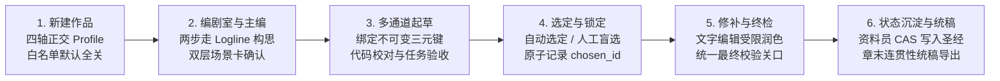
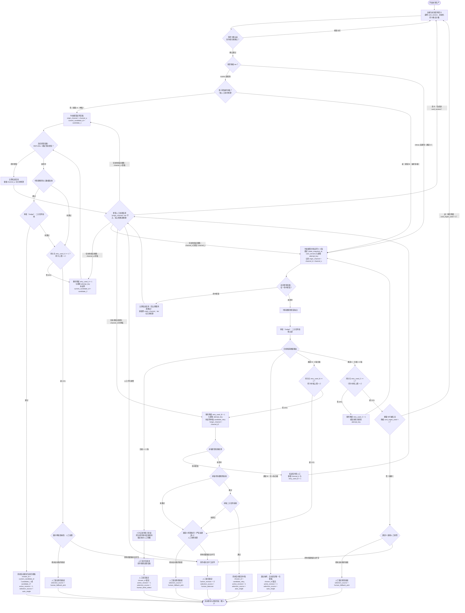
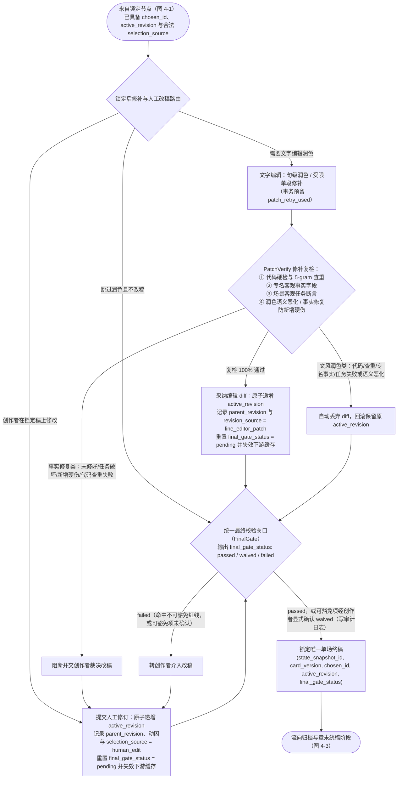
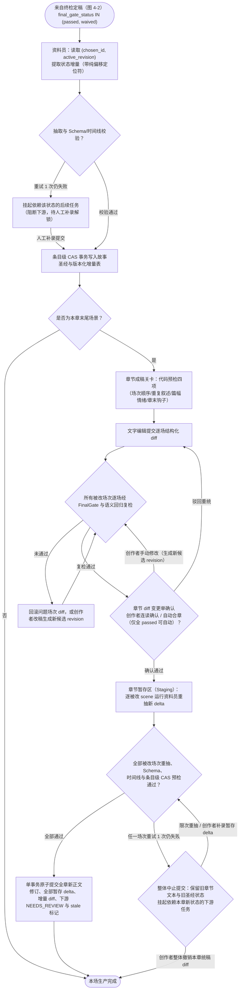
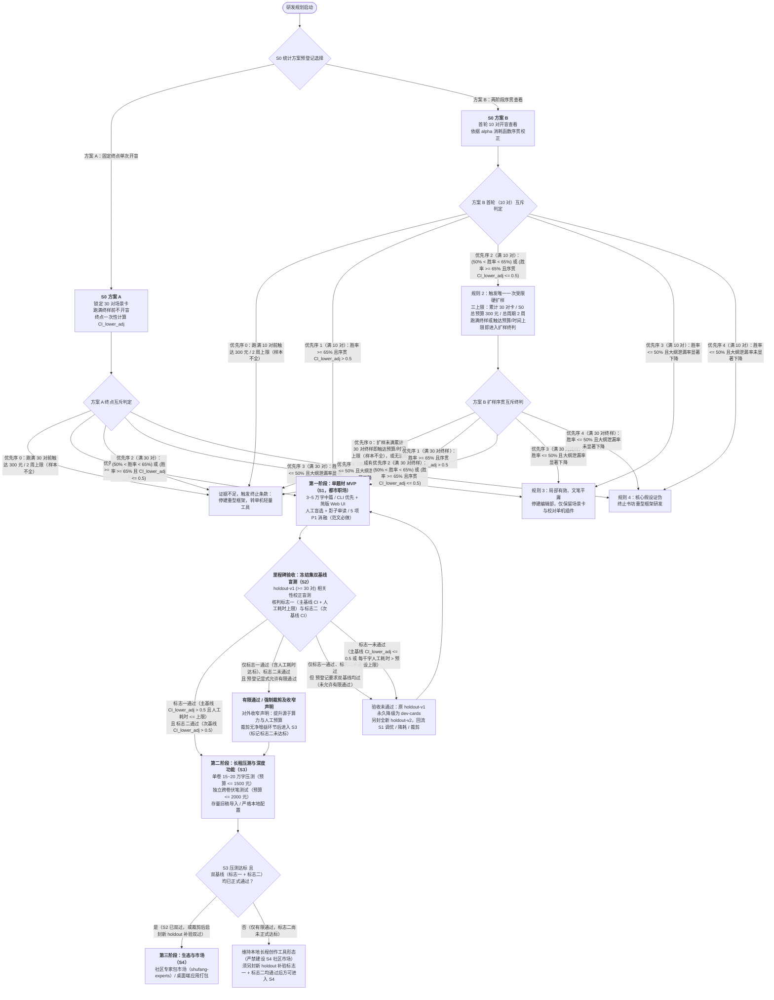

# 书坊（shufang）——中文小说创作 Agent Harness 设计草案

> **文档性质**：早期设计草案，持续讨论，尚未正式定版  
> **日期**：2026-10-25  
> **状态**：方案设计阶段（不动工，仅对齐架构与规范）  
> **阅读说明**：本文中的流程、技术选型与指标属于设计提议，尚未形成应用实现或实验验收结论。历史材料及下述修订记录中的 v1、v2、v2.1 等仅为内部改稿标记，不代表正式文档版本或软件版本；“已拍板”记录当时的讨论选择，仍需在实施前验证。历史材料见 [文档索引](docs/README.md)。  
> **变更来源**：依据编辑部终审签发意见与责任编辑复核清单（`docs/v2签发意见与复核遗留-2026-10-25.md`、`docs/评审报告-2026-10-24.md`）全面修订——将用户主流程前置至卷首，统一定稿“选定与锁定”语义，补全 MVP 必做量化指标与三档工程边界，拆分生产流水线主图，修复通道 B 独立校验流与 S0 双方案分叉，规范四轴正交配置、运行时信任边界与底座精确锁版。  
> **v2.1.1 增量修订**：按签发后复核未决清单直接修复——统一 S0 方案 B 扩样预算耗尽的终止口径（未满预登记终样即耗尽一律终止）；回滚一律追加新修订并以持久化单调分配器取号，杜绝编号重号；补齐六阶段缓存输入指纹、PatchVerify 专名事实出边、章节提交时 CAS、人工兜底锁定保存点、拒答恢复调用代次等一致性条款。  
> **v2.1.2 增量修订**：确定 S2 复验止损框架（最多 2 次复验、预算按首次实测成本 `C` 设定上限、超限即停），具体金额待首次 S2 估算与实测后回填；拍板 S0 采用方案 B（两阶段序贯查看），首发对齐平台为番茄小说。  
> **拟议技术底座（待探针验证）**：[`@earendil-works/pi-durable@1.4.0`](https://github.com/earendil-works)（持久任务图与文档存储）+ [`@earendil-works/pi-ai@1.4.0`](https://pi.dev/models)（统一多模型接入层）

---

## 1. 背景、定位与核心假设

### 1.1 背景与痛点：AI 写作的四类典型“机器味”与待证假设

当前市面上的开源 AI 小说创作工具与智能体框架（Agent Harness，即围绕大语言模型搭建的任务编排与质检流水线），产出的文本往往带有浓重的“机器味”，缺乏真人写作者的语感与戏剧张力。基于早期样本测试，我们归纳出四类典型症状；在 v2.1 方案中，这些成因归结被确立为**有待实测检验的科学假设**，并据此设计针对性的防范与验证机制：

| 症状名称 | 典型现象 | 初步成因假设 | Harness 能否解决 | 验证计划与阶段 |
|---|---|---|---|---|
| **大纲泄漏进对白**<br>*(Outline Leakage)* | 角色直接说出：“第一轮是试探……下一轮是薇薇自己的场。” | 模型将大纲中的场景节拍（Beat）直接塞入角色台词，使人物沦为“剧情报幕员”。 | ✅ **主要可解**：规划与落笔物理隔离；建立双层场景卡契约；代码与审读联合拦截，显著降低泄漏概率。 | S0 四条件消融；S1 开发集消融（P1） |
| **对齐痕迹与软拒答**<br>*(Alignment Artifacts)* | 角色在冲突或暧昧情境下突然跳戏说教（如“我心里有数，不是替你做主”），或激烈交锋被强行淡化。 | 模型在安全对齐训练中形成过度防御机制，遇到特定冲突情境时转向说教或弱化戏剧张力。 | ⚠️ **部分可解**：优选适配模型；以具体行动指令替代道德抽象词；确定性拒答（`REFUSAL` / `DETERMINISTIC_SOFT_REFUSAL`）检出后高优短路挂起并转人工，隐性说教仅打 `semantic_soft_refusal_hint` 提示标签、不硬挂起（见 4.4）。 | S0 抽测闭源模型软拒答发生率（P0） |
| **警句化与电报体**<br>*(Aphoristic Style)* | 通篇短句堆砌：“懒还在，懒底下是准的。”看似深刻，实则空洞。 | 模型固有的伪文学腔，叠加提示词中“去 AI 味、追求语言极简”引发的矫枉过正。 | ⚠️ **部分可解**：注入真人范文锚点；文字编辑句级润色；严格控制套话词表的惩罚力度。 | S1 开发集范文消融（P1，必做） |
| **比喻错位**<br>*(Metaphor Incongruity)* | 程序员或古装角色突然说出：“这就像点评一份迟到的工期。” | 模型跨知识域随意类比，脱离了角色的生活经验与在场身份。 | ⚠️ **部分可解**：场景卡显式限定视角人物（POV）与经验边界；审读模型核查设定一致性。 | S1 审读规则校准（P1） |

### 1.2 项目定位：面向大众主流题材，首期锁定“都市职场”MVP

本项目旨在基于 `@earendil-works/pi-durable` 运行时，打造一个**专注高质量中文小说创作**的 Agent Harness——**书坊（`shufang`）**。

核心定位明确为：**面向大众读者，创作可公开发布的各类主流题材中文小说**。首期 MVP（最小可行产品）主打题材锁定为**“都市职场”**（聚焦单一题材做深做透，不扩展为多题材并行；**首发对齐平台已拍板为番茄小说**，用于对齐章节节奏、导出规范与后续合规核查）。私人敏感题材降级为可选配置项，仅限创作者在纯本地离线环境下自用探索，不再作为系统架构的前提假设。**3~5 万字 MVP 并非番茄小说的典型商业长篇形态，因此 MVP 以工程指标与读者盲测验收为主，不将其直接等同于平台商业验收。**

### 1.3 正向读者体验四要素

没有硬伤并不等于作品好看。书坊引入**正向读者体验四要素**，作为审读评价与人工选稿的核心标尺：
1. **人物声线辨识度**：遮住人名后，读者能否仅凭语气、口头禅与句式特征分辨出说话人。
2. **期待感与伏笔兑现**：单场是否建立起新的悬念，或实质推进了读者关切的真相揭示。
3. **情绪收益**：单场是否提供了清晰的职场爽点、共情张力或认知反差。
4. **情节实质推进**：场景结束时，人物关系或故事局势是否发生了不可逆的实质变化。

### 1.4 核心判断与架构基石

> [!IMPORTANT]
> 1. **文笔上限取决于基础模型，Harness 决定质量下限与长程一致性**：文字的美感与语感主要源于基础模型的文学表现力及范文引导。Harness 的核心职责是构筑防线：**显著降低大纲泄漏进对白的概率、保障长篇逻辑一致、执行多级质量把关、提供人工接管入口、持续沉淀高质量偏好数据**。
> 2. **底座的核心价值在于任务持久化、文档存储与崩溃恢复**：生产环境依赖严格锁定 `@earendil-works/pi-durable@1.4.0` 与 `@earendil-works/pi-ai@1.4.0` 精确版本号。底座提供持久化任务图（DAG 状态机）、结构化文档存储与故障中断恢复能力，确保流水线崩溃重启后可精准续跑。`@shufang/core` 内部封装薄适配层将业务逻辑与底座解耦；若在 S0 技术探针中受阻，框架保留切换至“自研 SQLite 事务任务队列 + 轻量代码 DAG 状态机”的备选方案。
> 3. **先做轻量摸底，再建重型框架**：在投入开发复杂自动化流水线之前，必须先在第 0 步（S0）完成同模型四条件消融实验。若实测表明 Harness 机制相较单提示直出无显著增益，则立即收缩路线，绝不盲目铺开重型工程。
> 4. **LoRA 微调移出关键路径**：风格 LoRA（低秩自适应微调）依赖大规模合法授权语料与高昂清洗成本，且随基础模型版本迭代易发生分布漂移而失效。因此，LoRA 降级为远期探索项；MVP 阶段依靠“模型选型 + 提示词工程 + 范文锚点检索 + 审读修补闭环”保障成稿质感。

---

## 2. 全景导览：一页看懂书坊（用户主流程与核心概念）

### 2.1 端到端用户主流程

从创作者新建一部作品到最终导出章节，书坊的标准创作流转包含以下六个阶段：

#### 图 2-1：端到端创作主流程



1. **新建作品（Project Setup）**：创作者在本地启动书坊，设置作品级四轴配置（内容尺度、数据驻留、端点政策、模型能力）。**数据外发白名单默认全部关闭（Default Deny）**，确保手稿资产默认不离网。
2. **大纲规划与场景卡生成（Planning & Checkpoint）**：编剧室按需协助推演章纲，主编将剧情拆解为**双层场景卡**（主编私有层封存剧透，作者可见层严格限缩为 6 个核心创作字段）。流水线在**场景卡确认站（Card Checkpoint）**暂停，供创作者快速扫视确认。
3. **分道起草与严格质检（Drafting & Screening）**：
   - 常规场（`routine`）：走通道 A 单稿起草，或按人工耗时预算抽样进入多稿起草（通道 B）。
   - 高潮场（`climax`）：走通道 C 并发生成 2~3 版独立候选稿。
   - 候选草稿依次经过**安全拒答高优短路**、**代码确定性硬检**与**审读（Judge）二元语义任务验收**。
4. **候选定稿选定与锁定（Selection & Lock）**：
   - 唯一合格稿：系统自动选定并锁定，标记来源为 `selection_source = "auto_single"`。
   - 多版合格候选：审读评分在影子模式下隔离入库，创作者在乱序盲选界面挑出最佳稿并提交锁定，标记来源为 `selection_source = "human_blind_select"`。
5. **分级修补与统一最终校验（Patch & FinalGate）**：草稿完成锁定后，文字编辑执行受限句段修补。**修补稿与人工接管稿均须重新通过统一最终校验关口（FinalGate，以下简称“统一终检”）**，未通过则回滚或转人工裁决。
6. **状态归档与整章统稿导出（Archiving & Export）**：资料员仅读取经统一终检放行的唯一定稿，提取状态增量并以条目级 CAS（比较并交换）原子写入 SQLite 四层故事圣经。章末触发文字编辑整章连贯性统稿（逐场提交 diff 并复检），最终在导出边界附加合规标识模板，安全导出成稿。

**工程边界说明**：MVP 聚焦“都市职场”单题材，采用 CLI 优先配合简版 Web UI；剧情多分支（`branch_id`）与发布状态 Schema（`draft/published/revised`）在此阶段仅作**结构预留**；跨可见域动态脱敏过滤器、社区专家包市场、独立结构编辑与试读读者角色均归入**后续阶段**。

### 2.2 核心概念与必要术语

- **角色编制（Editorial Staff）**：借鉴出版工坊体制设立的 6 个大模型角色（主编、编剧室、作者、审读、文字编辑、资料员），由**纯确定性代码（调度引擎 `@shufang/core`）**统一编排与限流，大模型绝不充当流程调度器；编制上明确排除美编（封面/插画）与营销（宣发物料）角色。（*注：为避免称谓混淆，下文统一以“创作者”指代使用本系统的人类用户，以“作者模型”或“作者角色”指代承担正文起草职责的 `Writer` 智能体。*）
- **双层场景卡（Scene Card）**：主编下达给作者模型的单场任务书。**主编私有层**封存全书底牌不下发；**作者可见层**核心为 6 个创作字段 + 5 个系统元数据字段（另附可表演约束注记与可选风格锚点），以**收尾画面锚点（Closing Image）**替代抽象大纲结局，显著降低对白“报幕”概率。
- **四层故事圣经（Story Bible）**：本地 SQLite 维护的长篇正史库，主体切分为**正文客观事实层、人工锁定层、人物信念层（封存角色谎言）与读者账本**（另设专收插叙往事的**回溯账本**）；证据引用仅存字符偏移定位符而不内联原文，防止未发表正文借摘要渠道外泄。
- **定稿选定与锁定（Selection & Lock）**：单场草稿晋升为正史定稿的法定状态机动作。无论来自系统自动选定（`auto_single`）还是人工盲选（`human_blind_select`），均原子持久化 `chosen_id` 与修订版本号。**文字编辑修补以草稿锁定为前置条件；资料员归档以草稿锁定且通过统一终检为前置条件**。
- **偏好库（Preference Store）**：本地沉淀创作者个性化审美品味的样本库。**仅收录人工乱序盲选（`human_blind_select`）且具备 $\ge 2$ 版任务合格候选的成对真实对比样本**；自动单稿（`auto_single`）等其他来源一律打标隔离，不得混入偏好校准集。
- **数据外发白名单（Egress Allowlist）**：本地引擎与外部云端之间的安全防火墙。对**未发表正文、范文语料、结构化摘要、遥测日志**四类受控数据实行独立授权，出口网关按字段级标签执行权限并集检查，新建作品默认外发权限全关。

---

## 3. 核心架构决策总览（D1~D13）

下表汇总经多轮评审修订定案的全部 13 项核心架构决策，逐项标明**结论**、**通俗定案理由**、**落地阶段三档切分**与**正文详节跳转**。

| # | 决策点 | 修订后结论 | 为什么这样定（通俗理由） | 落地阶段与详节 |
|---|---|---|---|---|
| **D1** | **核心定位与模型选型** | 定位大众主流题材，首期 MVP 锁定“都市职场”；模型选型凭文学质感与指令遵循实测择优，开源与闭源同台竞技。 | 早期私密题材假设导致架构过度防御；主流大众题材优先追求文学表现力，须凭实测数据择优选型。 | **【MVP 必做】** 都市职场选型与盲测；<br>**【后续阶段】** 私人敏感题材独立验收组。<br>（详见 1.2、7.2） |
| **D2** | **总体架构与专家包定性** | 确定性代码状态机掌舵，精简 6 模型角色；专家包为纯声明式配置，严禁携带可执行代码与端点密钥。 | 大模型充当调度器既慢又不可控；专家包禁带代码与凭证，可从根源杜绝供应链投毒与手稿窃取。 | **【MVP 必做】** 代码状态机编排；<br>**【结构预留】** 最小 Manifest Schema + 1 个内置示例包；<br>**【后续阶段】** 社区专家包市场与分发。<br>（详见 4.1、附录 C） |
| **D3** | **主编可见范围与数据边界** | 主编仅读结构化状态，能否读正文唯一取决于作品数据外发白名单；网关按字段级标签做权限并集检查；会话无状态化（设 Token 上限、关 compaction、禁 session fork）。 | 原“主编必用闭源故不可读正文”在本地部署时不成立；解耦为白名单鉴权更严密，会话无状态化可防大纲泄漏。 | **【MVP 必做】** 白名单判定、作者上下文拼装、主编无状态化与关 compaction；<br>**【后续阶段】** 跨可见域动态脱敏过滤器。<br>（详见 4.1、6.2） |
| **D4** | **场景卡简报协议** | 场景卡物理切分双层；作者可见层限 6 创作字段 + 5 元数据字段；不含动作节拍清单；以收尾画面锚点替代抽象结局；设轻量人工确认站。 | 字段过多会分散模型注意力；将抽象大纲结局告知作者模型易致对白剧透，改用收尾画面锚点可兼顾指引与防泄漏。 | **【MVP 必做】** 双层场景卡、6 创作字段 + 5 元数据、Card Checkpoint；<br>**【结构预留】** `branch_id` 与扩展字段挂载验证；<br>**【后续阶段】** 多题材扩展包。<br>（详见 5.1） |
| **D5** | **质量闭环与影子审读** | MVP 默认人工盲选 + 审读影子模式（评分隔离存储，锁定前不外露）；生产侧固定 2 次正逆序审读取均值；达标后方可放权；每千字人工分钟数列为 S1 一级验收指标。 | 未经校准的审读模型易将位置偏置传导给创作者；在选稿锁定前彻底隔离机器结论，才能沉淀干净可靠的偏好集。 | **【MVP 必做】** 人工全量盲选、影子模式统计、2 次正逆序审读、人工耗时核算；<br>**【后续阶段】** 审读自动放权接管与高分稿抽检。<br>（详见 4.2、4.4） |
| **D6** | **分级返工与失败矩阵** | 分道流水线（单稿/抽样多稿/高潮多稿）唯一计数；安全拒答高优短路；编辑修补与人工接管出口强制回流统一终检；建立六阶段产物缓存。 | 对结构性失控废稿强行微调并无价值；按通道锁定重试上限可严控成本；强制回流统一终检可防劣稿或断链状态污染正史。 | **【MVP 必做】** 分道流水线、两级任务验收、修补与人工出口统一终检、单场六阶段缓存；<br>**【后续阶段】** 复杂多轮交互修补。<br>（详见 4.3、附录 B） |
| **D7** | **风格锚点与版权边界** | 范文设为可选四模式（无范文/风格说明/人工精选/自动检索；禁 AI 范文）；绑定作品级单一声音档案，导入语料须带来源标签并经创作者轻量确认；成稿与范文强制 5-gram（初值）/ LCS 查重拦截；S1 开发集必做范文消融 P1 实验。 | 多数新创作者并无现成范文，强制绑定会阻塞冷启动；输出端硬性查重可从工程层面防范洗稿与雷同风险。 | **【MVP 必做】** 范文可选四模式、声音档案绑定、输出端 5-gram 查重；<br>**【S1 开发集必做】** 范文消融实验（P1）；<br>**【后续阶段】** 外部事实资料包。<br>（详见 5.1、6.4、7.3） |
| **D8** | **长程状态、版本链与检索** | SQLite 四层圣经 + 回溯账本 + 条目 CAS；引用仅存纯偏移定位符；第 $k$ 场改稿局部 diff 传播；FTS5 + 实体表直查补足中文人名。 | 纯定位符防止正文借摘要外泄；回溯改稿仅对局部 diff 标记待复核，不全书重跑；实体表直查可补足中文短词检索。 | **【MVP 必做】** 四层状态表、条目 CAS、只读定性通道、第 $k$ 场局部 diff 与待复核队列、插叙隔离、FTS5 + 实体表检索；<br>**【结构预留】** `branch_id` 与发布状态 Schema；<br>**【后续阶段】** 多分支管理与按卷归档。<br>（详见 5.3、5.5） |
| **D9** | **本地运行与数据出域控制** | 单引擎进程独占 SQLite 存储，外部视图只读；数据外发白名单默认全关，首次配置逐类授权；UI 隐私指示器；本地并发信号量限流（并发=1）。 | 单进程独占可根除文件锁死锁；白名单默认全关保障隐私资产；本地单并发限流可防止显存溢出（OOM）。 | **【MVP 必做】** 单引擎进程拓扑、逐类数据外发白名单、隐私指示器、客户端并发信号量；<br>**【后续阶段】** 离线脱敏增强包。<br>（详见 6.2、6.3） |
| **D10** | **路线图、S0 闸门与两级验收** | S0 互斥有序决策表（方案 A/B 清晰分叉，超限即终止）；S1 单题材 MVP（含 5 项 P1 消融）；S2 冻结集双基线盲测（设产品闭环与架构净增益双标志，收窄能力声明）。 | 防止小样本证据不足时带病开工；严格一次性 holdout 隔离可防调参过拟合；双基线可剥离单纯多采样与人工挑稿红利。 | **【MVP 必做】** S0 探针与决策表、S1 都市职场 MVP、S2 冻结集双基线盲测；<br>**【后续阶段】** S3 长程压测与 S4 社区市场。<br>（详见第 7 节、附录 A） |
| **D11** | **角色编制与职责重划** | 维持精简 6 模型角色 + 代码状态机；校对硬淘汰、审读验任务与影子排序、文字编辑兼章末统稿；资料员依赖阻断。排除美编与营销。 | 流程控制交由代码执行可避免空耗算力；文字编辑兼任统稿无需增设新角色；资料员抽取失败立即挂起下游可防止断链。 | **【MVP 必做】** 6 类核心角色 + 代码状态机 + 章节统稿关卡；<br>**【后续阶段】** 独立结构编辑与试读读者角色。<br>（详见 4.1、4.4） |
| **D12** | **编剧室范围、多样性与成本** | 编剧室仅重大转折唤醒；默认单模型 3 视角角色卡；法定有效提案数 $\ge 2$ 份；单 Key 标非独立提案且不入库；两步走 Logline 构思交互；usage 预算告警。 | 强制要求多服务商 Key 会抬高使用门槛，且跨源多样性属待证假设；两步走交互可大幅节省 Token 开销并减轻阅读负担。 | **【MVP 必做】** 单模型多视角角色卡、两步 Logline 交互、法定数降级与 usage 预算告警；<br>**【后续阶段】** 跨服务商等预算对照实验。<br>（详见 4.1、6.2） |
| **D13** | **模型接入、安全与合规护栏** | 基于 `@earendil-works/pi-ai` 统一配置化接入；安全拒答高优短路挂起；禁止同一文本跨服务商自动重投；记录推理行为契约；Web UI 回环鉴权；导出边界置声明模板。 | 防范连环风控封号与本机恶意跨站请求；记录推理契约以受控追踪分布漂移；合规声明协助创作者履行标识义务。 | **【MVP 必做】** 统一出口网关、拒答短路挂起、推理契约记录、Web UI 本地鉴权、导出合规声明；<br>**【后续阶段】** 专家包社区 CI 准入。<br>（详见 6.2、6.4） |

---

## 4. 角色编制与流水线编排（D2、D3、D5、D6、D11、D12）

### 4.1 角色编制与权限矩阵

系统编制由 1 个调度引擎（纯代码）、1 个确定性校对模块（纯代码）与 6 个大模型角色共同组成：

| 角色名称 | 核心职责 | 推理模型要求 | 数据可见范围与触发契约 |
|---|---|---|---|
| **调度引擎**<br>*(`@shufang/core`)* | 流水线编排、DAG 状态机流转、并发限流、崩溃恢复、六阶段缓存管理与 CAS 事务。 | **纯代码执行，不用 LLM** | 独占底层 SQLite 读写权限。 |
| **主编**<br>*(Director)* | 拆解大纲、生成双层场景卡、主持编剧室研讨。**严禁直接起草正文**。 | 强推理模型（闭源旗舰或开放权重旗舰均可） | 读取结构化大纲与故事圣经；依作品外发白名单决定能否读取上一场末尾 500 字与章节定稿。**调用无状态化（显式设 Token 上限、关闭自动 compaction、严禁使用会话 fork 继承上下文）**。 |
| **编剧室**<br>*(Writer's Room)* | 在立项、分卷、章纲与重大转折处提供多视角 Logline 构思提案。**法定有效提案数默认 $\ge 2$ 份（仅 1 份时创作者可确认继续）；单 Key 模式下界面明确标注“非独立提案”且数据不入校准集；基于 usage 统计设置单次预算上限告警**。 | 默认单模型 + 3 套差异化视角角色卡（可选多服务商） | 仅读高阶大纲与抽象设定；产出两步走构思；数据外发受作品白名单管控。跨服务商等预算对照实验列入【后续阶段】。 |
| **作者**<br>*(Writer)* | 依场景卡起草正文（单稿或并发 2~3 版），强制绑定不可变三元键 `(state_snapshot_id, card_version, candidate_id)`。 | 强文学表现力模型 | 仅读场景卡作者可见层、前文衔接锚点及可选范文切片；**上下文由调度代码按白名单拼装，严禁读取主编私有层与后续大纲**；会话物理隔离。 |
| **校对**<br>*(Proofreader)* | **最高优先级短路识别安全拒答**；执行确定性代码筛查（字数、排版、禁透词字面复现、范文 5-gram 查重、非安全截断）。 | **纯代码执行，不用 LLM** | 只读待检草稿、场景卡确定性元数据与所注入范文切片；分别编码安全拒答挂起信号与常规拦截报告。 |
| **审读**<br>*(Judge)* | ① **二元语义任务验收**（核验收尾画面、核心状态变化、改写式禁透等客观断言）；② **影子质量排序**（2 次正逆序审读取均值）。 | 强指令遵循模型（**必须与作者角色绑定不同模型**） | 独立读取待验草稿与场景卡验收断言；**影子期评分与排序单向写入隔离存储，在人工选稿提交锁定前严禁向创作者或下游展示**。 |
| **文字编辑**<br>*(Line Editor)* | 对已锁定的入选稿执行受限修补；在章末节点承担整章连贯性统稿（逐场提交 diff）。 | 高语感敏感度文学模型 | **前置条件：当前场次已完成草稿锁定（`selection_source` 为 `auto_single`、`human_blind_select`、`human_fallback_pick`、`human_edit` 或 `human_takeover`），绑定 `(chosen_id, active_revision)`**；产出 diff 必经统一终检。 |
| **资料员**<br>*(Archivist)* | 提取状态变更，附带纯偏移定位符证据写入故事圣经。**抽取失败立即挂起依赖该状态的后续任务**。 | 强结构化抽取与 Schema 遵循模型 | **前置条件：仅接收已提交锁定且统一终检状态为放行（`final_gate_status IN ("passed", "waived")`）的当前活跃修订 `(chosen_id, active_revision)`**；调度代码单向只读注入最小定性信息以甄别角色谎言。 |

### 4.2 统一定稿“选定与锁定”语义与契约

#### 4.2.1 初始选定事件、锁定后修订链与 `selection_source` 枚举定义

系统严格区分**不可变初始选定事件（Initial Selection Event）**与**可递增文本修订链（Append-Only Revision Chain）**：
- **初始选定事件（不可变）**：在候选定稿首次锁定前，`chosen_id` 保持为 `NULL`。一旦触发锁定，系统原子持久化实际入选的候选标识 `chosen_id`、初始来源 `initial_selection_source` 与初始修订号 `candidate_revision = 1`（同步设当前活跃指针 `active_revision = 1`）。`chosen_id` 与 `initial_selection_source` 一经写入永不篡改。（*通道 A 状态断言：若首稿 `candidate_1` 验收失败、补稿 `candidate_2` 通过两级验收，系统必须锁定实际合格的 `chosen_id = "candidate_2"`、`candidate_revision = 1`、`selection_source = "auto_single"`，严禁误锁失败首稿。*）
- **锁定后文本修订链（追加递增）**：锁定后对定稿文本的任何实质修改（含文字编辑采纳 diff 或创作者手动改稿/裁决修正），严禁原地覆盖原候选文本，必须在同一 `chosen_id` 下追加生成新修订号 `candidate_revision = max(该 chosen_id 下已有修订号) + 1`（由**持久化单调分配器**发放，**回滚后亦不复用历史编号，严禁以当前 `active_revision + 1` 直接取号**），原子记录 `{ parent_revision, revision_source, text_sha256 }`、更新当前活跃修订指针 `active_revision`，**同时原子清空旧终检结论（重置 `final_gate_status = "pending"`）并使下游阶段缓存立即失效**，强制重新汇入 `FinalGate`。

当前有效来源 `selection_source` 严格限定为以下五种互斥枚举（其中前 1~3、5 项可作为 `initial_selection_source`，第 4 项专用于锁定后的人工文本修订）：

1. `auto_single`：常规单稿通道（通道 A 首稿 `candidate_1` 或补稿 `candidate_2`）或抽样多稿降级（通道 B 初筛仅剩 1 版合格，或通道 B 补单稿合格）经代码校对与语义任务验收双合格后，由系统自动锁定当前实际合格候选的草稿。
2. `human_blind_select`：通道 B 或通道 C 中合格候选 $\ge 2$ 版时，创作者在乱序盲选池中独立挑选并正式提交锁定的候选稿。
3. `human_fallback_pick`：通道 A / B / C 重试预算耗尽或通道 C 熔断后，创作者从已有未达标机器候选池中挑选一版作为修改基底并锁定的草稿。
4. `human_edit`：创作者在已完成锁定的草稿（无论初始来自自动锁定、盲选、未达标基底还是手写稿）上直接手动修改、润色、续写，或在 `PatchVerify` / `FinalGate` 人工裁决环节改稿提交后，衍生新 `active_revision` 并重新锁定的修订稿（保留原 `initial_selection_source` 与 `parent_revision` 供溯源）。
5. `human_takeover`：遭遇模型安全拒答短路挂起，或通道 A / B / C 重试耗尽及通道 C 熔断后，创作者弃用机器候选、完全手动起草并提交锁定的手写定稿。

#### 4.2.2 下游准入与偏好库隔离契约

- **文字编辑准入前置**：必须满足“当前场次已存在完成锁定的有效 `(chosen_id, active_revision)` 与合法的 `selection_source`（含 `auto_single`、`human_blind_select`、`human_fallback_pick`、`human_edit`、`human_takeover`）”。
- **资料员归档准入前置**：必须同时满足“当前场次已提交锁定选择 `(chosen_id, active_revision)`”且“该活跃修订的统一终检状态为放行（`final_gate_status IN ("passed", "waived")`，豁免边界见 4.4 节）”。
- **偏好库（Preference Store）入库隔离铁律**：
  - 仅当 `initial_selection_source = "human_blind_select"` 且当场存在 $\ge 2$ 版任务合格候选时，系统才将派生属性 `is_preference_pair` 标记为 `true`，**且成对校准样本严格锁定在盲选提交当刻的原始候选文本快照（`candidate_revision = 1`）**；
  - 若锁定后经人工修改产生 `selection_source = "human_edit"` 的新修订版本，其修改前后 diff 与动因作为独立修订轨迹关联存储，**严禁将人工改后文本回填覆盖或伪装成原始盲选候选稿**；其余初始来源（`auto_single`、`human_fallback_pick`、`human_takeover`）一律标记 `is_preference_pair = false`，严禁混入偏好校准集。

#### 4.2.3 章节统稿代码预检、暂存重抽与人工确认契约

章末统稿由文字编辑按场输出结构化 diff（生成候选新修订），所有被改场次均须逐场通过统一最终校验关口（FinalGate）及语义回归复检。在触发统稿前，系统强制执行**章节成稿关卡代码预检四项**：
1. 场次物理顺序与剧情连续性校验；
2. 相邻场次间重复叙述句与机械式呼应特征扫描；
3. 全章各场篇幅比例与情绪起伏节奏分布统计；
4. 章末悬念与收尾钩子（Hook）核验。

统稿产出的章节新版本在界面生成“待确认章节 diff 变更单”，并提供 3~5 章多章连读审阅视图，**默认须经创作者审阅并确认提交**；若开启“自动合章”模式，所有被改场次必须全部满足 `final_gate_status == "passed"`（无任何 `waived` 豁免项）且无语义恶化（凡涉及豁免项必须转为创作者手动确认），并永久打上 `consolidation_source = "auto"` 审计标记。

**章节状态暂存重抽与整体原子提交契约**：文本确认通过并不等于整章完成。系统必须先在**章节暂存区（Staging）**对所有被改场次逐场运行资料员重抽新状态增量 $\Delta_s'$，并完成全部被改场次的 Schema、时间线单调性与条目级 CAS 预检；**仅当全部被改场次重抽与预检均成功时，方可在单一数据库事务内整体原子提交全章新正文修订与状态变更；正式提交事务内仍须对每笔状态写入重新执行条目级 CAS 校验（核对预期版本），任一 CAS 失败则整个事务回滚并回到章节阻断/裁决节点——暂存预检不能替代提交时原子 CAS**。若任一被改场次重抽或预检失败（含自动重试 1 次仍失败），系统整体中止本章提交、完整保留统稿前的旧章节正文与旧故事圣经状态，并立即挂起依赖本章新状态的下游任务，直至人工补录暂存状态重验通过或创作者选择整体撤销本章统稿 diff。

### 4.3 单场与整章生产流水线

为提高可读性与工程可维护性，生产流水线拆分为三个职责解耦的流转子图。

#### 图 4-1：单场分道起草与锁定流转图



#### 图 4-2：文字编辑修补与统一最终校验关口（FinalGate）流转图



#### 图 4-3：单场状态归档与章节成稿关卡流转图



### 4.4 质检分工、安全拒答短路与统一最终校验关口

系统建立三层质检加统一终检的分工体系，将确定性代码硬检、客观二元审读与主观审美润色严格解耦：
1. **第一层：安全拒答最高优先级短路与确定性硬检（纯代码）**：
   - **安全拒答统一枚举**：服务商明确拦截编码为 `REFUSAL`（`finish_reason = content_filter`），高置信度文本模板拒答编码为 `DETERMINISTIC_SOFT_REFUSAL`。一旦命中，按最高优先级短路挂起当前任务并转人工处置，**严禁同卡自动补生成，严禁将未经修改的同一文本跨服务商自动重投**。人工若选择切换本地离线端点重跑，系统必须原样保留 `origin_channel`、`tier`、`card_version` 及同卡已用重试预算，严格回流原通道起草节点；**严禁借拒答恢复边将高潮场（`climax`）隐式降级为常规单稿**（若创作者确需降级高潮场，须在界面执行独立的显式降级确认、递增 `card_version` 并记入审计日志）。
   - **常规硬检**：筛查排版格式、字数越界、禁透词字面复现、禁用元话语、范文 5-gram（初值，于专题 C 标定）查重超标，以及非安全截断（`TRUNCATED_OUTPUT`，如 `finish_reason = length`）。常规违规按所在通道限次淘汰并触发补起草。
2. **第二层：二元任务验收与影子质量排序（审读 `Judge` 模型）**：
   - **客观二元任务验收**：核验收尾画面落地、核心状态变化、改写式禁透及人物视角边界。未达成客观任务断言的草稿直接判定不合格，严禁流入多稿盲选池。
   - **影子模式隔离排序**：在多版合格候选场景下，执行 2 次正逆序 Listwise 排序，得分取均值并记录分项维度分。**MVP 影子期内，评分、排序、缺陷摘要及提示标签单向写入隔离存储，在人工选稿提交锁定前严禁向创作者或下游角色展示；本条为影子数据隔离的唯一权威条款，其他章节引用时不得放宽**。
   - **放权条件与放权后交互（D5 落地规则）**：当且仅当双向盲测样本量 $\ge 50$ 对、审读模型与人类盲选结果一致率 $\ge 75\%$，且严重文学与逻辑缺陷漏检率达到预设验收指标后，系统方可逐步放权。放权后界面切换为“展示审读推荐的前 2 名候选 + 差异摘要”，并常态化保留约 $20\%$ 高分定稿供创作者随机抽检；放权后的确定性回退闸门仅由代码校对命中数、被淘汰版本数、审读正逆序交换不一致信号触发，Rubric 绝对分只作记录、不设硬门槛。若检出隐性道德说教倾向，仅打上 `semantic_soft_refusal_hint` 提示标签用于统计提示，不触发系统级硬挂起。
3. **第三层：审美建议与去套话（文字编辑）**：
   - 对“嘴角勾起一丝冷笑”等高频套话仅作高亮提示，严禁将其设为淘汰整稿的硬门槛，谨防矫枉过正。
4. **统一最终校验关口（FinalGate）与三态准入契约**：
   - 一切拟写入正史的当前活跃修订文本 `(chosen_id, active_revision)`，**均须汇流通过统一最终校验关口**，产出确定性状态枚举 `final_gate_status: "passed" | "waived" | "failed"`：
     - **绝对不可豁免红线（命中强制判 `failed`，禁止归档）**：安全拒答（`REFUSAL` / `DETERMINISTIC_SOFT_REFUSAL`）、范文 5-gram / LCS 查重超标、禁透词字面复现、专名与已锁定客观事实硬冲突；
     - **可人工确认豁免项（经确认记为 `waived`）**：字数上下限越界、排版格式告警、经创作者确认语意收束完整的长度截断文本，或创作者有意调整局部叙事重心导致的单场任务断言偏差（须同步标记 `goal_shift` 或更新卡片）；
     - **确认主体、审计与归档准入**：豁免仅限**创作者本人**在界面逐项勾选豁免原因码并填写说明，系统原子写入争议审计日志（生成 `waiver_audit_id`）。下游资料员归档与 `STAGE_EDITED` 完成条件统一接纳 `final_gate_status IN ("passed", "waived")`（“自动合章”无人工在场，仅限全 `passed` 放行）。

### 4.5 六阶段单场产物缓存与重试持久化契约（STAGE 1~6）

系统在 SQLite 中为单场流水线设立六个阶段级保存点，统一界定各阶段的完成判据、哈希输入键与失效重算规则：

| 阶段代码 | 阶段名称 | 对应产物与完成条件 | 阶段输入键集合（用于计算 Hash） | 缓存失效与重算规则 |
|---|---|---|---|---|
| `STAGE_CARD` | 场景卡阶段 | 主编产出的双层场景卡；**完成条件**：通过 Schema 格式校验且经 Card Checkpoint 确认。 | `scene_id`、`outline_version`、`director_template_version`、`ruleset_version` | 上游大纲变更或创作者手动修改卡片内容时失效。 |
| `STAGE_DRAFTS` | 原始起草阶段 | 作者模型起草的各版候选原始文本；**完成条件**：绑定不可变三元键与幂等 `attempt_key`，通过 API 完整性校验。 | `state_snapshot_id`、`card_version`、`origin_channel`、`attempt_index`、`writer_model_fingerprint`、`writer_template_version`、`style_anchor_hash`（含空值）、`context_bridge_hash`、`sampling_params_hash` | `STAGE_CARD` 失效时自动级联失效。 |
| `STAGE_PROOFED` | 代码校对阶段 | 通过确定性代码校对的候选子集；**完成条件**：无安全拒答短路，排版、字数、禁透词字面复现与查重均合格。 | `draft_hash`、`proofreader_ruleset_version`、`injected_corpus_hash`、`card_forbidden_rules_version` | 校对规则集版本升级、当次注入范文或卡片禁透规则变化、输入草稿变更时失效。 |
| `STAGE_JUDGED` | 任务验收与锁定 | 审读验收与初始选定结果；**完成条件**：常规路径须通过审读客观断言验收，并完成人工盲选或自动选定，原子持久化 `chosen_id`、`initial_selection_source` 与 `active_revision = 1`，影子审读数据入库；**人工兜底路径（`human_fallback_pick` 未达标基底、`human_takeover` 手写稿）以创作者提交锁定为完成条件，保存点标记 `human_fallback_lock`，崩溃恢复时不得将其视为任务合格候选，仅视为已锁定的修改基底或手写稿**。 | `proofed_candidates_hash`、`judge_model_fingerprint`、`judge_rubric_version`、`judge_template_version`、`card_acceptance_version`、`chosen_id`、`initial_selection_source` | 审读 Prompt 模板版本升级或卡片验收断言变更时失效。 |
| `STAGE_EDITED` | 修补与终检阶段 | 当前活跃锁定修订 `(chosen_id, active_revision)` 经修补/人工改稿并通过统一终检的单场定稿；**完成条件**：`final_gate_status IN ("passed", "waived")`（若为 `waived` 须具备有效 `waiver_audit_id`）。 | `chosen_id`、`active_revision`、`active_draft_hash`、`selection_source`、`editor_model_fingerprint`、`editor_instruction_version`、`final_gate_ruleset_version`、`final_gate_status`、`waiver_audit_id` | 任何编辑修补或 `human_edit` 递增 `active_revision`、重置 `final_gate_status` 或修补/终检规则变更时立即失效。 |
| `STAGE_ARCHIVED` | 状态归档阶段 | 资料员针对终检放行的 `(chosen_id, active_revision)` 提取并经条目级 CAS 写入故事圣经的状态增量；**完成条件**：Schema 校验、时间线单调性校验通过且条目 CAS 与版本化增量表成功写入。 | `chosen_id`、`active_revision`、`final_prose_hash`、`final_gate_status`、`archivist_model_fingerprint`、`archivist_template_version`、`canon_schema_version` | 定稿 `active_revision` / `final_prose_hash` 变更、资料员模型指纹或抽取 Prompt 调整时失效。 |

> 上表为各阶段**最低必备输入键**；完整输入指纹字段清单（覆盖实际上下文、范文切片、采样参数、模板、规则、模型与状态版本）由专题 A 统一维护，任何实际注入上下文或影响产出的输入变更都必须进入对应阶段指纹，不得仅凭表内示例键放行缓存。

**通道重试与退卡预算持久化及崩溃幂等恢复契约**：
1. **持久化作用域**：所有重试与重写计数器均随任务 checkpoint 持久化至 SQLite 任务状态表，严禁仅驻留内存。其中通道生成重试计数 `retry_used_A`（上限 1）、`retry_used_B`（上限 1）、`retry_used_C`（上限 1 轮）及编辑重写计数 `patch_retry_used` 的作用域均为 **`(scene_id, card_version)`**（同卡跨崩溃重启、跨本地/云端端点切换均严格保持已用计数，仅在新 `card_version` 生成时初始化）；通道 C 退回主编重出卡计数 `card_regen_used`（上限 1 次）的作用域为 **`scene_id`**（跨 `card_version` 累计）。
2. **发起前事务性预留与幂等恢复**：每次触发补起草、补轮或退卡前，调度引擎必须在**发起模型请求之前**，在同一 SQLite 事务内原子递增对应计数器并写入状态为 `in_flight` 的确定性幂等任务记录 `attempt_key = hash(scene_id, card_version, origin_channel, attempt_index, candidate_slot)`。若进程在 `in_flight` 期间崩溃重启，调度引擎凭 `attempt_key` 恢复当次已预留的未完成生成槽位（不再次递增预算，亦不退回 `0` 额外多跑一轮）；若对应候选文本已落盘，重启后直接复用落盘结果进入下游校验，严防崩溃重启突破唯一重试上限。
3. **人工拒答恢复的独立调用代次**：拒答挂起后经创作者授权切换本地端点重跑，属于**人工恢复**而非崩溃恢复，**不得复用原 `attempt_key`**。系统为每次人工授权恢复分配独立 `recovery_generation`，物理调用记录键为 `(attempt_key, recovery_generation)`；**逻辑生成槽位预算沿用已预留计数、不重复消耗同卡补稿预算**，原拒答调用记录永久保留且严禁作为成功缓存复用，同时记录人工授权人与新端点，防止把已完成的拒答结果误当可复用落盘稿。
4. **阶段缓存恢复契约**：进程重启后，调度引擎按拓扑顺序逐级比对输入参数 Hash；仅当输入参数、活跃修订号与规则版本完全一致时，直接从最近有效阶段恢复续跑；一旦上游发生实质变更或 `active_revision` 递增，失效阶段及其全部下游阶段强制重跑。

---

## 5. 关键生产协议、状态分层与改稿传播（D4、D7、D8）

### 5.1 场景卡简报协议

> [!IMPORTANT]
> **场景卡不包含动作顺序或分步节拍清单**。交给作者模型的是在场角色的张力关系与内在动机，而非预设的动作执行清单。此项作为默认设计规则，将在 S1 开发集中通过 P1 消融实验与“动作节拍清单”方案开展对照验证。

场景卡实行主编私有层与作者可见层的物理隔离：
1. **主编私有层（Director Private Layer）——作者模型绝对不可见**：
   - `scene_goal`（本场叙事目的）、`relationship_shift_abstract`（抽象关系转变）、`forbidden_reveals`（禁透清单）、`acceptance_criteria`（客观任务断言）。本层仅供审读与资料员定性使用，严禁下发给作者模型。
2. **作者可见层（Writer Visible Layer）——严格限容**：
   - **五大系统元数据字段**：`pov_character`（视角人物）、`timeline_mode`（`linear` 或 `flashback`）、`story_time_point`（故事内部时间锚点）、`tier`（`routine` 或 `climax`）、`branch_id`（结构预留，MVP 固定为 `main`）。
   - **六大核心创作字段（严格锁定为 6 个）**：
     1. `character_desires`（人物即时欲望）：当下最迫切想要达成的具体诉求。
     2. `scruples`（顾忌）：阻碍人物直接摊牌的顾虑或掣肘。
     3. `information_gaps`（信息差）：在场各方分别知道什么、不知道什么。
     4. `subtexts`（潜台词）：台面寒暄之下的试探与弦外之音。
     5. `speech_habits`（说话习惯）：用词偏好、语气与标志性句式。
     6. `closing_image`（收尾画面锚点）：**用具象动作定格替代抽象大纲结局**（例如：“张经理将茶杯推至桌沿，主角未伸手去接，两人隔着百叶窗斜光对视”），显著降低对白“报幕”概率。
   - **可表演外部约束注记（`behavioral_constraints`）**：将抽象禁令转化为角色可表演的回避反应（例如：“当被追问去向时，低头擦拭镜片借故岔开，绝不正面回答”）。
   - **风格锚点（`style_anchor`，可选）**：检索注入 1~2 段真人优秀范文切片，无匹配则留空，**严禁注入 AI 合成范文**。

### 5.2 数据资产与存储总表

书坊统一纳管六类核心数据资产，出口网关按字段级数据标签执行权限并集检查：

| 数据类别 | 核心内容 | 存储载体 | 责任角色 | 字段级外发白名单分类与并集规则 |
|---|---|---|---|---|
| **故事圣经** | 客观事实层、人工锁定层、人物信念层、读者账本与回溯账本 | SQLite 关系表 | 资料员（提取）+ 创作者（人工锁定） | 结构字段与纯定位符属 `结构化摘要`；**通过定位符反查正文原文须重验 `未发表正文` 权限** |
| **分层摘要** | 场景卡摘要、章节摘要、分卷大纲摘要 | SQLite 文档表 | 资料员 + 文字编辑 | `结构化摘要`（Structured Summaries） |
| **节拍大纲** | 主线大纲树、卷章规划、场景标签与结构节奏 | SQLite 树状表 | 主编 + 编剧室 | `结构化摘要`（Structured Summaries） |
| **范文语料库** | 参考文本切片、声音档案与角色声音约束卡 | SQLite 语料表 | 创作者自行导入与维护 | 范文切片属 `范文语料`；抽象声音约束属 `结构化摘要`（混装取并集） |
| **偏好库** | 场景上下文快照、全部候选草稿、采纳 ID 与模型指纹 | SQLite 偏好表 | 系统沉淀 + 人工盲选 | **复合记录取权限并集**：草稿属 `未发表正文`，范文属 `范文语料`，卡片属 `结构化摘要`（须全获授或剥离） |
| **全文索引** | 正文 FTS5 虚拟表 + 实体别名映射表 | SQLite FTS5 表 | 调度引擎自动维护 | FTS5 倒排词项与正文属 `未发表正文`；纯实体 ID 与偏移属 `结构化摘要` |

### 5.3 四层故事圣经架构与条目级 CAS（含纯偏移定位符）

故事圣经采用四层主体加回溯账本的物理隔离架构：
1. **正文客观事实层（Canon Facts）**：主线正文中真实发生并经核验的客观事实。
2. **人工锁定层（Human Canon Override）**：创作者锁定的最高优先级设定，任何模型无权自动覆盖。
3. **人物信念层（Character Beliefs）**：记录各角色的主观认知。**角色的谎言被严格封存在此，不混入客观事实层**。
4. **读者账本（Reader Ledger）**：追踪读者已知边界与伏笔承诺状态（`pending` / `fulfilled` / `abandoned`）。
5. **回溯账本（Backstory Ledger）**：插叙场景（`timeline_mode: flashback`）披露的往事专收于此，**严禁改写客观事实层的当前值**。

**条目级 CAS、版本化增量表与纯偏移定位符**：每次状态提交必须携带版本溯源 `{ sceneId, quoteSpan, factType, oldValue, version }`，并按 `(scene_id, chosen_id, active_revision)` 在版本化状态增量表（`scene_state_deltas`）中不可变地留存本修订对客观事实层、人物信念层、读者账本与回溯账本的完整贡献快照。其中 `quoteSpan` **严格定义为不含原文的纯偏移定位符** `{ sceneId, candidateId, draftRevision, startOffset, endOffset, spanSha256 }`，反查原文须重新通过出口网关的正文权限校验。写库采用原子 CAS：
```sql
UPDATE canon_facts 
SET current_value = :new_value, version = version + 1, last_scene_id = :scene_id
WHERE fact_id = :fact_id AND version = :expected_version;
```
若版本失配则拒绝写入，并在界面弹出冲突解决卡片。在创作者手动编辑故事圣经期间，依赖该实体的后台任务自动冻结。

### 5.4 资料员只读定性通道

调度引擎在唤醒资料员时，通过**单向只读通道**注入主编私有层定性信息（剧情禁透与核心任务断言）。资料员据此准确识破角色谎言，将虚假言论归入人物信念层（`Character Beliefs`），将模糊陈述归入 `unqualified_statements`（交人工待决队列）。定性通道严格单向隔离，定性措辞绝不回写至作者模型的可见上下文。

### 5.5 第 $k$ 场改稿传播、待复核队列与跨状态层回滚事务

当回溯修改前文第 $k$ 场正文（含整章统稿 diff 引起的修改）时，严禁自动顺次重抽并覆写下游各场正文，统一采用局部增量对比与依赖标记传播：
1. **局部增量对比**：仅对发生变更的第 $k$ 场新定稿运行资料员抽取新增量 $\Delta_k'$，比对原增量 $\Delta_k$，找出发生变动的具体实体属性。
2. **推入待复核队列**：在下游场次中，显式引用上述变动字段的故事圣经条目被标记为 `NEEDS_REVIEW`，并在界面侧边栏亮起黄色冲突提示。
3. **人工锁定层一致性契约**：人工锁定值不可被自动覆盖；但当上游事实变动与其前提冲突时，**系统必须同样将该人工锁定条目设置为 `NEEDS_REVIEW = true` 并推入待复核队列**，提示创作者确认“维持锁定”或“修正设定”。
4. **派生数据惰性失效**：受影响场景的分层摘要与全文索引打上 `stale` 标记，后续任务实际读取时再按需后台重算。
5. **跨状态层按场回滚事务契约（Scene-Level Rollback Contract）**：当第 $k$ 场定稿需从当前活跃修订 $r_{\text{cur}}$ 回滚至目标历史修订 $r_{\text{target}}$（存在 2 个及以上历史修订时同样适用）时，先按 `(scene_id = k, revision = r_target)` 定位目标增量快照 $\Delta_{k, r_{\text{target}}}$（若历史版本未存增量快照，先在事务外对 $r_{\text{target}}$ 文本完成重抽与校验暂存），随后在单一数据库事务内执行版本化联动回滚：
   - ① **文本与修订指针层**：**一律追加生成指向目标历史文本快照的新活跃修订**（按 4.2.1 的持久化单调分配器取 `max(该 chosen_id 已有修订号) + 1`，**不得直接切换 `active_revision` 回历史编号**），原子记录 `rollback_target_revision = r_target`、`parent_revision = r_cur` 与 `revision_source = "rollback"`；新修订必须按**当前**卡片、状态与规则版本重新汇入 `FinalGate` 及状态校验（历史修订曾通过终检不能替代当前有效终检），同步重置 `final_gate_status = "pending"` 并失效旧放行结论与相关缓存；同时定位待撤销的当前贡献 $\Delta_{k, r_{\text{cur}}}$ 与待恢复的目标贡献 $\Delta_{k, r_{\text{target}}}$；
   - ② **四层主体与双账本重算（全覆盖）**：覆盖**正文客观事实层（`Canon Facts`）、人物信念层（`Character Beliefs`）、读者账本（`Reader Ledger`）与回溯账本（`Backstory Ledger`）**，逐条目执行“撤销 $\Delta_{k, r_{\text{cur}}}$ 贡献并重放/恢复 $\Delta_{k, r_{\text{target}}}$ 贡献”的目标值计算（绝非简单退回 $r_{\text{cur}}$ 的前序旧值，确保多版修订回滚后状态与 $r_{\text{target}}$ 正文严格匹配）；
   - ③ **人工锁定保护与条目级 CAS 冲突裁决（严禁暴力覆盖下游）**：对**人工锁定层（`Human Canon Override`）**条目严禁自动覆写，统一标记 `NEEDS_REVIEW = true` 并入待复核队列；对上述四类状态表的每笔回写均强制执行**条目级 CAS 校验**（核对 `last_scene_id == k` 且 `version == expected_version`）——若某属性已被下游场次（$> k$）或并发操作后续改写（`last_scene_id != k` 或版本失配），**严禁直接覆盖为第 $k$ 场的历史值**，系统保留下游当前值、将该条目及下游引用标记为 `NEEDS_REVIEW = true` 并生成冲突裁决单交创作者确认；
   - ④ **派生数据惰性失效**：第 $k$ 场及显式引用变动属性的下游场次的分层摘要、全文索引（FTS5 与实体偏移）统一打上 `stale` 标记，受影响下游条目推入 `NEEDS_REVIEW` 待复核队列；
   - ⑤ **阶段缓存清除**：失效第 $k$ 场原版本 $r_{\text{cur}}$ 的归档缓存及受影响下游场次依赖旧状态快照的全部阶段缓存（`STAGE 1~6`）。

### 5.6 中文兜底检索：FTS5 + 实体别名表 / LIKE 路径

为确保本地无向量环境下的精准检索，系统建立双轨检索机制：
- **专名实体直查**：已在故事圣经注册的人物、地点、道具实体，其正文出场位置由实体别名映射表索引直达。
- **自由短词自动兜底**：未注册的两字中文短词自由检索，查询器自动回退至参数化 SQL `LIKE '%关键词%'` 或挂载 `jieba` 分词扩展，确保两字人名（如“薇薇”）稳定召回。

### 5.7 偏好库 Schema 与偏好校准（严格隔离 `selection_source` 与修订链）

偏好库用于沉淀创作者个性化审美品味并校准审读模型：
- **不可变快照**：完整记录 `{ preference_id, scene_id, card_version, timestamp }` 及当次上下文快照。
- **全量原始候选留存**：不可变保存盲选当刻的全部原始机器候选文本（`candidate_drafts: [{ draft_id, revision: 1, prose_text, eliminated_by }]`）。
- **初始选定与锁定后修订隔离**：分别记录不可变的 `chosen_id`、`initial_selection_source` 与当前活跃修订的 `(active_revision, selection_source)`。**仅当 `initial_selection_source = "human_blind_select"` 且具备 $\ge 2$ 版任务合格候选时，派生属性 `is_preference_pair` 记为 `true`，且参与偏好校准的正负样本严格绑定 `candidate_revision = 1` 的原始候选快照；后续经 `human_edit` 产生的修订文本及父版本关系（`parent_revision`）独立存入关联修订轨迹表，严禁回填覆盖或伪装成原始盲选候选稿；其余初始来源一律标记 `is_preference_pair = false`，禁止混入偏好校准集**。
- **修改动因三分类**：创作者在锁定稿上手动改稿（触发 `selection_source = "human_edit"` 并递增 `active_revision`）时勾选：`stylistic_polish`（文风润色）、`fact_continuity_fix`（事实修复）、`goal_shift`（目标变更，另存修订轨迹，不混入文风偏好集）。
- **模型指纹分桶**：绑定 `{ endpoint, modelId, modelBuild, promptTemplateVersion }`，仅在同指纹桶内比对，防止模型静默升级引发分布漂移。
- **双独立授权与级联删除**：“本地记录”与“训练授权”设独立开关；删除作品或章节时同步级联清除偏好库关联草稿。

---

## 6. 安全架构、数据白名单与合规护栏（D1、D3、D7、D9、D13）

### 6.1 四轴正交配置模型与严格本地配置

书坊确立作品级四轴正交配置模型：
1. **内容尺度（Content Rating）**：
   - `general`：面向大众读者的主流题材（MVP 主打“都市职场”），评测集与示例均完全公开。
   - `mature`：私人探索题材，仅限创作者在本地设备自用，官方开源仓库严禁收录任何相关样本。
2. **数据驻留（Data Residency）**：
   - `strict_local`：严格本地驻留。所有数据、模型推理与运行状态均不离开本机网络，强制限定端点政策只能选 `local_runner`。
   - `cloud_assisted`：云端辅助模式。允许经显式授权的数据类别通过安全 API 发往云端端点。
3. **端点政策（Endpoint Policy）**：
   - `local_runner`：本地推理引擎（如 Ollama、vLLM、llama.cpp）。
   - `cloud_no_train`：服务条款明确承诺不将 API 输入输出数据用于模型训练的商业云端服务商。
   - `cloud_standard`：适用标准商业条款的常规云端端点，外发范围由白名单严格管控。
   - **条款核对与提示**：每个端点配置包含 `termsReviewed: "reviewed" | "unknown"` 属性，**标记为 `unknown` 的端点不可默认启用**；界面同步展示服务商账号的地域合规与年龄核对提示。
4. **模型能力（Model Capability Tier）**：
   - `flagship_reasoning`：强推理模型（适用于主编规划、编剧室等）。
   - `creative_writer`：强创作表现力模型（适用于正文起草与文学润色）。
   - `fast_utility`：轻量高性价比模型（适用于结构化抽取与辅助校验）。

**严格本地配置组合（Strict-Local Profile）**：  
当创作者进行私人敏感创作或要求 100% 离线运行时，系统约束为：`Data Residency = strict_local` $\implies$ `Endpoint Policy = local_runner`。**模型能力档位（Model Capability Tier）不与数据驻留绑定，由创作者按角色自由配置（如主编选 `flagship_reasoning`、作者选 `creative_writer`、资料员选 `fast_utility`）**。

### 6.2 字段级统一出口网关与数据外发白名单

> [!CAUTION]
> **新建作品默认规则**：无论内容尺度如何设置，**新建作品的数据外发权限一律默认全部关闭（Default Deny）**。手稿与私有范文是创作者的核心资产，绝不自动联网上传。

- **受控数据四分类**：未发表正文（Unpublished Prose）、范文语料（Style Corpus）、结构化摘要（Structured Summaries）、遥测日志（Telemetry Logs）。
- **字段级标签与权限并集**：复合快照按子字段分别打标，网关执行**所需权限并集检查（Union of Permissions）**。授予摘要权限绝不传递至正文或范文；故事圣经纯偏移定位符反查正文原文必须重验“未发表正文”外发权限。
- **首次配置逐类显式授权卡片**：首次为任意角色绑定云端端点时，系统弹出显式授权卡片，由创作者逐类勾选允许外发的数据范围。
- **UI 顶部隐私状态指示器（Privacy Badge）**：常驻展示当前作品状态：🟢 `Strict Local`（严格本地模式：全角色绑定本地端点，零数据离网）与 🟡 `Cloud Assisted`（云端辅助模式：清晰列出当前调用云端的角色清单及已授权外发的数据类别）。
- **主编正文访问判定**：与模型是否开源解耦——绑定**本地端点**时数据不出本机，按本地角色权限配置放行，不涉及云端外发授权；绑定**云端端点**时，能否读取上一场末尾 500 字与章节定稿**唯一取决于该端点是否列入“未发表正文”外发白名单**（默认关闭，须逐类显式授权）。

### 6.3 运行安全、指令注入防护与底座锁版

1. **单引擎进程独占架构**：本地 Web UI 与 CLI 均为轻量客户端，通过本地 IPC 或回环 REST API 与后台唯一引擎进程通信。导出的 Markdown/YAML 仅作只读视图，严禁外部编辑器并发读写底层 SQLite 库文件。系统单用户运行，不设中心化云端账号体系。
2. **并发信号量限流**：针对本地推理（Ollama / vLLM），客户端适配层内置信号量（默认 `maxConcurrency: 1`），多稿起草自动串行排队，消除 GPU 显存溢出（OOM）崩溃风险。所有出口请求显式设置 `identity.attribution` 标识。
3. **Web UI 本地回环绑定与鉴权**：本地服务默认仅监听 `127.0.0.1`，**强制启用一次性会话 Token 或口令鉴权**，阻断跨站请求伪造与重绑定攻击（CSRF / DNS Rebinding）。API Key 加密存储于本地后端，严禁下发前端。
4. **运行时信任边界与指令注入防护**：用户导入的本地范文、历史草稿、外部资料及专家包扩展字段一律视为**非可信参考数据（Untrusted Reference Data）**，严格置于数据隔离域内，严禁拼入系统级特权指令；作者与审读角色剥离文件系统写入及外部网络访问工具权限；状态更新仅经受限接口提交，自动化测试套件内置伪指令注入与矛盾资料投毒回归用例。
5. **三类日志分级管理与诊断包脱敏**：运行恢复日志、争议审计日志与偏好训练日志分设访问权限与留存周期；导出的故障诊断包默认自动剥离全部正文、范文切片与 API 密钥。
6. **底座精确锁版与解耦**：严格锁定依赖版本 `@earendil-works/pi-durable@1.4.0` 与 `@earendil-works/pi-ai@1.4.0`，通过 `@shufang/core` 薄适配层隔离；底层基于标准 SQLite 关系表存储，保障数据自由迁移。

### 6.4 发布合规、版权查重与开源红线

1. **AIGC 内容标识与平台指引**：导出边界默认附带中性可编辑声明模板：“本作品相关章节由创作者借助 AI 工具辅助构思或起草，并经创作者审校、修改与定稿确认。”系统提供**由用户自主填写或导入的目标平台合规核对清单，以及指向各平台官方声明入口的操作指引**。明确声明：**系统不代为维护商业平台不公开的黑盒审核词库，自本系统导出成稿不代表已完成目标发布平台的法定标识义务或签约合规审核**；严禁开发任何规避监管水印的功能。
2. **范文合规三条件与输出端查重**：范文默认仅限本地使用；云端外发须同时满足**来源许可合法**、**创作者显式授权**、**端点条款合规**三项条件，并严格区分保密 API 外发与公开分发。在代码校对层强制计算成稿与所注入范文切片的 **5-gram 重合率（初值，于专题 C 标定）与最长公共子串（LCS）**，超标即标红拦截（该检查仅作工程侧风险预警，不构成法律意义上的无侵权证明）。
3. **开源内容红线全覆盖**：`shufang` 主仓、测试集（`@shufang/bench`）、**`shufang-experts` 社区专家包注册索引仓、项目 README、Release 发行物附件及一切公开展示面**，对成人、露骨或违法违规文本实行零容忍。在冻结集双基线盲测（标志一与标志二同时达标——无论在首次 S2 达成，还是经“有限通过”裁剪管线后启封全新 `holdout` 补测达成）正式通过前，严禁启动第三阶段（S4）`shufang-experts` 社区专家包市场建设。
4. **自定义违禁词表挂载口**：开放用户自定义词表挂载能力，仅作风险高亮与改写建议；**系统不承诺修改后平台绝对过审，且绝不强制剥夺创作者在本地导出原始手稿的支配权利**。

---

## 7. 路线图与演进规划（D1、D7、D10）

### 7.1 演进路线图

#### 图 7-1：研发演进与里程碑决策路线图



### 7.2 第 0 步：摸底探针与底座 Spike（S0，预计 1~2 周）

- **核心目标**：以最小代价验证多角色框架是否具备显著增益，严格收敛于 **4 项 P0 任务**：
  1. 同模型四条件消融实验（都市职场场景卡：首轮 10 对；方案 A 终样 30 对，方案 B 首轮 10 对、累计上限 30 对；四条件为单提示直出 vs 仅场景卡 vs 场景卡 + 范文 vs 完整闭环）；
  2. 底座技术 Spike（本地模型接入、崩溃恢复、人工审批闸门、FTS5 + 实体别名表检索；受阻则立即切换自研 SQLite 事务队列备选方案）；
  3. 成本与耗时基线测算（核算单场每千字成稿的实际成本与耗时）；
  4. 闭源模型软拒答发生率抽测。
- **方案 A 与方案 B 规则**：**本项目 S0 已拍板采用方案 B**：两阶段序贯查看（首轮 10 对开盲，仅命中优先序 2 时触发唯一一次扩样，依据 $\alpha$ 消耗函数做序贯校正）；方案 A 仅作为协议备选保留。方案 A 为固定终点单次开盲（锁定 30 对终样，中途不开盲）。**若因触达 S0 总预算（$\le 300$ 元）或总周期（$\le 2$ 周）上限导致样本不全或无法形成有效统计结果，一律按优先序 0 判定为证据不足、触发终止条款，严禁进入 S1**。（详见附录 A.3、A.4）

### 7.3 第一阶段：单题材 MVP（S1，都市职场 3~5 万字中篇）

- **交付清单**：`@shufang/core` 核心引擎（CLI 优先 + 简版 Web UI，**默认单 Key 配置即可运行，支持 TXT 手稿导入与简单切片**，完整逆向建档属 S3）；双层场景卡与 Card Checkpoint；分道流水线；人工盲选 + 影子审读；文字编辑局部修补与章末统稿；四层故事圣经 SQLite 持久化；1 个官方都市职场纯声明式专家包（仅验契约，不参评）；剧情分支与发布状态仅作结构预留。
- **一级验收指标**：将**“每千字成稿的人工分钟数”**（由创作者在 S1 启动前设定上限，建议 $\le 15$ 分钟/千字）列为 S1 一级验收指标。
- **开发集 P1 消融实验**：在 S1 开发集（`dev-cards`）上**必须完成全部 5 项 P1 消融实验**（范文锚点消融必做、可表演外部约束注记消融、收尾画面锚点（Closing Image）防泄漏测试、动作节拍清单对照、主编出卡质量盲评）。

### 7.4 里程碑验收：冻结集双基线盲测（S2）

- **验收环境**：启封一次性加密保存的当前版本冻结场景卡（`holdout-v1`，至少 30 对），招募至少 3 名目标题材真人读者参与盲测，并在跑数前完成预登记（包含是否允许“有限通过”模式及每千字人工耗时上限）。
- **双基线分别核判与结论标志**：
  - **标志一【产品闭环验收通过】**：相对主基线（单提示直出）经相关性校正的 $CI_{\text{lower,adj}} > 0.5$，**且每千字成稿人工介入耗时不超出预登记上限**（两项缺一不可；任一不达标即判定标志一未通过）。**能力声明边界：S2 验收通过仅证明短篇/中篇连续性与人机闭环成立，严禁夸大未经验证的超长篇连载能力**。
  - **标志二【架构净增益成立】**：相对等总预算次基线（拉齐全链路 Token/费用包络与人工选优耗时上限的 Best-of-$K$ 对照）满足 $CI_{\text{lower,adj}} > 0.5$（证明多 Agent 框架显著优于简单多采样与人工挑稿）。
- **S3 与 S4 准入及互斥路由规则**：
  1. **全面通过（标志一与标志二均通过）**：按标准路径进入 S3，并在完成 S3 长程压测后具备进入 S4 的准入资格；
  2. **有限通过（仅标志一通过、标志二未显著胜出，且预登记显式允许有限通过）**：走**“有限通过 / 强制裁剪及收窄声明”**分支——对外声明质量提升主要源于算力与人工预算，强制剔除经消融实验证实无净增益的管线环节后进入 S3 验证长程稳定性；**但在此状态下严禁启动 S4 社区专家包市场建设**（若后续希望进入 S4，必须在裁剪调优后另封全新 `holdout` 补测，直至标志一与标志二同时正式达标）；
  3. **预登记要求双过但标志二未通过**：若预登记要求双基线必须同时过门而实际仅标志一通过，直接按验收未通过处理，原 `holdout-v1` 永久退役并入 `dev-cards`，另封全新 `holdout-v2` 回流 S1 调优复验；
  4. **标志一未通过（含耗时超限）**：凡主基线 $CI_{\text{lower,adj}} \le 0.5$ **或**每千字成稿人工耗时超出预设上限，一律判定验收失败，原 `holdout-v1` 永久降级并入 `dev-cards`，另封全新 `holdout-v2` 并回流 S1 迭代。

### 7.5 第二阶段：长程压测与深度功能（S3）

- **单卷长程压测（15~20 万字）**：检验单卷内长程一致性、人物弧光连续性与卷内伏笔回收（**费用上限 $\le 1500$ 元，周期 $\le 4$ 周**）。
- **独立跨卷验证测试**：专门构建多卷场景卡集，检验跨卷伏笔回收率与万级条目故事圣经 CAS 检索性能（**费用上限 $\le 2000$ 元，周期 $\le 4$ 周**）。
- 研发存量手稿逆向建档工具（Brownfield Ingestion），支持导入旧稿以逆向抽取圣经条目与本地专属范文库。
- 落地完整的严格本地配置组合（Strict-Local Profile），提供纯离线安全创作闭环。
- 按需引入独立的结构编辑（章卷节奏诊断）与试读读者角色。

### 7.6 第三阶段：生态与市场（S4）

- **前置准入门槛**：必须同时满足“完成 S3 长程压测”且“已在一次性冻结集上正式通过标志一（含人工耗时上限）与标志二（双基线净增益）”。仅获 S2“有限通过”且未完成新冻结集标志二补验前，严禁开启社区市场建设。
- 开放 `shufang-experts` 社区专家包注册索引仓及自动化安全准入流水线。
- 封装跨平台独立桌面端应用（基于 Electron 或 Tauri）。

---

## 8. 实施指南与研发任务

### 8.1 六大研发专题实施指南（标明依赖拓扑）

> [!IMPORTANT]
> **专题执行依赖顺序**：必须**先完成【专题 E：评测协议】与【专题 F：内容策略与网关】（底座基础设施），再并行推进【专题 A：场景卡协议】、【专题 B：故事圣经】、【专题 C：校对审读】与【专题 D：专家包规范】（先 E/F，后 A~D）**。

- [x] **项目定名**：正式定名为 **书坊（`shufang`）**。
- [x] **模型接入架构**：基于 `@earendil-works/pi-ai` 统一抽象层，支持按作品配置文件声明式挂载。
- [ ] **专题 E：评测协议与消融实验工程规范**（前置底座）
  - 实现 S0 方案 A（固定终点）与方案 B（序贯查看）决策脚本；实现等总预算次基线对齐包络；开发多读者聚合、多作品整群自助重采样（Cluster Bootstrap）/ GLMM 及单作品移动分块自助法工具；建立版本化 `holdout` 启封与单向降级规程。
- [ ] **专题 F：内容策略 Profile 与数据出域白名单实现**（前置底座）
  - 定义作品级四轴配置序列化格式；实现本地统一出口网关、复合对象字段级标签与权限并集拦截器（含纯定位符反查正文二次鉴权）；开发 Web UI 隐私状态指示器与本地会话 Token 鉴权中间件。
- [ ] **专题 A：双层场景卡协议（Scene Card Schema）与正反例设计**
  - 输出完备 JSON Schema；编写将抽象大纲转化为可表演动作的 5 组都市职场正反例；固化 6 创作字段 + 5 元数据字段边界；设计六阶段产物缓存 Hash 规则。
- [ ] **专题 B：故事圣经四层存储、CAS 并发控制与改稿传播契约**
  - 编写 SQLite 建表 DDL（准入强制绑定已锁定定稿，证据引用为纯偏移定位符）；细化条目级 CAS 原子更新与资料员失败依赖阻断协议；实现第 $k$ 场改稿局部增量 diff、下游 `NEEDS_REVIEW` 依赖追踪算法与跨状态层按场回滚事务；落实插叙隔离写入回溯账本；内置被淘汰稿零残留污染回归测试。
- [ ] **专题 C：三层校对审读机制、中文规则基线与分级返工护栏**
  - 编制确定性代码校对规则集（最高优先级短路 `REFUSAL` / `DETERMINISTIC_SOFT_REFUSAL`），**上线前以人工标注的中文违规/正常样本集测定误杀率与漏检率，达标后方可启用硬淘汰**；标定范文 5-gram（初值）查重阈值；拆分代码硬检与审读二元任务验收，实现 2 次正逆序影子审读隔离存储；固化通道 B 独立补单稿校验流与 `PatchVerify` 完备失败出边。
- [ ] **专题 D：纯声明式专家包 Manifest 与示范资产许可规范**
  - 冻结 Manifest 2.0 规范（含 `localReferenceConfig` 最小结构与本地空库回退契约）；搭建官方内置都市职场专家包标准目录；制定示范资产开源许可核验清单。

### 8.2 终审留存待确认事项（创作者确认清单）

1. **首发平台与 S0 统计方案（已拍板）**：首发对齐平台确定为**番茄小说**；S0 采用**方案 B（两阶段序贯查看）**，预登记首轮 10 对、扩样累计上限 30 对、总预算 $\le 300$ 元、总周期 $\le 2$ 周。番茄小说现行作家协议、AI 辅助创作申报及签约条款仍须按第 6 项核查；S0 跑数前须冻结场景卡集、$\alpha$ 消耗函数与统计分析代码版本。
2. **S1 每千字成稿人工耗时上限与 `routine` 抽样比例**：设定人工干预耗时护栏（建议初值 $\le 15$ 分钟/千字），直接决定影子期常规场的抽样比例。
3. **Card Checkpoint 默认策略**：S1 默认每场必停（创作者扫视约 10 秒），实操后决定是否放宽为仅高潮场暂停。
4. **存量手稿逆向建档抽取细则**：排入 S3，细化如何从旧稿中分章抽取初始故事圣经条目与范文切片。
5. **S2 外部读者招募细则**：在 S1 尾声招募 3~5 名喜爱都市职场题材的大众读者，约定单人盲读总时长 $\le 1$ 小时。
6. **目标小说平台商业条款与 AIGC 细则追踪**：由创作者查阅目标平台最新作家专区公告与签约合同范本，核实 AI 辅助创作的申报要求、全勤奖资格及版权归属条款，填入第 6.4 节平台合规核对清单。
7. **S2 复验预算与最大换集轮次（止损框架已定，金额待实测回填）**：最多复验 **2 次**，即 `holdout-v1` 首验加 `holdout-v2`、`holdout-v3`，总计最多 3 套冻结集；第 2 次复验仍未通过即停止重型框架路线，回到 S0 或收缩为轻量工具。设首次 S2 的单次验收成本为 `C`（按 30 对卡 × 双基线 × 全链路生成与审读，加盲读组织成本估算，并在首次 S2 后按实测修订）：每次复验费用上限为 `C`，累计复验费用上限为 `2C`；每次复验周期不超过 1 周，累计不超过 2 周。**任一预算或轮次用尽即停止，禁止因“接近通过”临时追加**。首次 S2 预登记时完成 `C` 的估算并写入验收记录。

---

## 附录 A：评测统计检验方案与 S0 预登记决策协议（专题 E 深度细则）

### A.1 双基线评测原则与等总预算拉齐

评估 Harness 有效性必须在跑数前完成预登记，并同步执行双基线对照：
1. **主基线（Primary Baseline）**：相同基础模型、等价故事大纲，凭单一通用提示词直接生成正文（单提示直出）。
2. **次基线（Secondary Baseline，等总预算对齐基线）**：预先按完整 Harness 单场全链路的实际总成本或总 Token 预算包络（含写卡、多稿起草、审读、润色与重试开销），折算登记 $K$ 次独立生成或自检重试策略，并严格拉齐选优主体、可见信息与人工耗时预算。若 Harness 侧采用人工盲选，则次基线侧须在同等候选可见信息与同等人工耗时上限内按同一盲选规则挑稿，确保不将“多耗算力与人工挑稿的红利”误归因于多 Agent 架构增益。

### A.2 抽样聚合单位与相关性校正

- **配对盲读比较**：隐去模型与配置标识，正逆序随机打乱后派发给盲读者独立评选。
- **预登记抽样与聚合单位**：严禁将“多读者 $\times$ 连续场景卡”直接拆作独立同分布伯努利样本，严禁将未校正的普通二项 Wilson 区间称为“已完成聚类校正”。
  1. **多读者聚合**：同一对场景卡由多名盲读者评阅时，先在**场景卡对（Card Pair）**层级按多数票规则聚合，不得按人头票数虚增样本量。
  2. **多作品抽样**：以**作品（Work）为独立聚类单元**，采用预登记的**作品级整群自助重采样（Cluster Bootstrap）或广义线性混合效应模型（GLMM，含读者随机截距或作品 $\times$ 读者交叉随机效应）**校正组内相关性；所需样本量由预期效应量与组内相关系数（ICC）经统计功效分析（Power Analysis）反推。
  3. **单作品纵向抽样**：若卡集仅取自单部中篇的连续场次，**必须将推断结论显式收窄为“该单部样本作品内的场景级流水线表现”**，并采用**移动分块自助法（Moving Block Bootstrap）**校正相邻场次的自相关性。
- **过门判据**：统一以**经预登记相关性（及序贯）校正后的单侧 95% 置信区间下界大于 0.5（$CI_{\text{lower,adj}} > 0.5$）**作为硬性通过判据，配对胜率点估计 $\hat{p} \ge 70\%$ 作为追求目标值；若满足 $CI_{\text{lower,adj}} > 0.5$ 但 $\hat{p} < 70\%$，须明确记录差距并列入下一阶段针对性优化项。

### A.3 S0 方案 A（固定终点）与方案 B（序贯查看）详细规则

| 规则维度 | 方案 A：固定终点单次开盲 | 方案 B：两阶段序贯查看 |
|---|---|---|
| **样本量预登记** | 开工前预登记锁定终样量为 **30 对卡**。 | 首轮固定跑 **10 对卡**；扩样阶段累计上限锁定为 **30 对卡**。 |
| **开盲与分析动作** | 首轮 10 对仅验工程跑通，**全程不开盲统计**；跑满 30 对终样后一次性开盲，计算相关性校正下界 $CI_{\text{lower,adj}}$，按 A.4 优先序 0 $\to$ 1 $\to$ 2 $\to$ 3 $\to$ 4 单次终判（不设扩样）。 | 首轮跑满 10 对即开盲，按 A.4 优先序 0 $\to$ 1 $\to$ 2 $\to$ 3 $\to$ 4 判定；仅命中优先序 2 时触发唯一一次扩样，扩样停止后采用预登记 $\alpha$ 消耗函数（如 Pocock 或 O'Brien-Fleming）计算序贯校正下界 $CI_{\text{lower,adj}}$ 并按同一互斥分档终判。 |
| **首轮判定规则** | 不适用（首轮不开盲，不执行中期决策）。 | 跑满 10 对后互斥判定：命中优先序 1 直接进 S1；命中优先序 2 触发唯一一次扩样；命中优先序 3 转保留场景卡与校对单机插件；命中优先序 4 终止重型开发。 |
| **终点判定规则** | 跑满 30 对后互斥终判：命中优先序 1 进 S1；命中优先序 2 触发终止条款（转单机轻量工具，不再扩样）；命中优先序 3 转保留场景卡与校对单机插件；命中优先序 4 终止重型开发。 | 扩样跑满预登记终样（累计 30 对）后互斥终判：命中优先序 1 进 S1；命中优先序 2 触发终止条款（转单机轻量工具）；命中优先序 3 转保留场景卡与校对单机插件；命中优先序 4 终止重型开发。**未满终样即触达预算/时间上限时，不进入胜率分档判定，直接按优先序 0 终止。** |
| **提前触达上限处置（优先序 0）** | **在跑满 30 对前触达 S0 总预算（$\le 300$ 元）或总周期（$\le 2$ 周）上限导致样本不全或无法形成有效统计结果时，一律按优先序 0 判定为证据不足，严禁进入 S1，立即终止重型框架！** | **在首轮满 10 对前触达上限导致样本不全、扩样未满累计 30 对终样即触达预算/时间上限，或扩样终判无法形成有效统计结果时，一律按优先序 0 判定为证据不足，严禁进入 S1，立即终止重型框架！** |

### A.4 S0 互斥有序预登记决策表（适用范围：A 终点 / B 首轮 / B 扩样终判）

| 优先序与结果分档 | 互斥统计判定条件（两两互斥、覆盖全集） | 方案 B 首轮（满 10 对）动作 | 方案 A 终点（满 30 对）与方案 B 扩样终判动作 |
|---|---|---|---|
| **0. 样本不全 / 统计无效**<br>*(前置守卫)* | 在完成当前阶段法定样本（方案 A 为 30 对；方案 B 首轮为 10 对、扩样终判为累计 30 对）前触达 S0 总预算（$\le 300$ 元）或总周期（$\le 2$ 周）上限，或无法形成有效统计区间 | **证据不足，触发终止条款**：停建重型框架，转单机轻量辅助工具（严禁进入 S1）。 | **证据不足，触发终止条款**：停建重型框架，转单机轻量辅助工具（严禁进入 S1）。 |
| **1. 显著胜出** | 样本有效，且 $\hat{p} \ge 65\%$ **且**适用校正后的 95% 单侧下界 $CI_{\text{lower,adj}} > 0.5$ | **通过验证，直接进入 S1**：启动单题材 MVP（都市职场）系统研发。 | **通过验证，进入 S1**：启动单题材 MVP（都市职场）系统研发。 |
| **2. 证据不足** | 样本有效，且满足：$(50\% < \hat{p} < 65\%)$ **或** $(\hat{p} \ge 65\% \text{ 且 } CI_{\text{lower,adj}} \le 0.5)$ | **禁止直接开工，触发唯一一次受限硬扩样**：受三上限约束（① 累计 30 对卡；② S0 总预算 $\le 300$ 元；③ S0 总周期 $\le 2$ 周），任一触达即刻转入右列扩样终判。 | **证据不足，触发终止条款**（已无扩样机会）：立即停建重型框架，转向单机轻量辅助工具（严禁进入 S1）。 |
| **3. 局部有效、文笔平庸** | 样本有效，且 $\hat{p} \le 50\%$ **且**大纲泄漏率相较主基线显著下降 | **全流水线不经济，收敛范围**：停建编辑部，仅保留场景卡生成器与校对插件作为单机辅助工具（不扩样）。 | **全流水线不经济，收敛范围**：停建编辑部，仅保留场景卡生成器与校对插件作为单机辅助工具。 |
| **4. 核心假设证伪** | 样本有效，且 $\hat{p} \le 50\%$ **且**大纲泄漏率未见显著下降 | **核心假设未获支持，停止重型开发**：终止书坊框架工程，复盘基本假设（不扩样）。 | **核心假设未获支持，停止重型开发**：终止书坊框架工程，复盘基本假设，转向其他方向。 |

### A.5 数据集物理隔离与换集规程

- **开发集（`dev-cards`）**：约 10~15 对场景卡，用于日常调试与消融实验。
- **冻结验收集（`holdout-cards`）**：至少 30 对未见场景卡，附版本号（如 `holdout-v1`）加密封存，仅在 S2 里程碑节点启封盲测。
- **启封单向退役与复验换集规程**：每套 `holdout` 严格限用一次。若 S2 验收未达标回流 S1，已启封的原验收集立即永久降级并入 `dev-cards` 供错因复盘，严禁在调参后重跑原集充当验收；下一次 S2 复验必须另行构建并封存全新的未见场景卡集（`holdout-v2`）。

### A.6 推理行为契约字段规范（D13 落地细则）

单场生产中的每次模型调用均须在日志与数据库中完整记录**推理行为契约（Inference Behavior Contract）**，包含以下核心字段：
- `endpoint`：模型服务商端点地址或本地 runner 标识；
- `model_id`：所调用模型的精确标识符；
- `model_build_or_quant`：模型的构建版本号、权重发布日期或量化指纹；
- `prompt_template_version`：提示词模板的版本哈希或语义化版本号；
- `sampling_params`：实际采样参数对象，必含 `{ temperature, top_p, max_tokens, presence_penalty, frequency_penalty }`；
- `prompt_tokens`、`completion_tokens`、`total_tokens`：实际消耗的 Token 计数；
- `finish_reason`：模型推理结束原因（如 `stop`、`length`、`content_filter`）。

**合规约束**：无法获取的字段（如商业云端 API 未返回内部构建号）须显式标记为 `unknown`，不得留空；仅当缺失端点地址、模型 ID 或 `finish_reason` 等核心必填项时，该条推理记录判定作废。

### A.7 规划与流水线增量拆解（测试 A/B）与选优遗憾分析

为精确归因质量提升来源，系统在评测协议中预置拆解验证方案：
1. **测试 A（主编规划增量检验）**：人工手写高质量场景卡 vs 主编自动生成场景卡（固定同一作者模型起草，对比所产出的正文质量差距）。
2. **测试 B（Harness 流水线增量检验）**：主编自动生成场景卡 + 完整生产流水线（校对 + 审读 + 修补）vs 同一基础模型依据大纲单提示直出。
3. **Best-of-$N$ 选优遗憾分析（Selection Regret Analysis）**：在多版合格候选实验中，持续量化追踪审读模型所选的“机器最佳版”与创作者盲选的“人类最佳版”之间的评分差距与排序反序率，作为反向调优审读 Prompt 与校准 Rubric 权重的核心依据。

---

## 附录 B：完整异常与失败处置矩阵（专题 C 深度细则）

### B.1 三通道唯一重试计数与分道故障矩阵

| 故障或异常场景 | 触发阶段与优先级 | 判定依据与编码 | 自动化处理策略（按通道唯一计数与任务 checkpoint 持久化） | 人工兜底与强制回流终检 |
|---|---|---|---|---|
| **模型安全拒答 / 确定性软拒答** | **最高优先级短路拦截**（生成返回/校对最前哨，先于一切淘汰重试分支） | 编码为 `REFUSAL`（服务商拦截码）或 `DETERMINISTIC_SOFT_REFUSAL`（命中明确拒答模板），与长度截断分开编码。 | **立即挂起当前任务**；严格排除在通用重试之外，**严禁同卡自动补生成，严禁将未经修改的同一文本跨服务商自动重投**。挂起快照保留 `origin_channel`、`tier`、`card_version` 与同卡已用重试计数。 | 弹出告警，由创作者选择：① 改卡（生成新 `card_version`）；② 切换本地离线端点**按原所属通道与剩余预算回流重跑**（严禁将 `climax` 隐式降级为通道 A 单稿）；③ 完全手写接管（记 `selection_source = "human_takeover"`）。**一切结果必经 `FinalGate`**。 |
| **代码硬规则 / 元数据不达标** | 校对阶段（非安全拒答前提下执行） | 禁透词字面复现、字数越界、格式错乱、范文 5-gram（初值）查重超标、元数据冲突或非安全截断（`TRUNCATED_OUTPUT`，如 `finish_reason = length`）。 | 发起补起草前事务性预留持久化计数（作用域 `(scene_id, card_version)`）与幂等 `attempt_key`：<br>**通道 A（`routine` 单稿）**：自动补起草 `candidate_2`（`retry_used_A` 上限 $=1$，不退卡），合格时锁定实际通过的 `current_candidate_id`；<br>**通道 B（`routine` 抽样多稿）**：淘汰违规稿；余 $\ge 2$ 版进盲选，余 $1$ 版降级单稿自动锁定，余 $0$ 版走独立校验流补单稿 1 次（`retry_used_B` 上限 $=1$，已耗尽直转人工）；<br>**通道 C（`climax` 多稿）**：淘汰违规稿；合格 $< 2$ 版时同卡最多补起草 1 轮（`retry_used_C` 上限 $=1$）。 | 重试耗尽仍不达标时，界面区分两条互斥路径：挑未达标机器稿作基底记 `human_fallback_pick`（后续改稿递增 `active_revision` 并记 `human_edit`），弃用机器稿完全手写记 `human_takeover`；**必经 `FinalGate`，仅可豁免项允许创作者显式审计豁免（`waived`）**。 |
| **二元语义任务验收未完成** | 语义任务验收阶段（独立审读 `Judge` 模型执行，先于主观选优） | 审读判定客观任务未达成（收尾画面缺失、核心状态未变、改写式禁透或视角越界）。**审读仅行使客观任务准入权；主观排序在影子期无否决权**。 | 未达标稿不得混入盲选池，重试计数写入任务 checkpoint 且崩溃不重置：<br>**通道 A**：共享同卡 `retry_used_A` 预算（上限 $=1$，不退卡），再败转人工；<br>**通道 B**：过滤后余 $\ge 2$ 版进盲选，余 $1$ 版降级单稿，余 $0$ 版检查持久化 `retry_used_B`（上限 $=1$），耗尽直转人工；<br>**通道 C**：合格 $< 2$ 版先耗同卡 `retry_used_C`（$\le 1$ 轮）；多版暴露卡片缺陷允许跨卡累计预留 `card_regen_used`（场级上限 $\le 1$ 次）退回主编重出新 `card_version`，仍不达标熔断转人工。 | 人工兜底时仅展示未达标断言（绝不展示主观评分）；挑基底记 `human_fallback_pick`，熔断或耗尽后完全手写记 `human_takeover`，锁定后改稿递增 `active_revision` 记 `human_edit`，**全部必经 `FinalGate`**。 |
| **审读超时、故障或语义软拒答** | 审读阶段 | ① API 超时、网络故障或输出解析失败；② 检出隐性说教倾向（打 `semantic_soft_refusal_hint` 标签）。 | ① 通信/解析故障：指数退避重试 2 次，或切换同授权备用端点；② 语义软拒答标签：**不自动跨服务商重投**，影子期仅记入隔离库，放权后触发人工确认。 | 故障重试失败严禁伪造通过；若二元验收未完成则转人工核验断言后盲选；语义软拒答由创作者确认是否属于角色合理克制。 |
| **修补复检未通过或质量恶化** | 文字编辑与章节统稿复检阶段 | **所有修补均强制复检：① 代码硬检与查重、② 专名与事实字段、③ 场景任务断言**。润色执行语义回归对比；事实修复核验目标事实确已修正且无新增严重语义缺陷。 | 重写计数 `patch_retry_used` 事务性写入任务 checkpoint：<br>① **文风润色类**：若代码/事实/任务断言不通过或语义回归恶化，自动丢弃 diff 并**回滚保留修补前 `active_revision`**；<br>② **事实/连续性修复类**：**不因主观审美分波动而回滚，但若目标事实未修好、任务断言破坏、代码/查重失败或引入新增严重语义缺陷，严禁放行，立即阻断并转人工裁决**。 | 并列展示修补前后 diff 与复检失败项。创作者手动改定后原子递增 `active_revision`、记 `selection_source = "human_edit"`、清空旧 `final_gate_status` 并失效下游缓存，**强制重新通过 `FinalGate`**。 |
| **资料员抽取失败（单场与章节统稿）** | 单场状态归档与章节统稿暂存重抽阶段 | 输出 JSON 损坏、定位符越界/哈希失配，或发生时间单调性冲突、条目级 CAS 版本冲突。 | 自动重试 1 次，强化 Schema 与定位符约束提示；章节统稿在暂存区（Staging）按被改场次逐场校验，未全部通过前严禁开启正式提交事务。 | **依赖阻断与整体回退语义**：单场失败挂起依赖该场状态的后续任务；**章节统稿任一被改场次失败则整体中止提交，保留统稿前旧章节文本与旧圣经状态，挂起依赖新状态的下游任务**，待限次重抽/人工补录暂存状态通过或整体撤销本章统稿 diff 解锁。 |

### B.2 `PatchVerify` 完备失败出边与回滚策略

文字编辑产出的修补 diff 在 `PatchVerify` 节点接受严格复检，其出边策略分为三类：
1. **复检 100% 通过**：代码硬检、5-gram（初值）查重、专名客观事实与任务断言全部达标，且文风润色无语义恶化、事实修复确已纠正目标事实且未引入新增硬伤 $\to$ **原子递增 `active_revision`（记录 `parent_revision` 与 `revision_source = "line_editor_patch"`，重置 `final_gate_status = "pending"` 并失效下游缓存）$\to$ 出边指向 `FinalGate` 放行**。
2. **文风润色类（`stylistic_polish`）复检失败**：若命中代码硬规则违规、范文查重超标、**专名与客观事实核验失败**、任务断言破坏或审读判定语义回归恶化 $\to$ **系统自动丢弃 diff，直接回滚保留修补前已锁定的原 `active_revision` $\to$ 出边指向 `FinalGate`**。
3. **事实/连续性修复类（`fact_continuity_fix`）复检失败**：若目标事实未修好、任务断言被破坏、代码硬检失败、范文查重超标或引入新增严重语义硬伤 $\to$ **严禁静默回滚至原错误草稿，系统立即阻断并转入人工裁决修改（`HumanArbitrate`）$\to$ 创作者改稿提交后经 `CommitHumanEdit` 原子递增 `active_revision`、记 `selection_source = "human_edit"` 并清空旧终检状态 $\to$ 出边指向 `FinalGate`**。

### B.3 单场与章节统稿状态归档失败的阻断及整体中止语义

1. **单场状态归档失败阻断**：当资料员在单场归档阶段重试 1 次仍发生 JSON 损坏、定位符越界或条目级 CAS 冲突时，系统激活**严格依赖阻断语义**：
   - 允许创作者在本地查阅当前已定稿文本，或在离线草稿区手动记录灵感；
   - **所有显式依赖当前场次状态（包括依赖本场角色信念、客观事实变更或时间轴推进）的后续场景自动生成、任务验收与定稿提交任务，必须立即挂起（Block Downstream）**；
   - 仅与本场状态完全无依赖关系的独立任务（如异地分支线规划或无关联角色的幕后线）允许继续推进；
   - 挂起状态持续生效，直至资料员重新抽取成功，或创作者在 Web UI 中手动补录结构化状态并原子提交解锁。
2. **章节统稿多场重抽暂存与整体失败中止语义**：在章末统稿中，被改场次完成文本级复检并不代表状态归档成功，严禁据此静默完成整章：
   - **暂存隔离**：所有被改场次的新状态增量 $\Delta_s'$ 必须先在独立**章节暂存区（Staging）**逐场完成抽取，并逐场通过 JSON Schema、纯偏移定位符边界、时间线单调性与条目级 CAS 版本预检；
   - **整体原子提交**：仅当本章**全部**被改场次的暂存 `delta` 均预检通过后，系统才开启单一数据库写事务，一次性原子提交各被改场次的新正文修订、版本化增量表、故事圣经更新、下游 `NEEDS_REVIEW` 队列与派生索引 `stale` 标记；**提交事务内对每笔状态写入重新执行条目级 CAS 校验（核对预期版本），任一 CAS 失败即整体回滚并回到章节阻断/裁决节点——暂存预检不替代提交时原子 CAS**；
   - **任一失败整体中止**：若任一被改场次重抽或 CAS/Schema 预检在重试 1 次后仍失败，**系统严禁提交任何部分场次的新文本或新状态，正式表完整保留统稿前的旧章节定稿与旧故事圣经状态**，同时立即挂起一切依赖本章统稿新状态的后续任务；界面向创作者提供“针对失败场次限次重抽 / 手动补录暂存 `delta` 后重验提交”与“整体撤销本章统稿 diff（恢复单场原定稿状态并解除挂起）”两条显式恢复路径。

### B.4 状态迁移与崩溃恢复验收例

#### 验收例一：通道 B 零合格 $\to$ 事务预留补单稿 $\to$ 仍失败 $\to$ 人工接管（杜绝双重补稿与区分接管来源）

```text
[场景初始化]
- 场景等级：tier = "routine"，card_version = 1
- 触发模式：影子期抽样多稿（通道 B）
- 持久化任务 checkpoint：retry_used_A = 0, retry_used_B = 0, origin_channel = "channel_b"

[步骤 1：初始并发起草]
- 作者模型绑定幂等 attempt_key 并发生成 3 版原始候选：candidate_1, candidate_2, candidate_3。

[步骤 2：质检初筛与清零]
- candidate_1：字数严重不足，被代码校对淘汰；
- candidate_2：收尾画面缺失，被审读二元任务验收淘汰；
- candidate_3：大纲禁透词泄漏，被审读二元任务验收淘汰。
- 合格候选数量：qual_count = 0，路由至 RetryBCheck。

[步骤 3：通道 B 补稿预算事务预留]
- 读取持久化 checkpoint：retry_used_B == 0，走“否 (0/1)”分支。
- 在发起模型请求前，单事务原子写入 retry_used_B = 1 及 in_flight 幂等键 attempt_key_b_retry_1。
- 调度引擎唤醒作者模型起草单稿：candidate_retry（携带 origin_channel = "channel_b"）。

[步骤 4：补稿独立校验与再次失败]
- candidate_retry 落盘并通过高优拒答检测与代码硬规则验收，但在审读二元任务验收中因未兑现核心状态变化被判未通过，路由至 TakeoverB（同理，若下次重入 RetryBCheck 读到 retry_used_B >= 1，亦经“是 (1/1)”出边直达 TakeoverB）。

[步骤 5：阻断、来源区分与路由断言]
- 核心断言 A：系统识别 origin_channel == "channel_b" 且持久化 retry_used_B == 1，严禁路由至通道 A 的 RetryA；
- 核心断言 B：若创作者从 candidate_1~3 或 candidate_retry 中挑一版作基底，锁定 selection_source = "human_fallback_pick"（后续人工修改时递增 active_revision = 2 并记 selection_source = "human_edit"）；若创作者弃用全部机器候选完全手写，锁定 selection_source = "human_takeover"；
- 状态机迁移闭合，双重补稿隐患与接管来源混淆彻底消除。
```

#### 验收例二：通道 A 首稿失败 $\to$ 补稿途中进程崩溃重启恢复 $\to$ 补稿通过正确锁定 `candidate_2`

```text
[场景初始化]
- 场景等级：tier = "routine"，card_version = 1，origin_channel = "channel_a"
- 持久化任务 checkpoint：retry_used_A = 0，chosen_id = NULL

[步骤 1：首稿 candidate_1 起草与验收失败]
- 调度引擎设置 current_candidate_id = "candidate_1"，作者模型完成起草落盘。
- candidate_1 未通过审读二元任务验收，进入 RetryA。

[步骤 2：发起前事务预留与途中崩溃]
- RetryA 读取持久化 retry_used_A == 0，在发起补起草 API 调用前，单事务持久化：
  retry_used_A = 1，in_flight 槽位 attempt_key = hash(scene_id, card_v1, "channel_a", attempt=2, "candidate_2")。
- 作者模型生成 candidate_2 过程中，本地引擎进程意外断电崩溃。

[步骤 3：崩溃重启与幂等恢复]
- 引擎重启后读取 SQLite 任务 checkpoint：识别 retry_used_A == 1 且存在未落盘的 in_flight 槽位 attempt_key。
- 核心断言 A（防突破预算与防饿死）：引擎既不将 retry_used_A 重置回 0（杜绝后续再次触发第 3 版补稿），也不直接判耗尽丢弃当次已预留机会，而是凭同一幂等 attempt_key 恢复完成 candidate_2 的单次起草并落盘，保持 current_candidate_id = "candidate_2"。

[步骤 4：补稿通过两级验收与正确锁定]
- candidate_2 依次通过高优拒答检测、代码硬规则校对与审读二元任务验收，进入 AutoLockA。
- 核心断言 B（防错锁失败首稿）：AutoLockA 读取当前实际合格的 current_candidate_id，原子持久化：
  chosen_id = "candidate_2"（严禁误写为失败的 candidate_1），initial_selection_source = "auto_single"，selection_source = "auto_single"，candidate_revision = 1，active_revision = 1。
```

---

## 附录 C：专家包 Manifest 2.0 规范与 YAML 样例（专题 D 深度细则）

### C.1 Manifest 2.0 纯声明式设计原则

专家包是题材化定制的核心载体，严格遵循纯声明式规范：
1. **纯配置与零可执行代码**：配置文件限定为结构化 YAML/JSON，文本资产（示范文本、说明文档）仅限 `.md` / `.txt`，严禁包含任何 JavaScript/Python 代码；调度引擎仅作配置解析，绝不执行随包代码。
2. **严禁硬编码端点与凭证**：不得声明任何模型服务商 API URL 或密钥，推理端点统一由用户在本地配置。
3. **题材扩展字段契约五要素**：声明扩展字段必须完整包含五项要素——字段类型、填写角色（`filledBy`）、泄漏风险等级（`leakRisk: "safe" | "sensitive"`）、数据外发权限（`egressPermission: "local_only" | "allow_cloud"`）及校验验收方式（`validationMode`），且必须配套注入模板 `directorInstruction` 与 `judgeCriterion`；凡未声明核验规则的扩展字段，调度引擎一律拒收。

### C.2 `localReferenceConfig` 最小结构与本地空库回退契约

针对创作者本地未导入参考语料库的冷启动场景，Manifest 2.0 显式定义 `localReferenceConfig` 结构，并确立**本地空库回退契约（Empty Corpus Fallback Contract）**：

```yaml
localReferenceConfig:
  required: false                        # 明确标记本地语料非强依赖
  fallbackMode: "direct_drafting"        # 本地空库时的优雅回退策略
  styleCorpusTags: ["workplace-dialogue", "executive-presence"]
```

**本地空库回退契约与示范文本说明**：
- 专家包随附的 `bundledAssets` 严格定性为随包分发的合法**真人原创示范文本**（严禁包含 AI 合成语料），仅供创作者理解题材范式及运行回归测试；
- 若用户本地未导入符合 `styleCorpusTags` 的范文切片，系统不强制拿 `bundledAssets` 充当风格锚点，而是自动平滑回退至**“无范文直接起草”模式（`direct_drafting`）**——场景卡中的 `style_anchor` 字段直接留空，作者角色提示词模板自动剥离范文插值占位符；
- 严禁强迫用户必须先导入语料库才能开始创作，保障零门槛冷启动。

### C.3 都市职场官方专家包标准 YAML 样例

```yaml
# experts/urban-workplace/expert.yaml
manifestVersion: "2.0.0"                 # 专家包配置规范版本
id: "urban-workplace"
name: "都市职场专家包"
description: "针对现代职场商战、权力流动与办公室人际博弈的风格配置包"
author: "shufang-core-team"
license: "MIT"
engineVersion: ">=2.1.0 <3.0.0"          # 适配书坊核心引擎版本
targetGenre: "urban-workplace"

# 本地参考语料契约与空库回退策略
localReferenceConfig:
  required: false
  fallbackMode: "direct_drafting"
  styleCorpusTags: ["workplace-dialogue", "executive-presence"]

# 推荐模型列表（仅供选型参考，严禁硬编码端点与密钥）
recommendedModels:
  director: ["anthropic/claude-3-7-sonnet", "deepseek/deepseek-r1"]
  writer: ["deepseek/deepseek-v3", "qwen/qwen-2.5-72b-instruct"]
  judge: ["openai/gpt-4o", "google/gemini-2.0-flash"]

# 题材扩展字段声明（必须包含五要素）
extensionFields:
  - name: "office_power_dynamics"
    label: "职场权力位阶"
    type: "string"
    filledBy: "director"
    leakRisk: "sensitive"
    egressPermission: "local_only"
    validationMode: "semantic_review"
    description: "当前在场人物在组织架构与非正式利益链中的相对强弱势位置"

# 注入主编填卡的说明模板
directorInstruction: |
  在填写场景卡时，重点明确职场层级差距。下属对上级汇报时，必须包含合理的顾忌与推拉，禁止直接下达指令。

# 注入审读的评分 Rubric 片段
judgeCriterion: |
  核验职场专业度：对话是否符合真实商业机构运作逻辑，是否存在严重违背现代企业常识的幼稚霸总桥段。

# 随包分发的合法示范资产（严禁侵权语料与 AI 合成文本，须声明许可）
bundledAssets:
  - assetId: "sample_boardroom_dialogue"
    title: "高管例会争执示范文本"
    type: "text_snippet"
    license: "CC-BY-4.0"
    author: "书坊创作组"
    source: "原创真人编写"
    attribution: "保留作者署名"
    redistribution: "允许自由分发"

# 跨模型兼容性验收样例（用于自动化回归测试）
goldenTests:
  - testId: "test_subtle_confrontation"
    inputCardRef: "tests/card_confrontation_01.json"
    assertions:
      - rule: "no_direct_quote_leakage"
      - rule: "closing_image_present"
```

### C.4 社区专家包安全准入检查清单

社区专家包向 `shufang-experts` 索引仓提交 PR 时，CI 流水线执行以下自动化准入核验：
- [ ] **文件类型白名单**：全包严格限定为 `.yaml` / `.json` / `.md` / `.txt`，严禁包含任何可执行二进制文件或脚本；
- [ ] **网络端点与凭证扫描**：严禁在模型字段中声明 `https?://` 外部 API 请求端点，全包扫描严禁包含 `sk-` / `key-` 格式凭证；
- [ ] **示范文本许可白名单**：`bundledAssets` 示范文本逐项核验来源与许可，仅限**原创真人编写、已核实保护期的公版原文、CC0 或 CC-BY**，严禁使用开源代码许可证（如 MIT）充当文本许可；
- [ ] **敏感与合规内容扫描**：接入自动化文本合规检测，严禁包含成人、露骨或违法违规示范文本。

### C.5 拟议 Monorepo 仓库架构

以下是拟议的单仓多包（Monorepo）结构，相关应用目录尚未建立；当前实际文件布局见 [项目 README](README.md)。

```text
github.com/<your-org-or-user>/
├── shufang/                      ← 主开源仓库 (Monorepo)
│   ├── packages/
│   │   ├── core/                 ← @shufang/core：核心调度引擎（DAG 状态机、SQLite 四层圣经、场景卡协议、白名单网关）
│   │   ├── web/                  ← @shufang/web：本地 Web UI（仅监听 127.0.0.1 回环，人工盲选与圣经看板）
│   │   └── bench/                ← @shufang/bench：评测探针与双基线统计工具（仅收录公开合法测试集）
│   ├── experts/                  ← 官方内置专家包（首发都市职场示例包，仅验证契约，不参与盲测）
│   │   └── urban-workplace/      ← 声明式配置、提示词模板、字段 Schema 与验收样例
│   └── docs/                     ← 协议规范、评测报告与开发指南
└── shufang-experts/              ← （第三阶段 S4 开放）社区专家包注册表与索引仓
```
